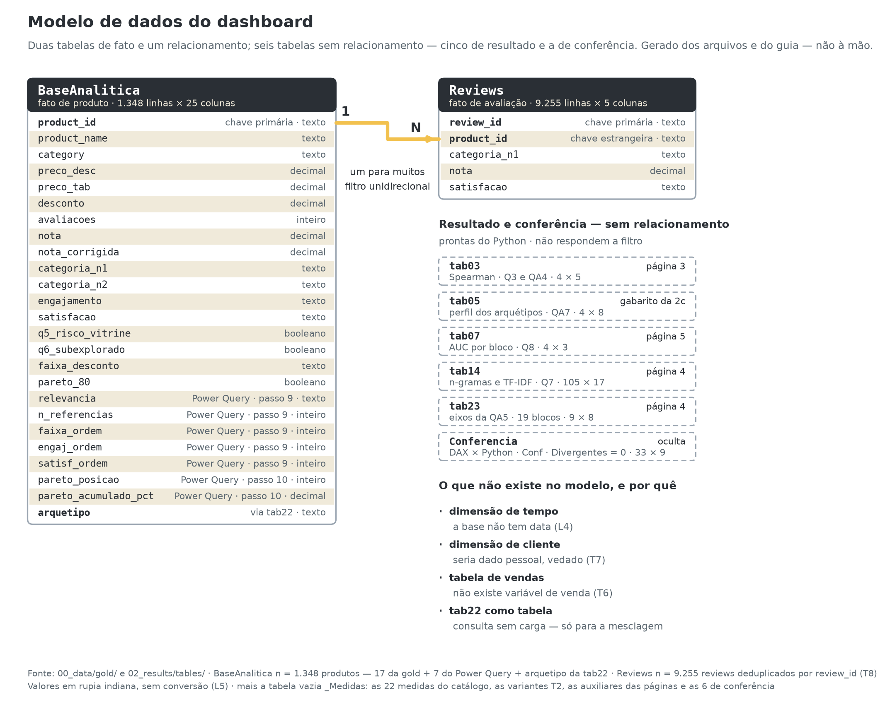

# Modelo de dados do `.pbix`

**A preparação é refeita dentro do `.pbix`**, no Power Query, partindo do arquivo de origem. Cada etapa tem nome descritivo — é o que o avaliador vê, e é a evidência do critério C2.

As consultas intermediárias (`bronze_amazon`, `silver_produtos`, `gold_intermediaria`) e as auxiliares (`tab22`, `gold_python`, `qa_compara_gold`) **não carregam no modelo**: é isso que impede o arquivo de gravar `user_id`, `user_name` e o texto das avaliações.

**Chegam ao modelo oito tabelas, em três papéis diferentes:**

| Papel | Tabelas | Relacionamento | Responde a filtro |
|---|---|---|---|
| **Fato** — construídas no Power Query | `BaseAnalitica` · `Reviews` | um para muitos, entre si | sim |
| **Resultado** — prontas do Python | `tab03` · `tab05` · `tab07` · `tab14` · `tab23` | **nenhum** | **não**, e é deliberado |
| **Conferência** — DAX × Python | `Conferencia` | **nenhum** | **não** — confere a base inteira |

Mais a tabela vazia **`_Medidas`**, que abriga todas as medidas: as 22 do catálogo (`medidas_dax.md`), as variantes T2, as auxiliares das páginas e as 6 de conferência (`conferencia_dax.md`).

A camada **gold** do Python continua canônica, agora como **gabarito**: a consulta `qa_compara_gold` compara a `BaseAnalitica` com `00_data/gold/base_analitica.csv` (lida na consulta `gold_python`), coluna a coluna, e precisa devolver **zero linhas** antes de qualquer visual ser montado.



*O diagrama é gerado por `gera_modelo_de_dados.py`. Tabelas, colunas e contagens são lidas dos próprios arquivos; o que só existe dentro do `.pbix` — as 7 colunas derivadas — é declarado em `modelo_esperado.py` e conferido contra os passos 9 e 10 do guia. **A mesma especificação é a que `verifica_pbix.py` usa para conferir o arquivo entregue**: o desenho e a conferência não podem divergir.*

## Tabelas de fato

### `BaseAnalitica` — fato de produto · 1.348 linhas × 25 colunas
Uma linha por produto. Construída no Power Query a partir do bronze. **Dezessete colunas reproduzem a gold, sete são derivadas no próprio Power Query (passos 9 e 10) e `arquetipo` vem da `tab22`.**

| Coluna | Tipo | Uso |
|---|---|---|
| `product_id` | texto | **chave primária** |
| `product_name` | texto | rótulo |
| `category` | texto | hierarquia completa, separada por `\|` |
| `categoria_n1` | texto | família — 4 acima do piso n ≥ 30 |
| `categoria_n2` | texto | **unidade de comparação** — 8 acima do piso |
| `preco_tab` · `preco_desc` | decimal | rupia indiana, **sem símbolo** (L5) |
| `desconto` | decimal 0–100 | percentual declarado |
| `nota` | decimal 1–5 | satisfação |
| `nota_corrigida` | decimal 1–5 | **Wilson 95%** — obrigatória em todo ranking (T1) |
| `avaliacoes` | inteiro | **volume de avaliações** — nunca vendas (T6) |
| `engajamento` | texto | `alto` ≥ p90 · `intermediario` · `baixo` < mediana |
| `satisfacao` | texto | `baixa` < 4,0 · `media` · `alta` ≥ 4,3 |
| `q5_risco_vitrine` | booleano | 19 produtos |
| `q6_subexplorado` | booleano | 187 produtos (funil — M12). Com `nota_corrigida ≥ 4,3`: **61**, a lista acionável (M22) |
| `faixa_desconto` | texto | 5 faixas, todas acima do piso |
| `pareto_80` | booleano | os 306 que concentram 80% das avaliações |
| `relevancia` | texto | **derivada (passo 9)** — `Âncora` 41 · `Risco de vitrine (Q5)` 19 · `Subexplorado (Q6)` 187 · `Cauda frágil` 227 · `Intermediário` 874, os rótulos da `tab17`; matriz Q1 da página 1 |
| `n_referencias` | inteiro | **derivada (passo 9)** — referências de avaliação do bloco; soma 10.588 |
| `faixa_ordem` · `engaj_ordem` · `satisf_ordem` | inteiro | **derivadas (passo 9)** — *Classificar por coluna* de `faixa_desconto`, `engajamento` e `satisfacao`; ocultas |
| `pareto_posicao` · `pareto_acumulado_pct` | inteiro · decimal | **derivadas (passo 10)** — desenham a curva de Pareto; o 306º leva o acumulado a 80,018% |
| **`arquetipo`** | texto A–D | **mesclada da `tab22`** no passo 11 — ML4, k = 4: A 268 · B 335 · C 298 · D 447 |

**A `qa_compara_gold` confere as 17 colunas que a gold tem.** As oito que ela não tem — as sete derivadas e `arquetipo` — ficam fora da comparação, e cada uma tem conferência própria no passo onde nasce: as contagens da `relevancia`, a soma de `n_referencias`, os 306 do Pareto, zero produtos sem `arquetipo`.

**A `tab22` não é tabela do modelo.** Entra como consulta **sem carga**, só para a mesclagem. Com a carga ativa, ela apareceria como nona tabela solta, repetindo uma coluna que a `BaseAnalitica` já tem. A conferência do passo 11 é **zero linhas com `arquetipo` vazio**: a `tab22` cobre os 1.348 produtos.

### `Reviews` — fato de avaliação · 9.255 linhas × 5 colunas
Construída no Power Query a partir de `gold_intermediaria`, deduplicada por `review_id` (T8). A conferência é a contagem: **9.255 de 10.588 referências** (passo 13), a mesma de `00_data/gold/reviews.csv` — nenhuma consulta compara as duas linha a linha.

| Coluna | Uso |
|---|---|
| `review_id` | chave |
| `product_id` | **relacionamento com `BaseAnalitica`** |
| `categoria_n1` · `nota` · `satisfacao` | desnormalizados, para filtro direto |

## Relacionamento

```
BaseAnalitica[product_id]  1 ──── N  Reviews[product_id]
```

Cardinalidade **um para muitos**, filtro **unidirecional** de `BaseAnalitica` para `Reviews`. Bidirecional criaria ambiguidade sem ganho: nenhum visual precisa filtrar produto a partir de review.

## Tabelas de resultado — sem relacionamento

| Tabela | Arquivo em `02_results/tables/` | Linhas × colunas | Página | O que traz |
|---|---|---|---|---|
| `tab03` | `tab03_correlacoes.csv` | 4 × 5 | 3 | ρ de Spearman, p e *n* dos quatro pares — Q3 e QA4 |
| `tab05` | `tab05_arquetipos.csv` | 4 × 8 | gabarito da 2c | perfil mediano dos quatro arquétipos — QA7. É o **gabarito** das medidas por arquétipo (seção 4 do guia): a matriz da 2c sai de `BaseAnalitica[arquetipo]`, que responde ao segmentador; a `tab05` confere os números |
| `tab07` | `tab07_ml2_blocos.csv` | 4 × 3 | 5 | AUC por bloco de preditores, com o desvio entre partições — Q8 |
| `tab14` | `tab14_ngramas.csv` | 105 × 17 | 4 | n-gramas por faixa de nota e contraste TF-IDF — Q7 |
| `tab23` | `tab23_qa5_temas.csv` | 9 × 8 | 4 | eixos temáticos nos 19 blocos de Q5 — QA5 |

**Por que vêm prontas.** O Power Query não treina modelo (ML2, ML4), não tem TF-IDF nativo e não pode carregar o texto das avaliações (T7), que é de onde saem os n-gramas e os eixos da QA5. Spearman com p-valor exigiria montar postos com empate e o teste em DAX: risco alto, ganho zero.

**Por que sem relacionamento.** Cada uma descreve a base inteira — ou, no caso da `tab23`, os 19 blocos de Q5. Um filtro de categoria que as alcançasse exibiria um número que ninguém mediu: o ρ calculado sobre os 1.348 não vira o ρ de Electronics por estar ao lado de um segmentador. Os visuais delas **dizem isso na própria tela**.

**Desligar a detecção automática de relacionamentos antes da primeira carga.** `BaseAnalitica[arquetipo]` tem o mesmo nome de `tab05[arquetipo]`, que é única; `tab05[n]` coincide com `tab03[n]`. Com a opção padrão ligada, o Power BI pode criar sozinho uma relação que este modelo proíbe. O modelo tem **exatamente um** relacionamento.

## Tabela de conferência — sem relacionamento

| Tabela | Arquivo | Linhas × colunas | Página | O que traz |
|---|---|---|---|---|
| `Conferencia` | `03_dashboard/conferencia_referencia.csv` | 33 × 9 | **oculta** | os 25 valores de referência do Python, mais 6 sob filtro de categoria e 2 da `Reviews`, na escala que o DAX devolve |

As 6 medidas `Conf ·` (`conferencia_dax.md`) recalculam cada valor pelo DAX do catálogo e mostram a diferença linha a linha. **`Conf · Divergentes` tem de mostrar 0.** É gerada por `gera_conferencia.py`, que falha se o catálogo e a referência se desencontrarem — medida renomeada aqui quebra lá, antes de chegar ao Power BI.

## O que NÃO entra no modelo

| Coluna | Por quê |
|---|---|
| `user_id` · `user_name` | dado pessoal — vedado em visual, slide ou frame de vídeo (T7, LGPD). **Não existem no gold.** |
| `img_link` · `product_link` | sem uso analítico declarado |
| `about_product` · `review_title` · `review_content` | texto longo, e o das avaliações traz nome de consumidor; a análise textual acontece em Python (ML3), e só o resultado agregado chega ao dashboard — `tab14` e `tab23` |

## Por que um modelo tão simples

Duas tabelas de fato e um relacionamento; as cinco de resultado e a de conferência não se ligam a nada. Não há dimensão de tempo — a base não tem data (L4). Não há dimensão de cliente — seria construída sobre dado pessoal vedado. Não há tabela de vendas — a base não tem variável de venda, e `rating_count` é volume de avaliações, nunca receita.

Inventar dimensões que os dados não sustentam é o erro mais comum em modelagem de portfólio. Aqui o modelo é pequeno porque a base é honesta sobre o que tem.

## Antes do primeiro visual

1. Importar `../method/design_system/tema_fase4_ambar_ardosia.json`. **Antes**, não depois.
2. Página `Conferência` com **`Conf · Divergentes` = 0**.
3. `python verifica_pbix.py` sobre o `.pbit` exportado — saída 0: nenhuma tabela a mais, nenhuma relação automática, nenhuma coluna pessoal.
4. Rodar `python3 ../src/valida_base.py ../00_data/bronze/amazon.csv` e confirmar `exit 0`. O caminho do bronze é obrigatório: sem ele o validador procura `amazon.csv` na pasta corrente e falha.
