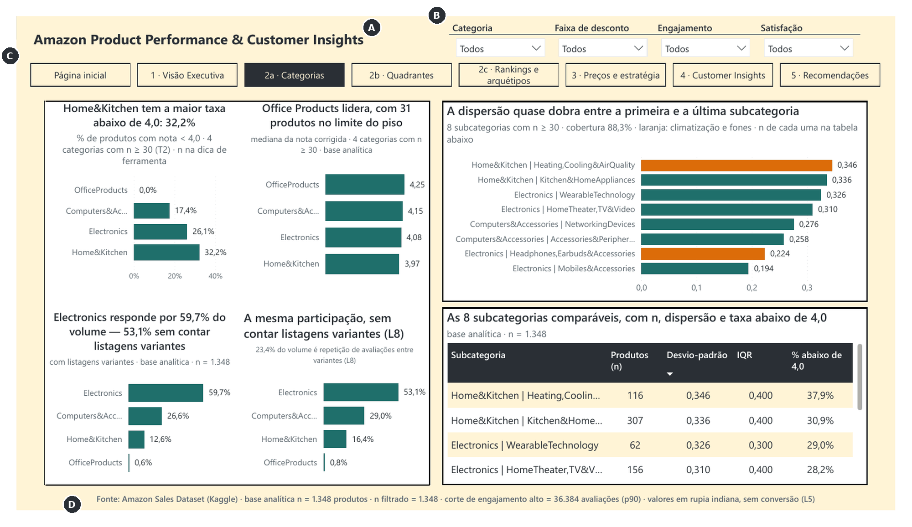
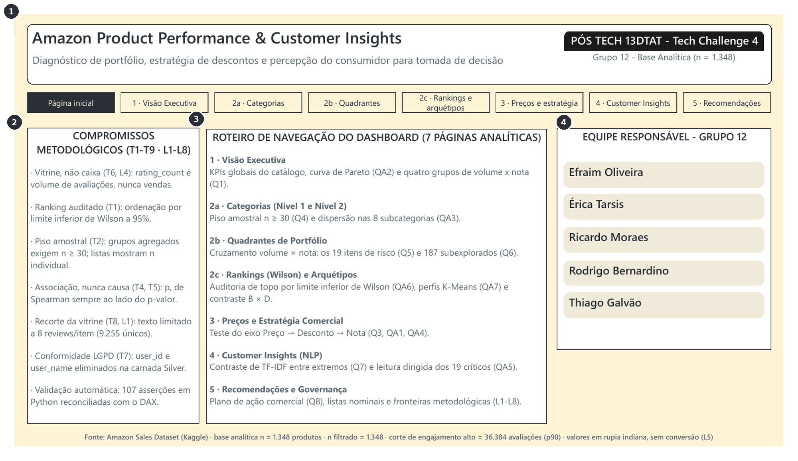
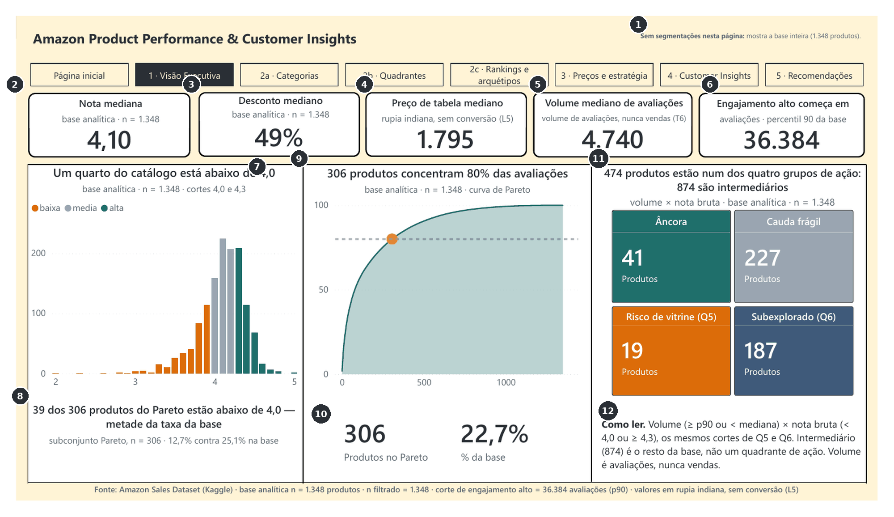
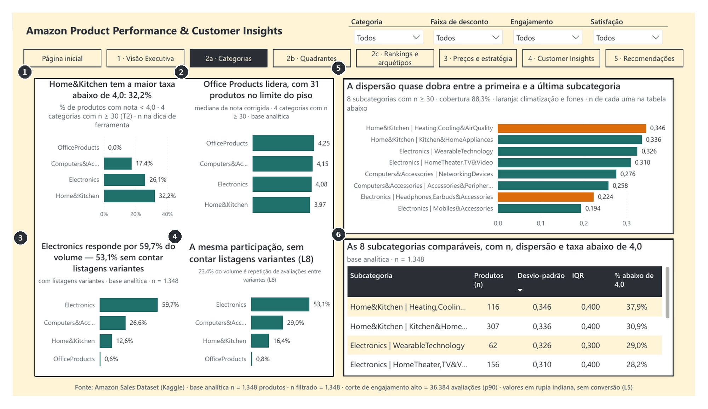
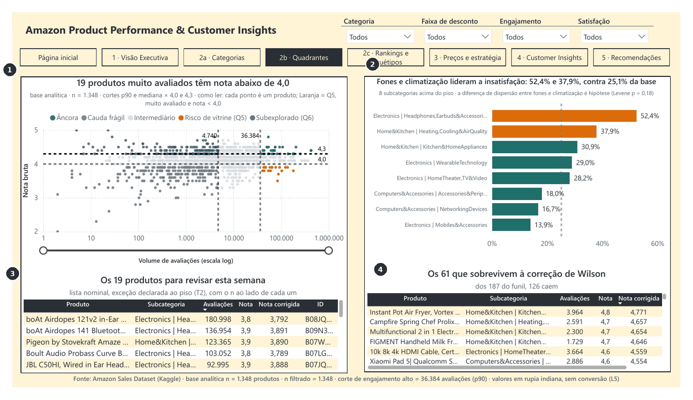
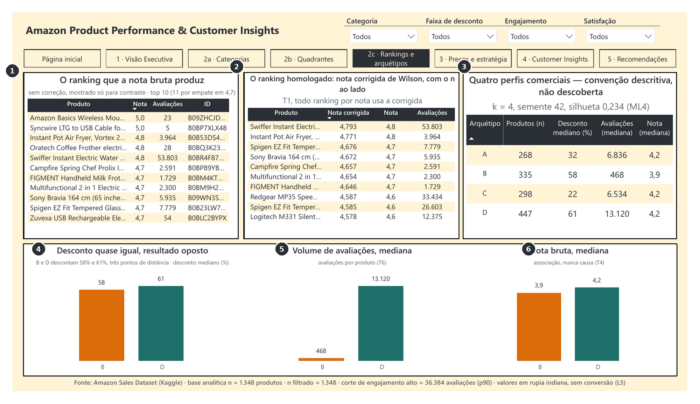
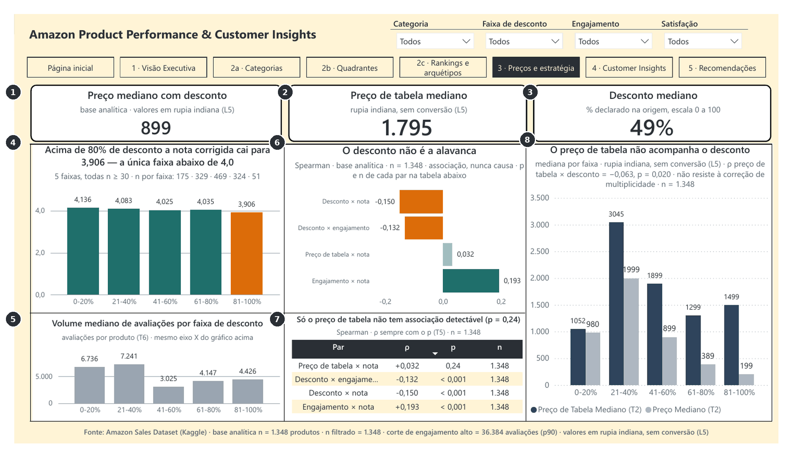
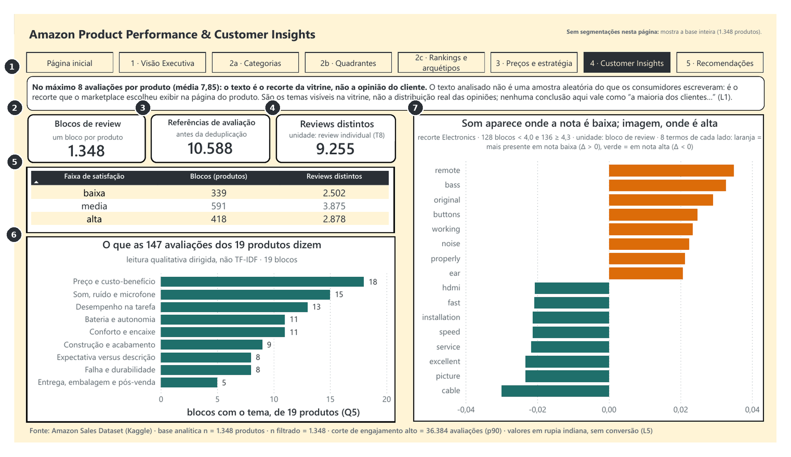
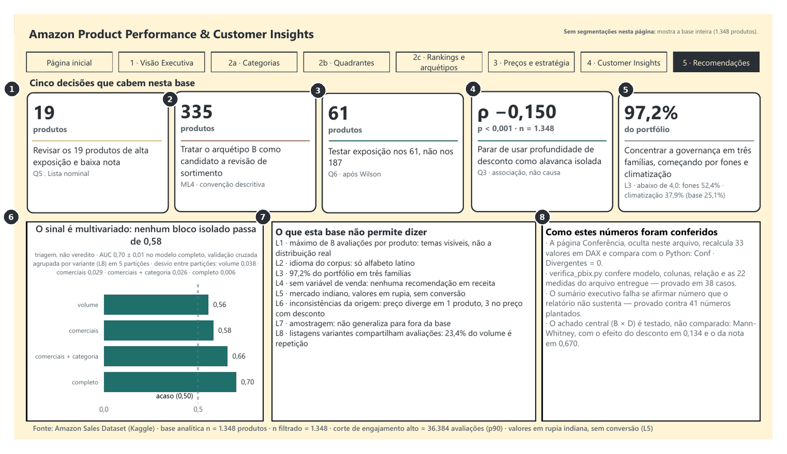

# Manual de Leitura do Dashboard

**Versão 1 · 13 de novembro de 2026 · dashboard TC4.R, exportado em 13/11/2026**

## 1. Como usar este manual

Este manual explica o que cada elemento do dashboard *Amazon Product Performance & Customer Insights* mostra e como lê-lo. Ele descreve o que está na tela, página por página; não descreve como os números foram calculados.

Cada página do dashboard aparece aqui como imagem, com números sobre os elementos. A tabela logo abaixo da imagem explica cada número, na mesma ordem.

- Os valores citados são os da tela **sem nenhum filtro**, com a base inteira: **1.348 produtos**. Nas páginas que têm segmentações, os valores mudam quando um filtro é aplicado.
- Os preços estão em **rupia indiana**, sem conversão para real ou dólar.
- O dashboard tem uma página inicial, sete páginas de análise e três páginas auxiliares, que não aparecem na barra de navegação (seção 12).

| Página | O que responde |
|---|---|
| Página inicial | Apresentação do painel, regras de leitura, roteiro das páginas e equipe. |
| 1 · Visão Executiva | O retrato do catálogo inteiro: números centrais, concentração das avaliações e os quatro grupos de produtos. |
| 2a · Categorias | Como categorias e subcategorias se comparam em nota, insatisfação, volume de avaliações e variação das notas. |
| 2b · Quadrantes | Quais produtos são muito avaliados e mal avaliados (risco) e quais são bem avaliados e pouco vistos (oportunidade). |
| 2c · Rankings e arquétipos | Quais produtos merecem o topo do ranking e quais perfis comerciais existem no catálogo. |
| 3 · Preços e estratégia | Como preço e desconto se relacionam com a nota e com o volume de avaliações. |
| 4 · Customer Insights | O que o texto das avaliações mostra. |
| 5 · Recomendações | As cinco decisões propostas, o que a base não permite afirmar e como os números foram conferidos. |

## 2. Cinco ideias para ler qualquer página

1. **Volume de avaliações não é venda.** O número de avaliações de um produto mostra quanta atenção ele recebe do público, não quantas unidades foram vendidas. A base não tem dado de venda. No painel, "engajamento" quer dizer volume de avaliações.
2. **Nota bruta e nota corrigida.** A *nota bruta* é a média de 1 a 5 que a Amazon exibe. A *nota corrigida* desconta a incerteza de quem tem poucas avaliações. Um produto com nota 5,0 em 5 avaliações tem nota corrigida 3,26; um com 4,8 em 53.803 avaliações tem 4,79. Todo ranking do painel usa a nota corrigida.
3. **Grupos com menos de 30 produtos não são comparados.** Categorias, subcategorias e faixas só entram em gráficos de comparação quando têm pelo menos 30 produtos. Listas de produtos são a exceção: mostram cada item com o seu número de avaliações.
4. **Associação não é causa.** Quando o painel mostra que duas medidas andam juntas (coeficiente ρ), isso não prova que uma provoca a outra. O ρ vem sempre acompanhado do p-valor, que indica se a associação pode ser obra do acaso.
5. **O texto é o recorte da vitrine.** A base traz no máximo 8 avaliações escritas por produto, as que a página do produto exibia. A página 4 mostra o que está visível na vitrine, não a opinião de todos os compradores.

## 3. Elementos comuns às páginas

| Nº | Elemento | O que é e como usar |
|---|---|---|
| A | Título do painel | Igual em todas as páginas. Nas páginas sem segmentações (1, 4 e 5), à direita do título aparece o aviso "Sem segmentações nesta página": a página sempre mostra a base inteira. |
| B | Segmentações | Quatro filtros: **Categoria**, **Faixa de desconto**, **Engajamento** e **Satisfação**. "Todos" quer dizer sem filtro. Estão nas páginas 2a, 2b, 2c e 3 e são sincronizados: o que for escolhido numa dessas páginas vale também nas outras três. Para limpar, volte cada filtro para "Todos". |
| C | Barra de navegação | Um botão por página. O botão escuro indica a página aberta. Clique num botão para ir à página. |
| D | Rodapé | Fonte dos dados, tamanho da base analítica (1.348 produtos), **n filtrado** (quantos produtos estão na tela depois dos filtros), o corte de engajamento alto (36.384 avaliações) e a moeda. Se o n filtrado for menor que 1.348, há filtro aplicado. |

**Interações disponíveis em todo o painel:**

- **Passar o mouse** sobre uma barra, um ponto ou uma linha mostra uma caixa com os valores daquele elemento. Na página 2a, essa caixa mostra também o número de produtos e a nota corrigida do grupo apontado.
- **Clicar** num elemento de um gráfico destaca os dados correspondentes nos outros gráficos da mesma página. Clique de novo no mesmo elemento para desfazer.
- **Clicar com o botão direito** numa linha de tabela que tenha a coluna **ID** e escolher **Detalhamento > Detalhe do produto** abre a ficha daquele produto (seção 12).

## 4. Página inicial

Apresenta o painel e diz como ele deve ser lido. Não tem gráficos.

| Nº | Elemento | O que mostra |
|---|---|---|
| 1 | Cabeçalho | Nome do projeto, objetivo (diagnóstico de portfólio, estratégia de descontos e percepção do consumidor) e identificação: curso, Tech Challenge 4, Grupo 12 e tamanho da base analisada, 1.348 produtos. |
| 2 | Compromissos metodológicos | As regras que valem para todos os números do painel, cada uma com o seu código (T1 a T9 e L1 a L8, explicados na seção 14). Reúne as cinco ideias da seção 2, a proteção de dados pessoais (nenhum nome ou identificador de cliente aparece no painel) e a validação automática dos números. |
| 3 | Roteiro de navegação | O que cada uma das sete páginas de análise mostra e quais perguntas responde. Os códigos entre parênteses (Q1, QA2…) são as perguntas listadas na seção 14. |
| 4 | Equipe responsável | Os cinco integrantes do Grupo 12. |

## 5. Página 1 · Visão Executiva

O retrato do catálogo inteiro em uma tela. Esta página não tem segmentações.

| Nº | Elemento | O que mostra e como ler |
|---|---|---|
| 1 | Aviso "Sem segmentações nesta página" | A página sempre mostra os 1.348 produtos, mesmo que um filtro tenha sido escolhido em outra página. |
| 2 | Nota mediana — 4,10 | Metade dos produtos tem nota bruta igual ou maior que 4,10, e a outra metade, menor. |
| 3 | Desconto mediano — 49% | Metade dos produtos é anunciada com 49% de desconto ou mais sobre o preço de tabela. |
| 4 | Preço de tabela mediano — 1.795 | O preço "cheio", antes do desconto, em rupia indiana. Metade dos produtos custa até 1.795. |
| 5 | Volume mediano de avaliações — 4.740 | Metade dos produtos tem até 4.740 avaliações. Abaixo desse número, o produto é considerado **pouco avaliado** (item 11). |
| 6 | Engajamento alto começa em — 36.384 | Os 10% de produtos mais avaliados têm 36.384 avaliações ou mais. A partir desse número, o produto é considerado **muito avaliado** (item 11). |
| 7 | Histograma "Um quarto do catálogo está abaixo de 4,0" | Cada barra é uma nota bruta (eixo horizontal, de 2 a 5), e a sua altura é o número de produtos com aquela nota. A cor indica a faixa: **laranja**, nota baixa (abaixo de 4,0); **cinza**, nota média (4,0 a 4,2); **verde**, nota alta (4,3 ou mais). As barras laranja somam 339 produtos, 25,1% do catálogo. |
| 8 | "39 dos 306 produtos do Pareto estão abaixo de 4,0" | Entre os 306 produtos mais avaliados (item 9), 39 têm nota abaixo de 4,0: 12,7%, metade da taxa do catálogo inteiro (25,1%). Nota baixa é menos frequente entre os produtos que concentram a atenção do público. |
| 9 | Curva "306 produtos concentram 80% das avaliações" | Os produtos estão ordenados do mais para o menos avaliado (eixo horizontal). A curva mostra a porcentagem acumulada de todas as avaliações do catálogo (eixo vertical, de 0 a 100). A linha tracejada marca 80%; o ponto amarelo mostra onde a curva cruza essa linha, no 306º produto. |
| 10 | Cartões 306 e 22,7% | 306 produtos, 22,7% do catálogo, reúnem 80% de todas as avaliações. O restante do catálogo divide os outros 20%. |
| 11 | Quatro grupos de produtos | Cada produto é classificado pelo volume de avaliações e pela nota bruta. **Âncora (41):** muito avaliado e nota alta (4,3 ou mais). **Risco de vitrine, Q5 (19):** muito avaliado e nota abaixo de 4,0. **Subexplorado, Q6 (187):** pouco avaliado e nota alta. **Cauda frágil (227):** pouco avaliado e nota abaixo de 4,0. O número grande em cada quadro é a quantidade de produtos do grupo. |
| 12 | "Como ler" | Resume os cortes que definem os quatro grupos. Os 874 produtos restantes ficam entre os cortes (intermediários) e não formam um grupo de ação. |

## 6. Página 2a · Categorias

Compara as famílias de produtos (categoria, nível 1) e os tipos de produto dentro delas (subcategoria, nível 2). Só aparecem grupos com pelo menos 30 produtos: 4 categorias e 8 subcategorias. As outras 5 categorias, com 7 produtos ao todo, ficam fora das comparações.

| Nº | Elemento | O que mostra e como ler |
|---|---|---|
| 1 | "Home&Kitchen tem a maior taxa abaixo de 4,0: 32,2%" | Para cada categoria, a porcentagem de produtos com nota bruta abaixo de 4,0. Barra maior, mais produtos mal avaliados: Home&Kitchen 32,2%, Electronics 26,1%, Computers&Accessories 17,4% e OfficeProducts 0,0%. O número de produtos de cada categoria aparece ao passar o mouse sobre a barra. |
| 2 | "Office Products lidera, com 31 produtos no limite do piso" | A nota corrigida mediana de cada categoria. OfficeProducts tem a maior (4,25), mas com só 31 produtos, logo acima do mínimo de 30: é a leitura mais frágil do gráfico. Home&Kitchen fica em 3,97. As barras começam do zero e as diferenças são pequenas; compare pelos rótulos. |
| 3 | "Electronics responde por 59,7% do volume — 53,1% sem contar listagens variantes" | A fatia de cada categoria no total de avaliações do catálogo. Electronics reúne 59,7% de todas as avaliações; Computers&Accessories, 26,6%; Home&Kitchen, 12,6%; OfficeProducts, 0,6%. |
| 4 | "A mesma participação, sem contar listagens variantes (L8)" | A mesma fatia, descontando as avaliações repetidas entre versões do mesmo anúncio (cores ou tamanhos diferentes que compartilham as mesmas avaliações). Essa repetição é 23,4% do volume total. Sem ela, Electronics cai para 53,1% e Computers&Accessories sobe para 29,0%. A diferença para o item 3 mostra quanto de cada fatia vem de anúncios repetidos. |
| 5 | "A dispersão quase dobra entre a primeira e a última subcategoria" | Para cada uma das 8 subcategorias com pelo menos 30 produtos (88,3% do catálogo), o desvio-padrão da nota: quanto as notas dos produtos variam dentro do grupo. Barra maior, notas mais desiguais e qualidade menos previsível. Climatização (Heating, Cooling & Air Quality) tem a maior variação, 0,346; Mobiles & Accessories, a menor, 0,194. Em laranja, climatização e fones (Headphones, Earbuds & Accessories), as duas subcategorias com mais insatisfação na página 2b. |
| 6 | Tabela "As 8 subcategorias comparáveis" | Para cada subcategoria: número de produtos (n), desvio-padrão, IQR (largura da faixa que contém a metade central das notas, menos sensível a casos extremos) e porcentagem de produtos com nota abaixo de 4,0. A tabela tem barra de rolagem: role para ver as 8 linhas. |

## 7. Página 2b · Quadrantes

Localiza produtos: os muito avaliados e mal avaliados, que expõem a vitrine a risco, e os bem avaliados e pouco vistos, que são oportunidade.

| Nº | Elemento | O que mostra e como ler |
|---|---|---|
| 1 | Mapa "19 produtos muito avaliados têm nota abaixo de 4,0" | Cada ponto é um produto. Eixo horizontal: volume de avaliações, em escala logarítmica (cada marca vale 10 vezes a anterior: 10, 100, 1.000…). Eixo vertical: nota bruta. As linhas tracejadas verticais marcam 4.740 avaliações (mediana) e 36.384 (início do engajamento alto); as horizontais, as notas 4,0 e 4,3. A cor indica o grupo do produto, conforme a legenda acima do gráfico. Os pontos laranja, no canto inferior direito, são os 19 produtos de risco de vitrine. A barra abaixo do eixo horizontal permite aproximar uma faixa de volume: arraste as pontas. |
| 2 | "Fones e climatização lideram a insatisfação: 52,4% e 37,9%, contra 25,1% da base" | Para cada subcategoria com pelo menos 30 produtos, a porcentagem de produtos com nota abaixo de 4,0. A linha tracejada vertical marca a taxa do catálogo inteiro, 25,1%: barra que passa da linha, insatisfação acima da média. Em laranja, fones (52,4%, mais que o dobro da base) e climatização (37,9%). O subtítulo avisa que a diferença de variação das notas entre essas duas subcategorias ainda é hipótese: o teste não a confirmou (p = 0,18). |
| 3 | Lista "Os 19 produtos para revisar esta semana" | Os 19 produtos de risco de vitrine (Q5), um por linha: nome, subcategoria, número de avaliações, nota bruta, nota corrigida e código do produto (ID). Ordenada do mais para o menos avaliado. Role para ver todos. |
| 4 | Lista "Os 61 que sobrevivem à correção de Wilson" | Dos 187 subexplorados (Q6), os 61 que mantêm nota corrigida de 4,3 ou mais, ordenados pela nota corrigida. Os outros 126 tinham nota alta apoiada em poucas avaliações e caíram na correção. Os 61 são os candidatos a ganhar exposição. Role para ver todas as linhas; a coluna ID fica à direita, na rolagem horizontal. |

## 8. Página 2c · Rankings e arquétipos

Mostra quais produtos merecem o topo do ranking e divide o catálogo em quatro perfis comerciais.

| Nº | Elemento | O que mostra e como ler |
|---|---|---|
| 1 | "O ranking que a nota bruta produz" | Os produtos de maior nota bruta: top 10, que vira 11 por empate em 4,7. Aparece só para comparação. Note que produtos com 5 e com 23 avaliações chegam ao topo. Não é o ranking oficial do painel. |
| 2 | "O ranking homologado: nota corrigida de Wilson, com o n ao lado" | O ranking oficial: os produtos de maior nota corrigida, do maior para o menor, com a nota bruta e o número de avaliações ao lado. Compare com o item 1: aqui todos os produtos têm milhares de avaliações. |
| 3 | "Quatro perfis comerciais — convenção descritiva, não descoberta" | O catálogo dividido em quatro perfis (A, B, C e D), que agrupam produtos parecidos em preço, desconto, nota e volume. Para cada perfil: número de produtos, desconto mediano, avaliações medianas e nota mediana. "Convenção descritiva" quer dizer que os perfis são uma forma de resumir o catálogo; os grupos não são naturalmente separados uns dos outros. |
| 4 | "Desconto quase igual, resultado oposto" | O desconto mediano dos perfis B (58%) e D (61%): três pontos de diferença. |
| 5 | "Volume de avaliações, mediana" | As avaliações medianas dos mesmos perfis: B tem 468, D tem 13.120, 28 vezes mais. |
| 6 | "Nota bruta, mediana" | A nota mediana: B tem 3,9, D tem 4,2. Os itens 4, 5 e 6 se leem juntos: com desconto praticamente igual, B tem pouca atenção e nota baixa, e D tem muita atenção e nota boa. O desconto, sozinho, não explica a diferença. |

## 9. Página 3 · Preços e estratégia

Mostra como preço e desconto se relacionam com a nota e com o volume de avaliações.

| Nº | Elemento | O que mostra e como ler |
|---|---|---|
| 1 | Preço mediano com desconto — 899 | O preço mediano já com o desconto: metade dos produtos sai por até 899 rupias. |
| 2 | Preço de tabela mediano — 1.795 | O preço mediano antes do desconto. |
| 3 | Desconto mediano — 49% | O desconto declarado no anúncio, numa escala de 0 a 100%. |
| 4 | "Acima de 80% de desconto a nota corrigida cai para 3,906" | Os produtos divididos em 5 faixas de desconto, de 0-20% a 81-100%. Cada coluna é a nota corrigida mediana da faixa. Até 80% de desconto, ela fica entre 4,025 e 4,136; na faixa de 81-100%, em laranja, cai para 3,906, a única abaixo de 4,0. O subtítulo traz quantos produtos há em cada faixa: 175, 329, 469, 324 e 51. |
| 5 | "Volume mediano de avaliações por faixa de desconto" | As mesmas 5 faixas, agora com o volume mediano de avaliações por produto. As faixas de até 40% de desconto têm os maiores volumes (6.736 e 7.241). |
| 6 | "O desconto não é a alavanca" | O coeficiente ρ de quatro pares de medidas. O ρ vai de −1 a +1: perto de zero, sem relação; negativo, quando uma medida sobe a outra tende a cair; positivo, as duas tendem a subir juntas. Barras laranja, para a esquerda: mais desconto anda com nota um pouco menor (−0,150) e com menos avaliações (−0,132). Barra verde: produtos mais avaliados têm nota um pouco maior (+0,193). Barra clara: preço de tabela e nota não têm relação detectável (+0,032). Todos os valores são pequenos. |
| 7 | Tabela "Só o preço de tabela não tem associação detectável (p = 0,24)" | Os mesmos quatro pares, com ρ, p-valor e n. O p-valor indica a chance de a associação ser obra do acaso: abaixo de 0,05, ela é considerada estatisticamente significativa. "< 0,001" quer dizer menor que um em mil: associação real, ainda que pequena. Só o par "Preço de tabela × nota" tem p alto (0,24): sem associação. |
| 8 | "O preço de tabela não acompanha o desconto" | Para cada faixa de desconto, duas colunas, nomeadas na legenda abaixo do gráfico: a mais escura é o preço de tabela mediano; a mais clara, o preço mediano já com desconto, em rupia indiana. A distância entre as duas é o desconto. O preço de tabela não cresce com o desconto (fica entre 1.052 e 3.045 nas cinco faixas), enquanto o preço final cai até 199 na faixa de 81-100%. O subtítulo confirma: entre preço de tabela e desconto, ρ = −0,063, uma associação que não resiste à correção para testes múltiplos. |

## 10. Página 4 · Customer Insights

Mostra o que o texto das avaliações revela. Esta página não tem segmentações.

| Nº | Elemento | O que mostra e como ler |
|---|---|---|
| 1 | Aviso no topo da página | O texto analisado é o recorte que a página do produto exibia: no máximo 8 avaliações por produto, 7,85 em média. As conclusões valem para o que está na vitrine, não para todos os compradores. |
| 2 | Blocos de review — 1.348 | Um bloco é o conjunto das avaliações escritas de um produto. Há um bloco por produto. |
| 3 | Referências de avaliação — 10.588 | O total de avaliações escritas, contando as repetidas: a mesma avaliação pode aparecer em mais de um anúncio. |
| 4 | Reviews distintos — 9.255 | O total de avaliações escritas, cada uma contada uma vez. É a base de qualquer contagem por avaliação. |
| 5 | Tabela por faixa de satisfação | Quantos produtos (blocos) e quantas avaliações distintas há em cada faixa de nota, da baixa para a alta: baixa, 339 produtos e 2.502 avaliações; média, 591 e 3.875; alta, 418 e 2.878. |
| 6 | "O que as 147 avaliações dos 19 produtos dizem" | Os temas presentes no texto dos 19 produtos de risco de vitrine (página 2b, item 3). Cada tema é identificado por uma lista fixa de termos, não por algoritmo de pontuação de palavras. Cada barra mostra em quantos dos 19 produtos o tema aparece: preço e custo-benefício em 18; som, ruído e microfone em 15; desempenho na tarefa em 13. |
| 7 | "Som aparece onde a nota é baixa; imagem, onde é alta" | Compara as palavras das avaliações de eletrônicos com nota abaixo de 4,0 (128 produtos) e com nota de 4,3 ou mais (136 produtos). Barras laranja, para a direita: palavras mais características das notas baixas, como *remote*, *bass*, *noise* e *ear* (controle remoto, graves, ruído, ouvido). Barras verdes, para a esquerda: mais características das notas altas, como *picture*, *excellent* e *installation* (imagem, excelente, instalação). Quanto maior a barra, mais a palavra distingue um grupo do outro. As palavras estão em inglês, o idioma das avaliações. |

## 11. Página 5 · Recomendações

Reúne as decisões propostas, o que a base não permite afirmar e como os números foram conferidos. Esta página não tem segmentações.

| Nº | Elemento | O que mostra e como ler |
|---|---|---|
| 1 | 19 produtos — "Revisar os 19 produtos de alta exposição e baixa nota" | Os 19 produtos de risco de vitrine (Q5), listados na página 2b, item 3. |
| 2 | 335 produtos — "Tratar o arquétipo B como candidato a revisão de sortimento" | O perfil B da página 2c: desconto alto, pouca atenção e nota baixa. Revisão quer dizer avaliar caso a caso, não retirar do catálogo. |
| 3 | 61 produtos — "Testar exposição nos 61, não nos 187" | Os subexplorados que mantêm nota alta depois da correção (página 2b, item 4). |
| 4 | ρ −0,150 — "Parar de usar profundidade de desconto como alavanca isolada" | Mais desconto não anda com nota melhor; anda com nota levemente pior (página 3, itens 6 e 7). O p < 0,001 indica que dificilmente essa associação é acaso. |
| 5 | 97,2% do portfólio — "Concentrar a governança em três famílias, começando por fones e climatização" | Três categorias reúnem 97,2% dos produtos. Dentro delas, fones (52,4% abaixo de 4,0) e climatização (37,9%) têm as maiores taxas de insatisfação (página 2b, item 2). |
| 6 | "O sinal é multivariado: nenhum bloco isolado passa de 0,58" | Mede quanto diferentes conjuntos de informação conseguem separar os produtos com nota abaixo de 4,0 dos demais. A medida (AUC) vai de 0,5, o acerto de um sorteio (linha tracejada "acaso"), a 1,0, a separação perfeita. Só o volume: 0,56. Só preço e desconto ("comerciais"): 0,58. Com a categoria: 0,66. Tudo junto: 0,70. Nenhuma informação sozinha identifica o produto mal avaliado; juntas, servem para triagem, não para veredito. |
| 7 | "O que esta base não permite dizer" | As oito limitações da base (L1 a L8), explicadas na seção 14. Antes de usar um número do painel numa decisão, confira se ele esbarra numa delas. |
| 8 | "Como estes números foram conferidos" | Resumo das verificações: a página Conferência recalcula 33 valores do painel e confirma que batem com o cálculo de referência; um programa confere a estrutura do arquivo; o sumário executivo é conferido contra o relatório, número a número; e o contraste entre os perfis B e D foi testado estatisticamente. |

## 12. Páginas auxiliares

Três páginas não aparecem na barra de navegação.

### 12.1 Detalhe do produto

A ficha de um produto. Abre pelo detalhamento: clique com o botão direito numa linha de tabela que tenha a coluna ID (as duas listas da página 2b e o ranking por nota bruta da página 2c) e escolha **Detalhamento > Detalhe do produto**. A ficha mostra:

- nome e subcategoria do produto;
- nota bruta, nota corrigida, número de avaliações, preço de tabela e desconto;
- perfil: arquétipo (A a D), grupo (Âncora, Risco de vitrine, Subexplorado, Cauda frágil ou Intermediário), faixa de engajamento e faixa de satisfação.

Use a página só pelo detalhamento: aberta diretamente, sem um produto escolhido, os cartões mostram os maiores valores do catálogo, e não os de um produto. Para voltar, clique na página de origem.

### 12.2 Dica de ferramenta

A caixa que aparece ao passar o mouse sobre os gráficos da página 2a. Mostra o número de produtos (n) e a nota corrigida do grupo apontado.

### 12.3 Conferência

Página técnica. Recalcula no Power BI 33 valores exibidos no painel e compara cada um com o valor de referência calculado à parte. O cartão **Divergentes** precisa mostrar 0, e o cartão **Conferidas**, 33. A tabela mostra, linha a linha, o valor do painel, o esperado, a diferença e a situação ("confere").

## 13. Glossário

| Termo | Significado |
|---|---|
| Base analítica | Os 1.348 produtos analisados no painel. |
| n | O número de produtos, ou de avaliações, por trás de um valor. |
| Nota bruta | A média de 1 a 5 exibida pela Amazon. |
| Nota corrigida (Wilson) | A nota ajustada pela quantidade de avaliações (limite inferior de Wilson a 95%). Com poucas avaliações, fica bem abaixo da nota bruta; com muitas, quase igual. |
| Volume de avaliações | O número de avaliações de um produto. Mostra atenção do público; não é venda. |
| Engajamento alto, intermediário e baixo | Alto: 36.384 avaliações ou mais (os 10% mais avaliados). Baixo: menos de 4.740 (a metade menos avaliada). Intermediário: entre os dois. |
| Satisfação baixa, média e alta | Nota bruta abaixo de 4,0; de 4,0 a 4,2; de 4,3 ou mais. |
| Mediana | O valor do meio: metade dos produtos fica acima, metade abaixo. É menos afetada por casos extremos que a média. |
| Percentil 90 | O valor abaixo do qual estão 90% dos produtos. |
| Piso amostral | O mínimo de 30 produtos para que um grupo seja comparado com outros. |
| Curva de Pareto | Mostra quantos produtos concentram a maior parte das avaliações. |
| Desvio-padrão | Quanto as notas variam em torno da média do grupo. |
| IQR (intervalo interquartil) | A largura da faixa que contém a metade central das notas. |
| ρ (rô) de Spearman | Coeficiente de −1 a +1 que mede se duas medidas tendem a subir ou a descer juntas. |
| p-valor | A chance de uma associação observada ser obra do acaso. Abaixo de 0,05, é considerada significativa. Na notação científica, 3,1E-08 quer dizer 0,000000031. |
| AUC | Medida de 0,5 (sorteio) a 1,0 (perfeito) de quanto um conjunto de informações consegue separar dois grupos de produtos. |
| Arquétipo | Perfil comercial (A, B, C ou D) que reúne produtos parecidos em preço, desconto, nota e volume. |
| Listagens variantes | Anúncios diferentes do mesmo produto (cor, tamanho) que compartilham as mesmas avaliações. |
| Bloco de review | O conjunto das avaliações escritas de um produto, tratado como uma unidade. |
| Review distinto | Uma avaliação escrita contada uma única vez, mesmo que apareça em mais de um anúncio. |
| TF-IDF | Peso que indica o quanto uma palavra é característica de um grupo de textos em relação aos outros. |
| Risco de vitrine (Q5) | Produto muito avaliado (36.384 ou mais) com nota abaixo de 4,0. |
| Subexplorado (Q6) | Produto pouco avaliado (menos de 4.740) com nota de 4,3 ou mais. |
| Âncora | Produto muito avaliado com nota de 4,3 ou mais. |
| Cauda frágil | Produto pouco avaliado com nota abaixo de 4,0. |
| Rupia indiana | A moeda dos preços da base. Os valores não são convertidos. |

## 14. Códigos que aparecem no painel

### 14.1 Perguntas

Os códigos **Q** são perguntas do enunciado do desafio; os códigos **QA** são perguntas adicionais definidas pelo grupo.

| Código | Pergunta | Página |
|---|---|---|
| Q1 | Quais categorias e produtos apresentam maior relevância? | 1 · Visão Executiva |
| QA2 | Quantos produtos concentram 80% das avaliações? | 1 · Visão Executiva |
| Q4 | Quais categorias apresentam maior ou menor satisfação? | 2a · Categorias |
| QA3 | Quais subcategorias têm maior dispersão de notas? | 2a · Categorias |
| Q5 | Existem produtos com alto engajamento e baixa avaliação? | 2b · Quadrantes |
| Q6 | Existem produtos com boa avaliação e pouca visibilidade? | 2b · Quadrantes |
| QA6 | Os produtos no topo do ranking merecem estar lá? | 2c · Rankings e arquétipos |
| QA7 | Quais arquétipos comerciais aparecem ao agrupar por preço, desconto, nota e volume? | 2c · Rankings e arquétipos |
| Q3 | Existe relação entre descontos e avaliações? | 3 · Preços e estratégia |
| QA1 | Existe faixa de desconto em que nota e engajamento se sustentam? | 3 · Preços e estratégia |
| QA4 | O preço de tabela explica a satisfação? | 3 · Preços e estratégia |
| Q7 | Quais padrões podem ser identificados nas avaliações? | 4 · Customer Insights |
| QA5 | Quais temas de reclamação predominam nos produtos de alto engajamento e baixa nota? | 4 · Customer Insights |
| Q8 | Quais oportunidades ou riscos existem para o negócio? | 5 · Recomendações |

### 14.2 Regras de leitura (T1 a T9)

| Código | Regra | O que significa na tela |
|---|---|---|
| T1 | Todo ranking por nota usa a nota corrigida. | O ranking oficial (página 2c) e as listas mostram a nota corrigida e o número de avaliações ao lado. |
| T2 | Grupo com menos de 30 produtos não é comparado. | Só 4 categorias e 8 subcategorias aparecem nas comparações; listas de produtos são exceção. |
| T3 | Todo gráfico declara fonte, base, n e corte usado. | Subtítulos e rodapé trazem essas informações. |
| T4 | Nenhuma conclusão em termos de causa. | Os textos falam em associação; nunca em "causa". |
| T5 | A força de uma associação vem sempre com a sua significância. | O ρ aparece sempre ao lado do p-valor. |
| T6 | Volume de avaliações nunca é tratado como venda. | "Engajamento" e "volume" medem atenção do público. |
| T7 | Nenhum dado pessoal de cliente aparece no painel. | Não há nome nem identificador de quem avaliou. |
| T8 | Contagens de texto dizem a unidade e contam cada avaliação uma vez. | A página 4 distingue blocos, referências e reviews distintos. |
| T9 | Todas as cores seguem uma paleta única. | Laranja indica atenção; verde-petróleo, resultado favorável; amarelo (âmbar), destaque. |

### 14.3 Limitações da base (L1 a L8)

| Código | Limitação | O que significa na leitura |
|---|---|---|
| L1 | No máximo 8 avaliações escritas por produto. | O texto mostra os temas visíveis na vitrine, não a opinião de todos os compradores. |
| L2 | Corpus só em alfabeto latino. | As avaliações são quase todas em inglês; trechos escritos em outros alfabetos ficam fora da análise de texto. |
| L3 | 97,2% do catálogo em três famílias. | Electronics, Home&Kitchen e Computers&Accessories dominam; as demais categorias quase não aparecem. |
| L4 | A base não tem dado de venda. | Nenhuma recomendação fala em receita ou faturamento. |
| L5 | Mercado indiano, valores em rupia, sem conversão. | Preços não são comparáveis diretamente com preços em real. |
| L6 | Inconsistências na origem: preço diverge em 1 produto e o preço com desconto, em 3. | Alguns produtos aparecem repetidos na origem com preços diferentes; o painel usa um único registro de cada produto. |
| L7 | A base é uma amostra. | Os resultados valem para estes 1.348 produtos, não para a Amazon inteira. |
| L8 | Listagens variantes compartilham avaliações: 23,4% do volume é repetição. | Compare as participações com e sem variantes (página 2a, itens 3 e 4). |
