# Relatório Técnico — Tech Challenge Fase 4

## Amazon Product Performance & Customer Insights

**POSTECH DTAT · 2026 · Grupo 12**
**Integrantes (ordem alfabética):** Efraim Oliveira · Érica Tarsis · Ricardo Moraes · Rodrigo Bernardino · Thiago Galvão

**Versão 1 · 13 de novembro de 2026**

---

## Resumo Executivo

Este relatório documenta a análise de **1.348 produtos** e **9.255 reviews individuais** — o texto exibido na vitrine, até 8 por produto — de um marketplace, conduzida para responder onde a liderança deve concentrar atenção comercial. Os números de base são reproduzíveis por um validador de **107 asserções** que falha se qualquer um deles divergir da origem — ele cobre as cinco bases, os cortes, os quadrantes, as distribuições, as quatro correlações, as categorias e o corpus. **Não** cobre as métricas de *machine learning*, a nota corrigida nem o contraste de termos de Q7: esses são reproduzíveis pelos notebooks, com semente e versões fixadas.

**A mensagem central é sobre desconto.** O agrupamento descreve o catálogo em quatro perfis comerciais, por convenção (ML4). Dois deles — os grupos **B** (335 produtos) e **D** (447 produtos) — praticam desconto praticamente idêntico: **58% e 61%**. E divergem em volume e em nota. O grupo D acumula **13.120 avaliações medianas**; o grupo B, **468** — vinte e oito vezes menos. B é também o **único dos quatro com nota abaixo do limiar de satisfação** (3,9 contra 4,2 dos demais).

**A leitura é esta, em uma frase: desconto praticamente igual, resultado oposto.** Três pontos percentuais separam B de D na profundidade do desconto; vinte e oito vezes os separam no volume de avaliações, e B é o único grupo abaixo do limiar de satisfação. Se descontar mais fosse suficiente, os dois estariam no mesmo lugar. **A profundidade do desconto não separa o produto que ganha tração do que não ganha** — e essa é a mensagem que a liderança precisa levar.

**A nuance estatística, para quem for conferir o número.** A correlação geral entre desconto e nota é **ρ = −0,150** (p = 3,1 × 10⁻⁸, n = 1.348): negativa e pequena. O par B × D **não ilustra essa correlação — ele a contraria**, porque D desconta *mais* e é avaliado *melhor*. Isso não é contradição no relatório; é a razão de o coeficiente ser pequeno. Com n = 1.348 o teste detecta uma associação real, e ela mesma é fraca o suficiente para que casos de peso — 782 produtos entre os dois grupos — andem na direção inversa. **O que sustenta a recomendação é a dispersão em torno da associação, não o sinal dela.** Significância e relevância são coisas diferentes, e aqui as duas precisam ser lidas juntas.

**Três achados que sustentam recomendação imediata:**

| Achado | Medida | Onde agir |
|---|---|---|
| **Risco de vitrine** — produtos muito avaliados e mal avaliados | **19 produtos** com volume ≥ p90 (36.384 avaliações) e nota < 4,0 | maior exposição, pior percepção: revisão prioritária |
| **Potencial subexplorado** — bem avaliados, com baixo volume de avaliações | **187 produtos** por nota bruta; **61** depois da correção de Wilson (T1) — 126 caem | a **lista acionável são os 61**; os 187 são o funil de triagem (§5.18) |
| **Concentração extrema do engajamento** | **306 produtos (22,7%)** concentram 80% das avaliações | a percepção do catálogo é formada por menos de um quarto dele |

**Três coisas que a base não permite afirmar, e que o relatório declara abertamente.** Não há variável de venda — `rating_count` é volume de avaliações, nunca receita ou demanda, e nenhuma recomendação aqui é expressa em dinheiro. O texto das avaliações vem truncado em no máximo 8 por produto, então Customer Insights descreve **os temas visíveis na vitrine**, não a distribuição real das opiniões. E 97,2% do portfólio está em três famílias de produto, o que significa que "análise por categoria" quer dizer, na prática, três categorias mais uma no limite amostral.

O preço de tabela, por sua vez, **não apresenta associação com a satisfação** (ρ = +0,032, p = 0,236): produtos caros e baratos convergem na mesma faixa de nota. É um resultado inconclusivo, e está publicado como tal. E também **não acompanha o desconto** (ρ = −0,063, p = 0,020, sem significância depois da correção de multiplicidade).

---

### As duas definições que o grupo fechou

Duas perguntas do enunciado dependiam de definições de negócio que o projeto manteve abertas até serem decididas. **Ambas estão fechadas**, e nenhuma criou limiar novo — as duas reaproveitam cortes já medidos e publicados. O detalhamento está em **§5.18**.

| Pergunta | Definição adotada | Resultado |
|---|---|---|
| **Q1** · relevância | **Matriz 2×2**, cruzando volume de avaliações (≥ p90 = 36.384 · < mediana = 4.740) com **nota bruta** (≥ 4,3 · < 4,0) — os mesmos cortes que Q5 e Q6 já usavam. A **ordenação dentro de cada quadrante** usa a nota corrigida de Wilson (T1). **Não se criou índice composto** — um índice ponderado convida à pergunta *"por que esses pesos?"*, e não há resposta defensável | quatro quadrantes: **Âncora 41** · **Risco de vitrine 19** (= Q5) · **Subexplorado 187** (= Q6) · **Cauda frágil 227** |
| **Q6** · visibilidade | **Volume de avaliações abaixo da mediana (4.740)**, adotado como *proxy declarado de exposição de vitrine*. Visibilidade real — impressões, cliques, posição na busca — **não existe nesta base**, e o relatório diz isso em vez de estimar | **187 produtos** com nota ≥ 4,3 e volume abaixo da mediana |

A matriz de relevância **reproduz Q5 = 19 e Q6 = 187 exatamente**. Ela não é uma definição concorrente: é o quadro que dá nome aos dois quadrantes que ainda não tinham — Âncora e Cauda frágil.

### As três mensagens para a liderança

O enunciado exige que a apresentação encerre respondendo *"Quais são as principais mensagens que a liderança deve levar a partir desta análise?"*. A resposta, que fecha o vídeo (§10.3) e é sustentada por todo o relatório:

**1 · Desconto não é estratégia de sortimento.** Dois grupos com **58% e 61%** de desconto — três pontos de distância — terminam com **468 e 13.120** avaliações medianas e notas **3,9 e 4,2**. Se o desconto fosse a alavanca, esses dois grupos não estariam em lados opostos do portfólio.

**2 · Um quarto do catálogo está abaixo de 4,0** (339 produtos, 25,1%), **e a insatisfação tem endereço: fones (52,4%) e climatização (37,9%).** E ela não está onde a atenção está: dos 306 produtos que concentram 80% das avaliações, apenas **39 (12,7%)** têm nota abaixo de 4,0 — **metade da taxa da base**.

**3 · As listas para agir já estão no painel.** Existe uma fila de 19 produtos para começar esta semana — alto engajamento, nota abaixo de 4,0 — e a dos **61** bem avaliados e pouco comentados, com nome e número de avaliações. Nenhuma precisa de dado novo, de projeto ou de orçamento.

**Os limites valem para as três.** Tudo foi medido sobre volume de avaliações, não sobre vendas — e sobre no máximo 8 avaliações por produto, em rupia indiana, sem conversão. Fora desses limites, a evidência não sustenta decisão.

---

## Artefatos e Links do Projeto

| Artefato | Local | Estado |
|---|---|---|
| Dashboard Power BI | `03_dashboard/TechChallenge4_G12.pbix` | ✅ página inicial e sete páginas analíticas — versão TC4.R, exportada em PDF em 13/11/2026 (§9) |
| Manual de leitura do dashboard | `docs/manual_leitura_dashboard_v1.pdf` · `.docx` | ✅ o que cada item de cada página representa, com as telas da versão TC4.R |
| Vídeo executivo (meta do grupo: 6 min; o enunciado admite 7) | `04_video/roteiro.md` · `roteiro_video_v1.pdf` · `.docx` | ⏳ roteiro fechado em 5:50 (§10); gravação pendente |
| Este relatório | `docs/technical_report_phase4_v1_powerbi.docx` · `.pdf` | ✅ v1 |
| Sumário executivo (2 páginas) | `docs/executive_summary_phase4_v1_powerbi.pdf` · `.docx` | ✅ extraído deste relatório por `src/gera_resumo.py` |
| Folha de defesa (1 página) | `docs/defense_sheet_phase4_v1_powerbi.pdf` | ✅ todos os números falados no vídeo, cada um com base, *n* e a seção onde está |
| Notebooks de análise | `01_notebooks/01_eda` a `06_storytelling` | ✅ **os 6 executam sem erro** e fecham as próprias validações, em ambiente criado do `requirements.txt` (reexecutados em 10/11/2026) |
| Validador da base (107 asserções) | `src/valida_base.py` | ✅ exit 0 · 0 puladas |
| Validador do dicionário (coluna a coluna) | `src/valida_dicionario.py` | ✅ exit 0 · nenhuma divergência |
| Conferência do `.pbix` | página oculta `Conferência` + `03_dashboard/verifica_pbix.py` | ✅ página no arquivo entregue, descrita na página 5 do dashboard · verificador provado em 38 casos |
| Saída datada dos controles | `docs/evidence/E01` · `E02` · `E04` | ✅ gerada em 10/11/2026, com versão do Python e SHA da base |
| Paleta aplicável (regra T9) | `src/paleta.py` | ✅ confere com o tema |
| Gerador de figuras e tabelas | `src/gera_figuras.py` | ✅ 13 figuras · 24 tabelas (`tab01`–`tab08`, `tab15`–`tab22`, `tab24`–`tab31`) |
| Método: definições, T1–T9, limitações | `method/` | ✅ |
| Figuras e tabelas | `02_results/images/` · `02_results/tables/` | ✅ |
| Base analítica (17 colunas, sem dado pessoal) | `00_data/gold/base_analitica.csv` | ✅ gerada por `src/prepara_dados.py`, reproduzida pelo notebook 02 |

**Base de dados:** Kaggle — `karkavelrajaj/amazon-sales-dataset`
**SHA-256 do arquivo canônico:** `4ba126c4ba8edd35e62e94ce1c853073d832de380184ab4f5f97d1e314882c77`
O validador confere esse hash antes de qualquer asserção: se a base for outra, ele para.

**Como reproduzir:** `EXECUCAO.md`, na raiz do repositório. Do clone ao dashboard aberto, com comandos literais.

---


---

## 1. Compreensão do Problema

### 1.1 O contexto de negócio, e a distância entre o que a liderança pede e o que a base entrega

O enunciado coloca o grupo como equipe de Data Analysts contratada por uma empresa de e-commerce que quer "compreender melhor o desempenho de seu portfólio e a percepção dos consumidores". O objeto de análise é a base pública `amazon-sales-dataset` (Kaggle — `karkavelrajaj/amazon-sales-dataset`), de um marketplace **indiano**, com valores em **rupia indiana** e sem nenhuma conversão aplicada.

A primeira decisão de compreensão do problema foi separar duas coisas que o enunciado mistura na mesma frase: **o que a liderança gostaria de saber** e **o que estes dados podem sustentar**. A empresa do caso fala a língua do resultado — sortimento, preço, retorno. A base fala outra língua: são 16 colunas, todas em texto na origem, 1.465 linhas, uma linha por produto com um bloco de avaliações concatenado. Não há unidades vendidas, receita, margem, estoque nem data.

> **Em linguagem de liderança:** esta base é a **vitrine**, não o **caixa**. Ela mostra o que está exposto, por quanto, com qual etiqueta de desconto, quantas pessoas comentaram e que nota deram. Ela não mostra quanto vendeu. Uma análise que prometa receita a partir daqui está inventando o número mais importante do slide.

Essa separação governa o projeto inteiro. Ela vira regra transversal **T6** (`rating_count` é **volume de avaliações** — nunca vendas, receita, demanda ou popularidade real) e limitação obrigatória **L4** (ausência de variável de venda, logo nenhuma recomendação expressa em reais e nenhuma análise temporal). Tratamos isso como ganho, não como perda: ao fechar a porta da receita logo na abertura, todo o resto do relatório pôde ser afirmativo sem ressalva sussurrada no rodapé.

O que a base efetivamente entrega, medido na **base analítica (n = 1.348)**, está em `tab02_distribuicao`:

| Variável | p25 | Mediana | p75 | p90 | Máximo |
|---|---|---|---|---|---|
| Preço de tabela (rupia indiana) | 899 | **1.795** | 4.592 | 15.999 | 139.900 |
| Preço com desconto (rupia indiana) | 349 | **899** | 2.184 | 8.993 | 77.990 |
| Desconto (%) | 31 | **49** | 62 | 75 | 94 |
| Nota | 3,90 | **4,10** | 4,30 | 4,40 | 5,00 |
| Avaliações | 1.108 | **4.740** | 16.052 | 36.384 | 426.973 |

*Fonte: `amazon.csv` (Kaggle) · base analítica · n = 1.348 · `02_results/tables/tab02_distribuicao.csv`.*

Três leituras saltam desta tabela e definem o problema antes de qualquer modelo:

1. **O desconto não é exceção, é regra.** A mediana de desconto é 49%. Metade do catálogo tem etiqueta de "menos da metade do preço". Num portfólio assim, "dar desconto" não diferencia nada — o que diferencia é *quanto* e *onde*.
2. **Preço é extremamente assimétrico.** A mediana é 1.795 e o máximo é 139.900 — 78 vezes a mediana. Isso já decide método: média aritmética e correlação de Pearson seriam dominadas pela cauda. Por isso toda estatística de posição deste relatório é mediana/percentil e toda correlação é de **Spearman** (posto), imune à escala da cauda.
3. **Nota tem pouquíssima variância útil.** O intervalo interquartil vai de 3,90 a 4,30 — 0,4 ponto em uma escala de 1 a 5. Metade do catálogo cabe em quatro décimos. Qualquer "ranking dos melhores produtos" por nota bruta é ruído com aparência de ordem, e é daí que nasce a regra **T1** (todo ranking por nota usa o limite inferior de Wilson a 95%, com o *n* de avaliações ao lado).

*(ver **Figura 2**, seção 2.5)*

*(ver **Figura 3**, seção 4.3)*

---

### 1.2 O eixo do enunciado: Preço → Desconto → Engajamento → Satisfação

O enunciado apresenta, em caixa destacada, a relação que a liderança quer entender:

> **Preço → Desconto → Engajamento → Satisfação do Cliente**

E, mais adiante, uma segunda caixa: **Quantidade de Avaliações × Satisfação dos Clientes**.

Tratamos esse eixo pelo que ele é: **uma hipótese de trabalho da liderança, não um achado**. As setas são o desenho que um gestor faz no guardanapo — preço define desconto, desconto atrai gente, gente comenta, comentário revela satisfação. O trabalho do analista não é ilustrar esse desenho; é medir cada elo e dizer quais se sustentam.

Cada elo tem uma variável correspondente na base, e cada um tem uma pergunta do escopo encarregada de testá-lo:

| Elo do eixo | Variável na base | Onde é testado | Resultado medido |
|---|---|---|---|
| Preço | `actual_price` | QA4 | ρ = **+0,032** · p = 0,236 — **sem associação** com a nota |
| Desconto | `discount_percentage` | Q3 · QA1 | ρ = **−0,150** · p = 3,1e-08 — significativa, magnitude pequena |
| Desconto → Engajamento | `discount_percentage` × `rating_count` | QA1 | ρ = **−0,132** · p = 1,1e-06 — o desconto **não** acompanha o volume |
| Engajamento × Satisfação | `rating_count` × `rating` | Q5 · Q6 | ρ = **+0,193** · p = 8,3e-13 — associação fraca positiva |

*Fonte: Spearman · base analítica · n = 1.348 · os quatro pares do eixo em `02_results/tables/tab03_correlacoes.csv`.*

*(ver **Figura 4**, seção 5.4)*

**Multiplicidade.** Este relatório testa seis correlações de Spearman: os quatro pares do eixo (`tab03`) e dois pares de apoio (`tab24`) — um deles, preço de tabela × desconto, exibido na página 3 do dashboard (§5.13). Sem correção, a chance de ao menos um falso positivo entre seis testes a 5% é de cerca de 26%. Corrige-se por Bonferroni — o mais conservador e o mais simples de auditar —, com α = 0,05 ÷ 6 ≈ **0,0083**. Resultado: **desconto × nota (p = 3,1e-08), desconto × volume (1,1e-06) e volume × nota (8,3e-13) sobrevivem; preço de tabela × nota (p = 0,236) e preço de tabela × desconto (p = 0,020) não.** A correção não muda nenhuma leitura do eixo, e a leitura de cada par de apoio está na própria `tab24`. Os outros dois testes do relatório respondem a perguntas distintas e não entram nessa família: o Mann-Whitney B × D (§5.16) tem p tão pequeno que sobreviveria a qualquer correção, e o Levene entre fones e climatização (§5.17) é justamente um resultado **não** significativo.

**O achado de compreensão do problema é que o eixo se rompe no primeiro elo.** O preço de tabela não tem associação detectável com a nota (p = 0,236, acima de qualquer limiar convencional) e não acompanha o desconto (§5.13). O desconto tem associação com a nota, mas **pequena** — ρ = −0,150 corresponde a uma fração mínima de variação compartilhada — e tem associação *negativa* com o engajamento, exatamente o contrário do que a seta do enunciado sugere.

Duas advertências acompanham obrigatoriamente esses números, e elas valem para o relatório inteiro:

- **Associação, nunca causa (T4).** Nenhuma frase deste trabalho diz que "desconto alto derruba a nota". O que se diz é que **desconto mais alto está associado a nota ligeiramente menor**. A base não tem desenho experimental, não tem tempo e não tem contrafactual: não há como separar o efeito do desconto do fato de que produtos que precisam de desconto profundo podem já ser produtos diferentes.
- **Magnitude sempre junto com significância (T5).** Com n = 1.348, o teste de significância é generoso: ρ = −0,132 cruza o limiar com p = 1,1e-06 e continua sendo pequeno. Publicar "p < 0,001" sem o ρ ao lado é verdadeiro e enganoso ao mesmo tempo. Este relatório publica sempre o par.

> **Em linguagem de liderança:** o desconto aparece nos dados como um **sintoma**, não como uma **alavanca**. Ele anda junto com uma nota um pouco pior e com um pouco menos de comentários — mas "anda junto" é tudo o que se pode afirmar. Quem quiser saber se descontar *faz* alguma coisa precisa de um teste A/B, e isso não existe nesta base.

É justamente porque o eixo se rompe que o projeto não parou nele. Se preço não explica satisfação e desconto explica pouco, a pergunta útil deixa de ser "qual variável explica a nota" e passa a ser **"onde estão os produtos que merecem atenção"** — que é, literalmente, a pergunta norteadora do enunciado.

---

### 1.3 A pergunta norteadora e a regra de vinculação

> **"Quais produtos, categorias e estratégias comerciais merecem maior atenção e quais oportunidades podem ser identificadas a partir dos dados disponíveis?"**

O enunciado fecha a seção de critérios com uma frase que funciona como teste de aceitação: *"O objetivo final não é produzir mais gráficos. É produzir melhores decisões."* E, antes dela, outra no mesmo sentido: *"O objetivo não é criar a maior quantidade possível de gráficos, mas construir uma solução que permita transformar dados em decisões."*

Traduzimos essas duas frases em uma regra operacional dura, registrada nas diretrizes do projeto:

> **Regra de vinculação —** todo visual, toda medida, todo slide e todo bloco do vídeo responde à pergunta norteadora **por meio de uma das 14 perguntas do escopo**. Análise sem esse vínculo é descartada, ou justificada explicitamente como controle de qualidade.

Essa regra tem um custo que vale a pena declarar: ela **impediu** análises que eram interessantes e não eram úteis. O exemplo concreto está registrado: a divergência entre o desconto declarado na coluna `discount_percentage` e o desconto recalculado a partir dos dois preços. Medimos — a divergência máxima é de **0,50 p.p.**, média de 0,21 p.p., nenhum caso acima de 1 p.p. É um resultado limpo e rápido de contar, e não decide nada. Em vez de virar a décima sexta pergunta, virou **uma linha de controle de qualidade**: a base é internamente consistente no desconto, e por isso o desconto declarado pode ser usado sem recálculo. Esse é o padrão do projeto — descoberta que não muda decisão não ganha visual, ganha uma linha.

---

### 1.4 As perguntas do enunciado e o escopo de 14

O enunciado propõe perguntas em duas seções, "Problema de Negócio" e "Customer Insights", e o grupo acrescentou perguntas próprias, numeradas com o prefixo QA. Este relatório trata de **14 perguntas** — as que têm resposta exibida por inteiro no dashboard entregue: **7** do enunciado e **7** do grupo. A numeração é a do dashboard, e por isso não é contínua.

#### 1.4.1 As 7 do enunciado

| # | Pergunta do enunciado | Página do dashboard | Situação medida |
|---|---|---|---|
| Q1 | Quais categorias e produtos apresentam maior relevância? | 1 · Visão Executiva | ✅ **respondida** — matriz de relevância (§5.18): Âncora 41 · Risco 19 · Subexplorado 187 · Cauda frágil 227 |
| Q3 | Existe relação entre descontos e avaliações? | 3 · Preços e estratégia | ρ = **−0,150** · p = 3,1e-08 |
| Q4 | Quais categorias apresentam maior ou menor satisfação? | 2a · Categorias | apenas as **4** categorias acima do piso amostral (T2) |
| Q5 | Existem produtos com alto engajamento e baixa avaliação? | 2b · Quadrantes | **19 produtos** · 147 avaliações |
| Q6 | Existem produtos com boa avaliação e pouca visibilidade? | 2b · Quadrantes | ✅ **respondida** — **187** por nota bruta · **61** após Wilson, a lista acionável (§5.18) |
| Q7 | Quais padrões podem ser identificados nas avaliações dos consumidores? | 4 · Customer Insights | contraste de TF-IDF entre nota < 4,0 e ≥ 4,3 em Electronics — **128** e **136** blocos, 8 termos de cada lado (§5.8) |
| Q8 | Quais oportunidades ou riscos para o negócio? | 5 · Recomendações | consolida as demais |

*Base analítica · n = 1.348 · `method/definitions/escopo_perguntas.md`.*

*Método, resultado, base e *n* de cada pergunta, em colunas separadas: `02_results/tables/tab13_respostas_perguntas.csv`. O arquivo é gerado pelo notebook `04_analises`, de modo que a situação publicada aqui não pode divergir do que o código produz. Ele cobre as 12 perguntas do escopo de 10/11/2026; Q7 e QA3, que voltaram em 13/11 (§1.5), têm a resposta em `tab14_ngramas.csv` (notebook `05_nlp`) e `tab16_satisfacao_subcategoria.csv`.*

#### 1.4.2 As 7 próprias do grupo — e o que cada uma existe para corrigir

Nenhuma QA foi criada para "somar análises". Cada uma nasceu de um buraco identificado ao ler as 8 do enunciado contra os dados reais:

| # | Pergunta do grupo | Buraco que ela fecha |
|---|---|---|
| QA1 | Existe faixa de desconto em que nota e engajamento se sustentam? | Q3 responde "existe relação?" com um ρ; a liderança precisa de **faixa acionável**, não de coeficiente |
| QA2 | Quantos produtos concentram 80% das avaliações? | o enunciado pede engajamento; sem Pareto, não se sabe se ele está espalhado ou concentrado — **306 produtos = 22,7%** da base |
| QA3 | Quais subcategorias têm maior dispersão de notas? | Q4 compara **médias**, e a média esconde se a experiência dentro de uma família é homogênea ou irregular — o desvio-padrão da nota vai de **0,194** a **0,346** entre as 8 subcategorias acima do piso |
| QA4 | O preço de tabela explica a satisfação? | o eixo do enunciado começa em "Preço" e **ninguém testa esse elo** se a pergunta não for escrita |
| QA5 | Quais temas de reclamação predominam nos produtos de alto engajamento e baixa nota? | Q5 devolve uma lista de 19 produtos; sem o **porquê**, a lista não vira ação |
| QA6 | Os produtos no topo do ranking merecem estar lá? | com IQR de nota de 0,4 ponto, todo ranking bruto é ruído — QA6 é a auditoria do próprio ranking |
| QA7 | Quais arquétipos comerciais emergem ao agrupar preço, desconto, nota e volume? | as quatro variáveis do eixo só fazem sentido **juntas**; o eixo linear do enunciado não comporta a leitura multivariada |

#### 1.4.3 Customer Insights — tabela de amarração

As perguntas da seção Customer Insights do enunciado não receberam numeração própria no escopo: são respondidas por **Q7** e **QA5**. A amarração explícita, que o enunciado cobra no critério homônimo:

| Pergunta de Customer Insights (enunciado) | Coberta por | Como |
|---|---|---|
| O que os clientes mais valorizam? | **Q7** | o lado da nota ≥ 4,3 do contraste de termos em Electronics: imagem (`picture`, `hdmi`), velocidade (`speed`, `fast`), instalação e atendimento — temas visíveis na vitrine (L1), não um ranking de valor |
| Quais problemas aparecem com maior frequência? | **QA5** | leitura qualitativa dirigida das 147 avaliações dos 19 produtos de Q5 |
| Quais padrões estão presentes em avaliações positivas? | **Q7** | o mesmo lado do contraste: `cable`, `picture`, `excellent`, `service`, `speed`, `installation`, `fast` e `hdmi` são mais característicos dos 136 blocos de nota ≥ 4,3 |
| Quais temas aparecem em avaliações negativas? | **Q7** + **QA5** | o lado da nota < 4,0 do contraste — som, funcionamento e controle remoto, nos 128 blocos de Electronics — e a leitura dirigida dos 19 produtos de Q5, de alto engajamento e nota abaixo de 4,0 |

*Fontes: `02_results/tables/tab14_ngramas.csv` (Q7, recorte Electronics) e `tab23_qa5_temas.csv` (QA5, quadrante Q5, 19 produtos) · unidade declarada = **bloco de review**, deduplicado por `review_id` (T8).*

Duas observações de método que pertencem à compreensão do problema, e não só à execução:

- **Em Q7 o método é estatística de texto, porque há massa para ela.** O contraste compara 128 blocos de nota baixa com 136 de nota alta, dentro de Electronics; com esse tamanho, a frequência inversa de documento significa alguma coisa (§5.8).
- **Em QA5 o método é leitura dirigida, não estatística de frequência.** QA5 opera sobre **19 blocos**, onde qualquer estatística de frequência é anedota com decimais. O método é leitura qualitativa dirigida, com protocolo de codificação declarado. Escolher a ferramenta pelo tamanho do corpus, e não pelo nome bonito do método, é parte da resposta a este critério.

---

### 1.5 Como o grupo usou a liberdade de escolher as perguntas

O enunciado é explícito: *"As perguntas apresentadas são apenas sugestões. A equipe deverá definir quais análises são mais relevantes para responder ao desafio."* A liberdade é real, e o grupo a usou com um critério único: entram as perguntas cuja resposta o dashboard entregue mostra por inteiro, e as perguntas próprias que fecham buracos das sugeridas (§1.4.2). A justificativa importa porque ela define a forma de todo o trabalho.

**Argumento 1 — a sugestão é o modelo mental de quem avalia.** Os 9 critérios de avaliação do enunciado começam por "Compreensão do problema — capacidade de interpretar o contexto de negócio". Quem escreveu as perguntas escreveu também a rubrica — por isso elas são o ponto de partida do escopo.

**Argumento 2 — responder é barato.** As perguntas compartilham as mesmas quatro variáveis (preço, desconto, volume de avaliações, nota) e a mesma base de 1.348 produtos. O custo marginal de responder mais uma, depois de ter respondido as anteriores, é de um visual.

**Argumento 3 — resposta inconclusiva também é resposta.** QA4 devolve ρ = +0,032 com p = 0,236: **não há associação** entre preço de tabela e nota. Esse é um resultado, não um fracasso. Ele elimina uma hipótese que a liderança traria para a reunião ("produto caro é melhor avaliado") e economiza a discussão. O mesmo vale para Q3: a relação existe e é pequena — dizer isso com o ρ na tela é mais defensável do que exibir um gráfico sugestivo sem coeficiente.

**O trade-off que isso cria, e como foi contido.** Responder muitas perguntas empurra o projeto exatamente na direção que o enunciado proíbe: *"o objetivo não é criar a maior quantidade possível de gráficos"*. Se cada pergunta virasse duas páginas, a solução ficaria volumosa e indecisa. Três mecanismos contêm isso:

1. **Escopo fechado.** 14 perguntas, nenhuma a mais. "Fechado" é um estado formal do documento, não uma intenção — mudar o escopo exige decisão registrada. A última é de 13/11/2026: **Q7 e QA3 voltaram ao escopo** quando a versão final do dashboard passou a mostrar as duas respostas por inteiro, nas páginas 4 e 2a.
2. **Regra de vinculação.** Cada pergunta tem **uma** página do dashboard atribuída de antemão (tabela da seção 1.4.1). Não existe análise órfã procurando onde morar.
3. **Teto de esforço.** Os 9 critérios não incluem modelagem. Nenhuma aplicação de machine learning consome tempo adicional depois que seu destino no `.pbix` ou no vídeo estiver montado. O mesmo teto vale para este relatório, que é apoio e não entrega.

**Alternativas descartadas, com o motivo:**

| Alternativa | Por que foi descartada |
|---|---|
| Escolher 3 ou 4 perguntas "de maior impacto" e aprofundar | aproveita a liberdade do enunciado, mas o avaliador não distingue recorte deliberado de omissão sem uma justificativa que custaria mais espaço do que as respostas |
| Responder as 8 e mais o que fosse aparecendo na exploração | escopo aberto dispersa; a exploração de uma base com 16 colunas gera curiosidade infinita e decisão nenhuma |
| Responder só as perguntas próprias, por serem mais ambiciosas | abandona a rubrica; ambição que ignora o enunciado não pontua em nenhum dos 9 critérios |
| Responder só as perguntas do enunciado e nada mais | cumpre o pedido e deixa buracos reais — sem QA2 não se sabe que o engajamento é concentrado; sem QA6 o ranking é ruído; sem QA1 o desconto não vira faixa acionável |

---

### 1.6 Visão geral da metodologia: Python primeiro, Power BI por último

A ordem de trabalho foi fixada antes da primeira linha de código:

> Tratamento, medidas, análises, gráficos, NLP e storytelling são concluídos **em Python**. Só então o `.pbix` é construído. **O Power BI é o último item — e o vídeo, o último de todos.**

Essa ordem é tão estruturante que virou a numeração das pastas do repositório: `00_data` → `01_notebooks` → `02_results` → `03_dashboard` → `04_video`. A ordem no `ls` é a ordem do trabalho.

**E a numeração para aí de propósito.** `method/`, `src/` e `docs/` não recebem número porque não são etapas: são **transversais**, usados em todas elas. O caso de `method/` torna a regra evidente — ele precisa ser lido **antes** de qualquer coisa acontecer em `00_data`, de modo que qualquer número o colocaria no lugar errado. E `05_docs` afirmaria que o relatório é escrito **depois** do vídeo, quando o oposto é verdade: ele está na quinta versão e os dois entregáveis ainda estão por produzir.

Os arquivos da raiz seguem o mesmo critério, com um motivo adicional: **dois dos três têm nome obrigatório.** O GitHub só renderiza a página inicial do repositório se o arquivo se chamar `README.md`, e `pip install -r` espera `requirements.txt`. Numerá-los custaria a página de entrada e a convenção que toda ferramenta procura, sem organizar nada. **A distinção, em uma linha: numerado é etapa do fluxo; sem número é transversal ou porta de entrada.** Se tudo fosse numerado, a ordem do `ls` deixaria de significar alguma coisa — que é justamente o que ela existe para fazer.

| Etapa | Onde | O que sai dali |
|---|---|---|
| 1. EDA | `01_notebooks/01_eda` | shape, tipos, nulos, duplicidade, outliers, distribuição |
| 2. Tratamento | `01_notebooks/02_tratamento` | conversão de tipos, deduplicação, base processada sem `user_id`/`user_name` |
| 3. Medidas | `01_notebooks/03_medidas` | cortes operacionais, `nota_corrigida`, valores de referência de cada medida DAX |
| 4. Análises | `01_notebooks/04_analises` | correlações, quadrantes, Pareto, faixas, segmentação |
| 5. NLP | `01_notebooks/05_nlp` | corpus declarado, leitura dirigida |
| 6. Storytelling | `01_notebooks/06_storytelling` | narrativa, figuras finais |
| 7. Dashboard | `03_dashboard/` | `.pbix` com as 5 áreas em 7 páginas analíticas, mais a página inicial |
| 8. Vídeo | `04_video/` | executivo, até 7 minutos |

**Por que Python antes, e não em paralelo.** Três razões, todas custosas de aprender depois:

1. **Cada medida DAX tem valor de referência calculado em Python.** Quando um cartão do dashboard mostra 1.348, existe uma célula de notebook que produz 1.348. A reconciliação é mecânica, não confiada à memória. O validador `src/valida_base.py` roda **107 asserções**, cada uma declarando sobre qual das cinco bases foi medida; saída 0 significa que os números do material conferem.
2. **Definição que muda tarde custa caro no Power BI e barato no Python.** Mudar o corte de engajamento é uma constante em um notebook e é, no `.pbix`, um conjunto de medidas, filtros, títulos e rótulos espalhados por sete páginas. Construir o dashboard antes de fechar as definições é escolher pagar o preço alto.
3. **Depuração.** Uma discrepância entre dois visuais do Power BI é difícil de rastrear até a origem. Uma discrepância entre notebook e dashboard tem uma referência para conferir.

**Alternativas descartadas:**

| Alternativa | Por que foi descartada |
|---|---|
| Construir o `.pbix` em paralelo aos notebooks, para "ganhar tempo" | com **D-1** e **D-2** ainda em aberto à época (relevância e visibilidade, hoje fechadas), duas das sete páginas seriam refeitas; o tempo ganho é tempo emprestado |
| Entregar o notebook como entregável principal | o enunciado pede `.pbix` e vídeo. O notebook entra como **evidência de reprodutibilidade**, não como entrega |

**A segunda reversão do projeto: o tratamento passou a ser feito também no Power Query.** Uma versão anterior deste relatório descartava explicitamente *"fazer tratamento e medidas direto no Power Query"*, com o argumento de que a banca não reexecuta um Power Query e de que o grupo perderia a reconciliação automática das 107 asserções.

**Metade do argumento continua de pé, e metade estava errada.** Continua verdade que o Power Query não é reexecutável por quem avalia — por isso os validadores em Python permanecem, e permanecem como a prova. O erro foi tratar as duas coisas como excludentes: supor que fazer no Power Query significava *abandonar* a verificação.

Não significa. O critério **C2** avalia a *qualidade das transformações realizadas*, e quem abre um `.pbix` que importa a base já tratada **não vê transformação nenhuma** — o trabalho existe, documentado neste relatório e em `src/prepara_dados.py`, mas fora do artefato que está sendo avaliado. Dizer "está no repositório" transfere para o avaliador o ônus de procurar.

A decisão revista é fazer **as duas coisas**: a preparação é refeita no Power Query, com cada etapa nomeada, e uma consulta de controle compara o resultado com a camada gold **coluna a coluna, exigindo zero divergência**. O Power BI mostra a transformação; o Python continua provando que ela está correta. Nenhum número novo aparece, porque qualquer divergência derruba a montagem antes do primeiro visual.

**Uma alternativa que foi descartada e depois readotada — e vale registrar por quê.** A primeira versão deste projeto **recusou** a arquitetura em camadas *bronze/silver/gold*, com o argumento de que a Fase 3 a usava por ter pipeline em nuvem, várias origens e carga incremental, enquanto aqui existe **um** CSV e **uma** deduplicação: três camadas pareciam cerimônia sem função. **A decisão foi revertida**, e a reversão não foi estética — o argumento original estava simplesmente errado sobre o que as camadas entregam neste caso:

| Camada | O que ela garante aqui | O que se perderia sem ela |
|---|---|---|
| **bronze** | o CSV de origem **nunca é alterado**; `prepara_dados.py` confere o **SHA-256** e **aborta** se a origem divergir | sem camada intocada não existe essa verificação — a reprodutibilidade voltaria a ser alegação, não teste |
| **silver** | é onde a **separação LGPD** ocorre: `produtos.csv` (9 colunas) é versionado, `produtos_texto.csv` fica fora do git | o texto das avaliações contém **nomes de pessoas reais**; sem a separação, publicar a base tratada publicaria dado pessoal |
| **gold** | base analítica única (n = 1.348) + corpus (n = 9.255), consumidos por todo notebook, figura e medida | dois artefatos poderiam divergir sem que ninguém notasse |

O custo da reversão foi real e está registrado: **três dos seis notebooks quebraram** quando a separação LGPD dividiu o silver, porque continuavam lendo `produtos.csv` esperando colunas de texto. Foram corrigidos e **reexecutados** — não corrigidos por substituição de texto, que é exatamente como o defeito havia entrado. O episódio é a justificativa prática da regra que o projeto adotou depois: *nenhuma correção de notebook vale sem reexecução.*

Registrar a reversão em vez de apagá-la é deliberado. Um relatório que só mostra as decisões que deram certo não permite avaliar o julgamento de quem decidiu.

**As cinco bases, e por que elas existem.** O tratamento não produz uma base, produz cinco — e a compreensão do problema exige entender por quê. A base bruta tem 1.465 linhas, mas **114 são excedentes** (mesma `product_id` repetida), distribuídas em **92** `product_id`, das quais **31** têm `rating_count` divergente entre as ocorrências. Deduplicando, restam **1.351 produtos**. Um registro tem `rating` inválido (o caractere `|`) e dois têm `rating_count` nulo, sem sobreposição entre eles:

| Base | *n* | Quando usar |
|---|---|---|
| Bruta | **1.465** | apenas para relatar a qualidade da origem |
| Produtos | **1.351** | contagem de portfólio, após deduplicação |
| Nota válida | **1.350** | análises que dependem só de `rating` |
| Engajamento válido | **1.349** | análises que dependem só de `rating_count` |
| **Analítica** | **1.348** | **padrão** — toda análise cruzada, modelagem e quadrante |

*Reconciliação: 1.465 − 114 = 1.351 → −1 (`rating` inválido) = 1.350 → −2 (`rating_count` nulo) = **1.348**. Fontes: `02_results/tables/tab01_bases_oficiais.csv` (as cinco bases) e `02_results/tables/tab11_reconciliacao_camadas.csv` (cada base com o seu delta **em relação à base Produtos**, 1.351 — nota válida e engajamento válido são filtros paralelos, não uma cadeia —, e o motivo da remoção em coluna própria).*

*(ver **Figura 1**, seção 2.4)*

> **Em linguagem de liderança:** são cinco réguas, e cada número diz qual usou. Dizer "temos 1.465 produtos" é errado — 114 daquelas linhas são o mesmo produto repetido. Dizer "temos 1.348" e não explicar de onde saiu é pior: parece que sumiram 117 produtos. A regra **T3** resolve isso obrigando todo visual a declarar fonte, base, *n* efetivo e limiar aplicado.

**As nove regras transversais.** T1 a T9 não são perguntas nem análises: são **requisitos de construção**, aplicados a cada página do dashboard e a cada bloco do vídeo por checklist. Em uma linha cada: **T1** ranking por nota sempre corrigido; **T2** nenhum grupo agregado com n < 30 é ranqueado (listas nominais de produto não estão sujeitas ao piso); **T3** todo número declara base e *n*; **T4** linguagem causal vedada; **T5** magnitude junto com significância; **T6** `rating_count` é volume de avaliações; **T7** `user_id` e `user_name` nunca aparecem (LGPD); **T8** todo método textual declara unidade, deduplica por `review_id` e cita o truncamento; **T9** toda saída visual usa exclusivamente a paleta v06, aplicada por ferramenta.

T2 merece nota, porque foi a regra mais difícil de escrever. Na primeira redação, o piso de n ≥ 30 eliminaria por engano o quadrante de **19 produtos** de Q5 — que é um dos achados mais acionáveis do trabalho. A redação final distingue **grupo agregado** (categoria, subcategoria, faixa, cluster — sujeito ao piso) de **lista nominal de produtos** (Q5, Q6, QA5 — não sujeita, mas exibindo o *n* de avaliações produto a produto). É a diferença entre "esta categoria é pior que aquela" e "estes 19 produtos específicos merecem sua atenção".

**O que o piso significa na prática.** Das 9 categorias de nível 1, apenas **4** têm 30 produtos ou mais: Electronics (490), Home & Kitchen (447), Computers & Accessories (373) e Office Products (31, no limite). As outras **5 somam 7 produtos**. Ou seja: "análise de portfólio por categoria" significa, honestamente, **três famílias mais uma no limite amostral** — e **97,2%** do portfólio está nas três primeiras. É por isso que a comparação de dispersão desce ao nível 2 da hierarquia: é lá que ela tem grupos suficientes para existir.

*(ver **Figura 5**, seção 5.5)*

**Machine learning, com teto declarado.** Os 9 critérios de avaliação **não incluem modelagem**. O projeto usa ML onde ele responde a uma pergunta do escopo e não além disso: **ML2** (atributos associados à baixa satisfação, AUC **0,70 ± 0,01** entre as cinco partições, com as listagens-gêmeas agrupadas — poder de discriminação moderado, e isso se declara), **ML3** (contraste de termos por TF-IDF entre os blocos de nota baixa e alta, destino Q7) e **ML4** (segmentação descritiva multivariada, k = 4, semente 42, destino QA7). ML1 — regressão explicativa da nota — foi **absorvido no ML2**: com R² de 0,10, a regressão respondia pior à mesma pergunta que o modelo de classificação responde melhor. Previsão de vendas, séries temporais, filtragem colaborativa, detecção de anomalia de preço e classificação de sentimento por modelo pré-treinado foram avaliadas e descartadas, com motivo registrado — a maioria delas por ausência da variável necessária na base, não por dificuldade.

---

### 1.7 A fronteira do problema: o que este trabalho não responde

Compreender o problema inclui compreender onde ele termina. As oito limitações obrigatórias (L1–L8) estão declaradas na íntegra na seção própria deste relatório; quatro delas mudam a leitura de **tudo** e pertencem à abertura:

- **Truncamento em 8 avaliações por produto (L1)** — média medida de 7,85. O texto analisado não é amostra aleatória do que os consumidores escreveram: é o recorte que o marketplace escolheu exibir na página. Consequência: Customer Insights descreve **os temas visíveis na vitrine**, nunca "o que a maioria dos clientes pensa".
- **Ausência de variável de venda (L4)** — sem receita, margem, estoque ou data. Logo: nenhuma recomendação em reais e **nenhuma** afirmação sobre tendência, sazonalidade ou evolução.
- **Mercado e moeda (L5)** — marketplace indiano, valores em rupia, sem conversão. Transpor as faixas de preço para outro mercado é analogia, não resultado.
- **Concentração de categorias (L3)** — as 5 categorias abaixo do piso somam 7 produtos e nunca são ranqueadas; nenhuma recomendação se estende a elas.

Além das limitações, **duas perguntas do enunciado dependiam de definições de negócio** que o projeto deliberadamente manteve abertas em vez de preencher com vocabulário inventado — **Q1** (fórmula de relevância) e **Q6** (o que é "visibilidade"). Em ambas o número já existia; faltava o nome. **As duas foram fechadas em 24/09/2026**, por decisão do responsável pelo projeto, e nenhuma criou limiar novo: cada uma reaproveitou cortes já medidos e publicados (§5.18).

O registro fica porque o **processo** é defensável e vale ser mostrado: publicar um rótulo antes de fechar a definição seria inventar vocabulário — e vocabulário inventado é a primeira coisa que cai sob questionamento. A regra do projeto é explícita: apontar o risco é obrigação de quem constrói; decidir a mudança é do responsável pelo projeto (Lei de Falkland). As **oito** decisões registradas em `method/open_decisions.md` estão **fechadas**.


---

## 2. Base de Dados, Governança e Qualidade

Esta seção responde a uma pergunta que a banca faz antes de qualquer gráfico: **de onde saem os números e por que se pode confiar neles?** O projeto trabalha com uma base pequena — um arquivo, 1.465 linhas — e justamente por ser pequena ela expõe cada decisão. Não há onde esconder uma linha descartada.

O critério de avaliação "Preparação dos dados" é medido pela qualidade das transformações. A resposta deste projeto é que **nenhuma transformação é implícita**: cada corte tem um número, uma regra determinística e um validador que reprova o material se o número mudar.

---

### 2.1 Procedência e volumetria

| Item | Valor |
|---|---|
| Origem | Kaggle · `karkavelrajaj/amazon-sales-dataset` |
| Mercado | marketplace indiano · valores em rupia indiana |
| Arquivo | `amazon.csv` · 1.465 linhas × 16 colunas · 4,74 MB |
| SHA-256 | `4ba126c4ba8edd35e62e94ce1c853073d832de380184ab4f5f97d1e314882c77` |
| Granularidade da origem | 1 linha por produto, com o bloco de avaliações concatenado na própria linha |

O SHA-256 não é adorno. Ele é o que permite afirmar que os números deste relatório foram medidos **sobre este arquivo**, e não sobre uma versão do dataset atualizada depois. `src/valida_base.py` confere o hash como primeira asserção e aborta se o arquivo for outro. Se o Kaggle publicar uma revisão da base amanhã, o projeto falha ruidosamente em vez de reportar números diferentes em silêncio.

**Duas consequências de mercado, declaradas desde já** (limitações L5 e L4): os preços estão em rupia e **nenhuma conversão para real foi aplicada** — as faixas de preço descrevem o comportamento comercial daquele mercado; e a base **não contém unidades vendidas, receita, margem, estoque nem data**. A ausência de data elimina qualquer análise temporal: não há tendência, sazonalidade ou evolução a reportar, e o relatório não as menciona em lugar nenhum.

---

### 2.2 O dicionário: o que cada coluna é — e o que ela não é

As 16 colunas chegam **todas como texto**, inclusive as numéricas: preços vêm como `1,234.56` com marcador de rupia à frente — vírgula de milhar e ponto decimal —, desconto como `64%`, volume de avaliações como `1,234`. O tratamento remove o símbolo de moeda, o separador de milhar e o sinal de percentual, e converte.

| Coluna | Origem | Tratamento | Uso |
|---|---|---|---|
| `product_id` | string | chave; deduplicação (§2.4) | chave primária |
| `product_name` | string | sem alteração | rótulo |
| `category` | string com `\|` | separada em até 7 níveis; **nível 1** = família, **nível 2** = unidade de comparação | agrupamento |
| `actual_price` · `discounted_price` | `1,234.56` com marcador de rupia à frente | remoção do marcador de rupia e da vírgula de milhar | preço de tabela e praticado |
| `discount_percentage` | `64%` | remoção de `%` | desconto declarado |
| `rating` | string | decimal 1–5 · 1 registro com valor `\|` → nulo | satisfação |
| `rating_count` | `1,234` | inteiro · 2 nulos | **volume de avaliações** |
| `review_id` · `review_title` · `review_content` | listas concatenadas | explodidas por `,` e **deduplicadas por `review_id`** | corpus textual |
| `about_product` | string | preservada na silver; **fora da gold** (D-5) | — |
| `user_id` · `user_name` | string | **removidas** (§2.8) | nenhum |
| `img_link` · `product_link` | string | removidas — sem uso analítico | — |

**O ponto mais importante de vocabulário do projeto inteiro está nesta tabela.** `rating_count` é o **número de pessoas que avaliaram** o produto — nunca unidades vendidas, receita, demanda ou popularidade real (regra T6). A confusão é fácil de cometer e fatal: um produto com 400 mil avaliações não vendeu 400 mil unidades, e nada na base diz quanto ele vendeu. O relatório usa "volume de avaliações" e, como rótulo de negócio, "engajamento". *Para quem não é da área: é a diferença entre saber quantas pessoas comentaram um restaurante e saber quantas jantaram lá. O primeiro número existe; o segundo, não.*

O tratamento preserva **12 das 16 colunas** do bronze: as 11 que o enunciado cita explicitamente, mais `review_id`, que não está na lista do enunciado mas é indispensável — sem ele o corpus textual aparece 14% maior do que é (§2.7). Saem quatro: `user_id` e `user_name` por T7/LGPD, `img_link` e `product_link` por não terem uso analítico.

**Essas 12 colunas não ficam num arquivo só, e a razão é LGPD.** A contagem por artefato, para que nenhuma afirmação deste relatório fique ambígua:

| Artefato | Colunas | Versionado? | Por quê |
|---|---|---|---|
| `00_data/silver/produtos.csv` | **9** | ✅ sim | atributos estruturados — nenhum texto livre |
| `00_data/silver/produtos_texto.csv` | **5** | ❌ **não** (`.gitignore`) | `about_product`, `review_title`, `review_content` — o texto das avaliações contém **nomes de pessoas reais** assinando o próprio comentário |
| `00_data/gold/base_analitica.csv` | **17** | ✅ sim | as 8 estruturadas de produto **mais 9 colunas derivadas** (`nota_corrigida`, `categoria_n1`, `categoria_n2`, `engajamento`, `satisfacao`, `q5_risco_vitrine`, `q6_subexplorado`, `faixa_desconto`, `pareto_80`) |
| `00_data/gold/reviews.csv` | **5** | ✅ sim | corpus deduplicado por `review_id` (T8), sem o texto |

As 9 e as 5 somam 12 contando `product_id` e `review_id` **uma vez** — são as chaves que permitem rejuntar as duas partes em quem tiver o arquivo de texto localmente.

---

### 2.3 Exploração inicial: forma, tipos, nulos e duplicidade

| Verificação | Resultado | Base |
|---|---|---|
| Linhas × colunas | 1.465 × 16 | bruta |
| Tipos na origem | 16 colunas string | bruta |
| **Linhas integralmente duplicadas** | **0** | bruta |
| Linhas excedentes por `product_id` | **114**, em **92** `product_id` | bruta |
| `product_id` com `rating_count` divergente entre ocorrências | **31** | bruta |
| Falha de conversão em `rating` | **1** (valor `\|`) | bruta |
| Nulos em `rating_count` | **2** | bruta |
| Falha de conversão em preços e desconto | **0** | bruta |

Três leituras merecem destaque, porque contrariam o que se espera de uma base pública.

**Primeira: não há uma única linha integralmente duplicada.** A duplicidade da base não é a trivial — é a duplicidade *parcial*, em que o mesmo `product_id` aparece com atributos ligeiramente diferentes. Um `drop_duplicates()` ingênuo sobre a linha inteira não removeria nada e daria a falsa sensação de base limpa.

**Segunda: a base é notavelmente limpa no numérico.** De 1.465 × 5 campos numéricos, exatamente **três** falham na conversão — 1 `rating` e 2 `rating_count`. Preços e desconto convertem integralmente. Isso é 0,04% de falha, e é por isso que o projeto **não construiu um pipeline de imputação**: seria maquinaria para tratar três linhas.

**Terceira: a qualidade comercial passa em todos os testes.** Em **zero** produtos o preço com desconto supera o preço de tabela. E o desconto declarado bate com o recalculado a partir dos dois preços: divergência **máxima de 0,50 ponto percentual**, média de 0,21, **nenhum caso acima de 1 p.p.** (base analítica, n = 1.348). Isso deixou de ser pergunta de análise e virou **achado positivo de controle de qualidade**, reportável em uma linha: os três campos comerciais da base são internamente coerentes.

> **Alternativa descartada — adotar o desconto recalculado como oficial.** Tecnicamente seria mais "puro": derivar o desconto dos dois preços em vez de confiar no campo declarado. Foi descartado porque a divergência máxima é de meio ponto percentual e o campo declarado é **o que o marketplace publica na vitrine** — é o número que um gestor comercial reconhece. O recalculado permanece como controle, não como métrica.

---

### 2.4 As cinco bases oficiais — o centro desta seção

Este é o ponto em que a maioria dos trabalhos sobre esta base escorrega. Depois de limpar, aparecem vários totais possíveis — 1.465, 1.351, 1.350, 1.349, 1.348 — e o trabalho passa a citá-los de forma intercambiável, às vezes na mesma página. Um KPI diz "1.465 produtos", um gráfico ao lado soma 1.348, e a soma não fecha.

A decisão do projeto foi a oposta: **as cinco bases coexistem oficialmente, cada uma com um uso declarado, e nenhum número entra em visual, slide ou fala do vídeo sem dizer qual delas usou** (regra T3).

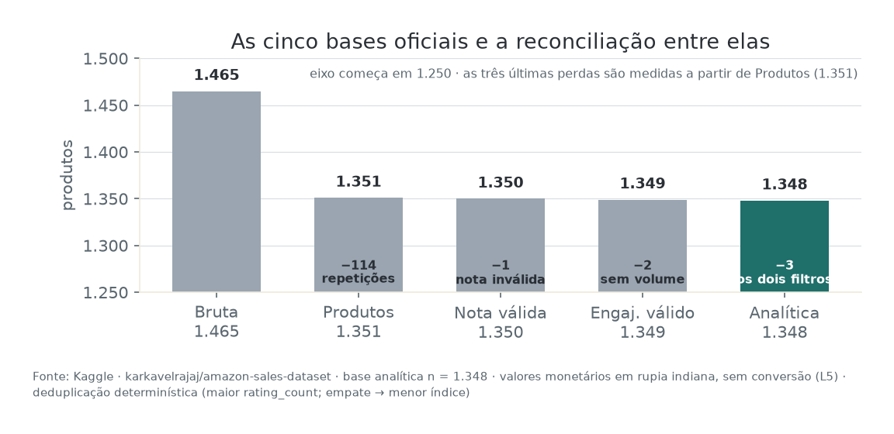

| Base | *n* | Quando usar |
|---|---|---|
| Bruta | **1.465** | apenas para relatar a qualidade da origem |
| Produtos | **1.351** | contagem de portfólio, após deduplicação |
| Nota válida | **1.350** | análises que dependem só de `rating` |
| Engajamento válido | **1.349** | análises que dependem só de `rating_count` |
| **Analítica** | **1.348** | **padrão** — toda análise cruzada, modelagem e quadrante |

*(tab01_bases_oficiais)*

#### 2.4.1 De 1.465 para 1.351 — a deduplicação e o desempate

**114 linhas excedentes**, distribuídas em **92 `product_id`**. A regra adotada mantém a ocorrência de **maior `rating_count`** por produto.

Só que a regra sozinha **não decide**. Dos 92 `product_id` repetidos, apenas **27 têm um máximo único**; nos outros **65 o máximo empata** e a regra fica muda — a contagem completa está em `02_results/tables/tab09_dedup_empates.csv`. Foi aqui que o projeto encontrou o problema mais sutil de toda a preparação: a primeira versão do validador ordenava sem exigir estabilidade, o que em `pandas` recai em *quicksort* — ordenação não estável. **O resultado passava a depender do algoritmo de ordenação da biblioteca.** Dois analistas rodando o mesmo código poderiam publicar medianas diferentes.

A regra publicada, e única válida, é portanto composta: **maior `rating_count` e, no empate, a ocorrência de menor índice de linha na origem**. É reprodutível em Python, em DAX e em Power Query.

**Qual o impacto de ter escolhido essa regra e não outra?** Medido, não estimado:

| Efeito da troca da regra (produtos, n = 1.351) | Resultado |
|---|---|
| Diferença agregada em `rating_count` | **40 avaliações em 23.802.463** — 0,0002% |
| Produtos que mudam de `rating` | **0** |
| Produtos que mudam de `actual_price` | **0** |
| Produtos que mudam de `discounted_price` | **1** |
| Produtos que mudam de `discount_percentage` | **1** |
| Produtos que mudam de **texto de avaliação** | **4** |

Nota, categoria e nome **nunca** divergem entre ocorrências do mesmo produto. A escolha é **imaterial para toda métrica agregada** e material para exatamente seis produtos. O caso do preço é o `B096MSW6CT`, que aparece com 999 e com 1.899 e com `rating_count` **idêntico** nas duas ocorrências — ou seja, é precisamente um dos 65 empates. Sem o desempate declarado, o preço desse produto seria sorteado pelo algoritmo de ordenação.

> **Alternativas descartadas.**
> **(a) `keep="first"` — manter a primeira ocorrência.** Simples e determinístico, mas amarra o resultado à ordem física do arquivo, que não tem significado analítico. Diferença medida contra a regra adotada: 40 avaliações. Foi descartada não por magnitude, mas por não ter defesa: "ficou a primeira porque estava em cima" não responde à banca.
> **(b) Consolidar as ocorrências pela média.** Criaria um produto que não existe na origem e quebraria o vínculo com o bloco de avaliações — o texto pertence a **uma** das ocorrências, não à média delas.
> **(c) Somar os `rating_count` das ocorrências.** Pressupõe que são avaliações distintas. Não são: nos 31 casos divergentes as contagens são leituras do mesmo produto em momentos diferentes. Somar inflaria o engajamento do produto e distorceria o p90, que é o corte de todo o quadrante Q5.

#### 2.4.2 De 1.351 para 1.350 e 1.349 — dois filtros paralelos, não uma cadeia

Aqui a figura 1 pede leitura cuidadosa, porque as barras descem em sequência mas **os dois filtros do meio são independentes**:

- **Nota válida = 1.350** → 1.351 menos **1** produto cujo `rating` veio com o valor `|`.
- **Engajamento válido = 1.349** → 1.351 menos **2** produtos com `rating_count` nulo.

São recortes paralelos sobre a mesma base de 1.351. Existem porque uma parte das análises só precisa de uma das duas variáveis: uma distribuição de notas não deve perder os dois produtos que têm nota mas não têm contagem de avaliações, e vice-versa. Usar 1.348 para tudo descartaria dado válido sem necessidade.

#### 2.4.3 1.348 — a interseção, e por que ela é o padrão

As três exclusões **não se sobrepõem**: o produto com `rating` inválido não é nenhum dos dois com `rating_count` nulo. Logo a interseção é 1.351 − 1 − 2 = **1.348**.

**A reconciliação completa, número a número:**

> 1.465 (bruta) − **114** linhas excedentes = **1.351** (produtos) − **1** `rating` inválido = **1.350** (nota válida) · e 1.351 − **2** `rating_count` nulos = **1.349** (engajamento válido) · interseção das duas = **1.348** (analítica)

A base analítica é o padrão porque **toda análise que interessa cruza nota e volume**: o quadrante de alto engajamento com nota baixa, a curva de Pareto, as correlações, a segmentação. Exigir as duas variáveis presentes é condição de existência dessas análises, não preferência.

*Para quem não é da área: é a diferença entre "quantos produtos há na prateleira" (1.351) e "quantos produtos podem entrar em um gráfico que cruza nota com número de avaliações" (1.348). As duas perguntas são legítimas e têm respostas diferentes. O erro não é ter dois números — é citá-los sem dizer qual é qual.*

> **Alternativa descartada — publicar uma base única.** Tentador para simplificar a comunicação. Descartada por dois motivos: a contagem de portfólio ficaria 3 produtos menor do que o catálogo realmente tem, e a seção de qualidade da origem **precisa** das 1.465 linhas para relatar as 114 excedentes. Uma base única obrigaria a esconder a evidência da própria limpeza.
> **Alternativa descartada — arredondar para "cerca de 1.350 produtos".** Elimina a fricção e torna o trabalho inauditável. Um número arredondado não reconcilia com nada.

**Custo assumido desta decisão:** ela é mais cara de comunicar. Toda legenda, todo KPI e toda fala do vídeo carregam a base e o *n*. O projeto aceitou o custo porque o oposto — cinco números circulando sem rótulo — é exatamente o achado que derruba a credibilidade de um dashboard na primeira pergunta.

---

### 2.5 Distribuições e o tratamento de outliers

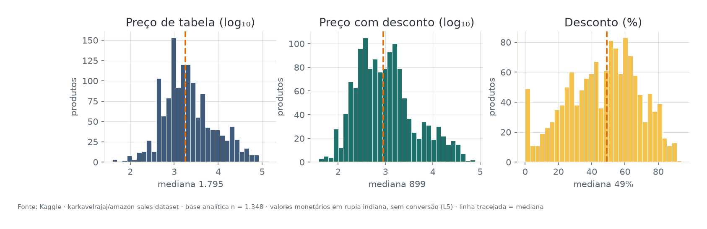

*(ver **Figura 3**, seção 4.3)*

| Variável | p25 | Mediana | p75 | p90 | Máximo |
|---|---|---|---|---|---|
| Preço de tabela (rupia indiana) | 899 | **1.795** | 4.592 | 15.999 | 139.900 |
| Preço com desconto (rupia indiana) | 349 | **899** | 2.184 | 8.993 | 77.990 |
| Desconto (%) | 31 | **49** | 62 | 75 | 94 |
| Nota | 3,90 | **4,10** | 4,30 | 4,40 | 5,00 |
| Avaliações | 1.108 | **4.740** | 16.052 | 36.384 | 426.973 |

*(tab02_distribuicao · base analítica, n = 1.348 · percentis por interpolação linear)*

Três fatos estruturais saem daqui e condicionam todo o resto do relatório.

**1. Preço e volume são fortemente assimétricos.** O preço de tabela máximo (139.900) é **78 vezes** a mediana (1.795); o volume máximo de avaliações (426.973) é **90 vezes** a mediana (4.740). Por isso as figuras 2 e 3 usam **escala logarítmica** nos eixos de preço e de volume: em escala linear, 90% dos produtos colapsam numa única barra à esquerda e o gráfico não informa nada.

**2. A nota é quase uma constante.** Entre o p25 (3,90) e o p75 (4,30) há **0,4 ponto** numa escala de 1 a 5. Metade do catálogo cabe numa faixa de quatro décimos. Esse é o número que mais surpreende na base, e ele tem uma consequência direta: **diferenças de nota entre grupos serão pequenas por construção**, e qualquer leitura que trate 4,1 e 4,3 como "mundos diferentes" está superinterpretando ruído. É também o que torna obrigatória a correção de variância em todo ranking por nota (regra T1) — sem ela, um produto com 5 avaliações e nota 5,0 lidera o ranking de "melhores produtos".

**3. Os cortes operacionais são percentis da própria base, não números redondos.** Engajamento alto = **p90 = 36.384 avaliações**; engajamento baixo = **abaixo da mediana = 4.740**; satisfação baixa = nota **< 4,0** (339 produtos, 25,1%); satisfação alta = nota **≥ 4,3** (418 produtos). A faixa intermediária, 4,0 a 4,29, tem **591 produtos**. A soma fecha: 339 + 591 + 418 = **1.348** ✅.

> **Alternativa descartada — remover ou winsorizar os outliers de preço e de volume.** Seria o reflexo automático de quem vê um máximo 78 vezes maior que a mediana. Foi descartada porque **os extremos passaram em todos os testes de coerência**: nenhum produto tem preço com desconto acima do preço de tabela e nenhum desconto declarado diverge mais de 0,50 p.p. do recalculado. O produto de 139.900 não é erro de digitação — é um produto caro. Removê-lo apagaria justamente a ponta premium do catálogo, que é onde decisões de sortimento e de margem acontecem. **O tratamento adotado não é remover, é medir diferente:** mediana e percentis no lugar da média, escala log nos eixos e **Spearman no lugar de Pearson** em todas as associações, porque Spearman trabalha sobre postos e não é arrastado por uma cauda longa.
> **Alternativa descartada — cortes redondos (desconto de 50%, nota 4,0 e 4,5, "top 100 produtos").** Mais fáceis de comunicar, mas arbitrários: mudam de significado a cada base. Os percentis são reprodutíveis e reconciliam com a distribuição publicada acima. O único corte redondo mantido é a nota 4,0, e por um motivo declarado: é o limiar que o consumidor lê como "abaixo de 4 estrelas".

---

### 2.6 Concentração do portfólio e o piso amostral

*(ver **Figura 5**, seção 5.5)*

| Categoria de nível 1 | Produtos | Acima do piso |
|---|---|---|
| Electronics | **490** | sim |
| Home & Kitchen | **447** | sim |
| Computers & Accessories | **373** | sim |
| Office Products | **31** | sim, no limite |
| Musical Instruments | 2 | não |
| Home Improvement | 2 | não |
| Toys & Games | 1 | não |
| Health & Personal Care | 1 | não |
| Car & Motorbike | 1 | não |

*(tab04_categorias · base analítica, n = 1.348)* — **Reconciliação:** 490 + 447 + 373 + 31 + 7 = **1.348** ✅

**97,2% do portfólio está em três famílias.** Das 9 categorias de nível 1, apenas 4 alcançam 30 produtos, e as outras 5 somam **7 produtos no total**. Quando este relatório diz "análise por categoria", isso significa, na prática, **três famílias de produto mais uma no limite amostral** (limitação L3).

Daí a regra **T2**: nenhum grupo agregado — categoria, subcategoria, faixa de desconto ou cluster — com n < 30 é ranqueado ou comparado, e a supressão é declarada no rodapé do visual. Sem ela, "Car & Motorbike lidera em satisfação" seria uma frase sustentada por **um** produto.

A regra tem uma segunda metade igualmente importante: **listas nominais de produtos não são grupos agregados** e não estão sujeitas ao piso. Sem essa ressalva, a mesma regra que protege contra a categoria de 1 produto eliminaria por engano o quadrante de 19 produtos de alto engajamento e nota baixa — que é um dos achados centrais do trabalho. Nessas listas, o *n* de avaliações é exibido produto a produto.

> **Alternativa descartada — reagrupar as 5 categorias pequenas em "Outros".** Produziria um grupo de 7 produtos, ainda abaixo do piso, com o agravante de misturar instrumentos musicais com autopeças. Um rótulo "Outros" no eixo sugere uma categoria comparável; sete produtos heterogêneos não são.
> **Alternativa descartada — descer para o nível 3 ou mais da hierarquia de `category`** (a base permite até 7 níveis). Ganha-se granularidade e perde-se toda comparabilidade: praticamente nenhum grupo sobreviveria ao piso de 30. O projeto fixou **nível 1 como família e nível 2 como unidade de comparação** — no nível 2 há **8 subcategorias acima do piso, cobrindo 88,3% dos produtos**, que é o melhor equilíbrio entre detalhe e sustentação amostral que a base oferece.

---

### 2.7 Uma armadilha de contagem no corpus textual

A duplicidade da base não está só nos produtos. Ao explodir as listas de avaliações da base analítica, o corpus tem **10.588 referências de avaliação** — mas apenas **9.255 `review_id` distintos**. Há **1.333 referências repetidas**, e **759 `review_id` aparecem em mais de um produto**.

Quem contar as referências sem deduplicar publica um corpus **14% maior do que ele é**. Por isso `review_id` foi preservado na base tratada mesmo não constando da lista de colunas do enunciado, e por isso a regra **T8** exige que todo método textual declare a unidade (bloco ou review individual) e deduplique.

O corpus também é **truncado em no máximo 8 avaliações por produto** (média medida: **7,85**), o que significa que o texto analisado **não é amostra aleatória** do que os consumidores escreveram — é o recorte que o marketplace escolheu exibir na página (limitação L1). O detalhamento por faixa de nota está em *tab06_corpus* e o método textual é tratado na seção de Customer Insights; aqui o ponto é de **qualidade de dado**: a unidade de contagem precisa ser declarada antes de qualquer número.

---

### 2.8 LGPD — o que a base traz de dado pessoal e o que foi feito

A base bruta contém **duas colunas de dado pessoal**: `user_id` e `user_name`. Este repositório é público.

| Medida | Decisão |
|---|---|
| `user_id` e `user_name` na base tratada | **removidas** — a silver versionada tem 9 colunas, a gold analítica 17, e nenhuma das duas os contém |
| `amazon.csv` bruto no repositório | **não versionado** — `00_data/bronze/*` está no `.gitignore` |
| Exibição em visual, slide ou frame de vídeo | **vedada** (regra T7), sem exceção |
| Reprodutibilidade sem o arquivo | garantida por **SHA-256 + instrução de download** do Kaggle |
| Saída do validador | `src/valida_base.py` **não imprime** nenhum identificador — há uma asserção explícita para isso |

**Por que remover e não anonimizar.** A alternativa óbvia era aplicar um *hash* em `user_id` e manter a coluna. Foi descartada por dois motivos. O primeiro é jurídico: *hash* de identificador é **pseudonimização**, não anonimização — o dado continua sendo dado pessoal sob a LGPD, e manter a coluna num repositório público apenas troca um risco por outro menos visível. O segundo é analítico: **nenhuma das 14 perguntas do escopo usa o consumidor como unidade de análise**. A unidade é o produto. Uma coluna pseudonimizada que ninguém usa é risco sem contrapartida.

Vale registrar que a remoção **custou uma possibilidade real**, e o projeto sabe exatamente qual: na base analítica há **9.036 `user_id` distintos**, dos quais **909 avaliam mais de um produto**. Havia, portanto, material para uma análise de comportamento por avaliador. Ela foi **deliberadamente não feita**. O `00_data/README.md` registra ainda 9.050 `user_id` e 7.699 `user_name` distintos no arquivo como baixado.

*Para quem não é da área: a base vem com o nome e o identificador de quem escreveu cada avaliação. Nada na pergunta de negócio exige saber quem é essa pessoa — a pergunta é sobre produtos. Então o nome não entra no repositório, não entra no dashboard e não entra no vídeo.*

---

### 2.9 Como a qualidade é garantida — e não apenas afirmada

Um relatório pode declarar que a base foi tratada. Este projeto **executa** a declaração: `src/valida_base.py` transforma cada número publicado em asserção, com **a base declarada linha a linha** (T3), e retorna código de saída 1 se qualquer um divergir.

O validador cobre, com base declarada em cada asserção: procedência (SHA-256), estrutura e conversão sobre a base bruta, a deduplicação determinística — incluindo a separação entre os 27 máximos únicos e os 65 empates —, as cinco contagens oficiais, a coerência comercial, os cortes e quadrantes, as contagens por categoria e subcategoria, a tabela de distribuição inteira, as quatro correlações de Spearman, o corpus textual com e sem deduplicação, as somas de `rating_count` e a comparação numérica entre as duas regras de deduplicação possíveis.

Dois detalhes de engenharia merecem registro, porque são o tipo de coisa que separa um validador real de um validador decorativo:

- **Dependência ausente não vira aprovação.** Se `scipy` não estiver instalado, as quatro correlações são **declaradas como puladas**, nunca aprovadas em silêncio. O relatório distingue "verificado" de "não verificado".
- **Tolerância explícita.** Cada asserção numérica declara a tolerância que aceita, e o arredondamento segue a regra do inteiro par (padrão do Python), declarada em rodapé.

O mesmo princípio vale para as figuras: `src/gera_figuras.py` gera **toda** imagem deste relatório a partir da base canônica, aplicando a paleta v06 por módulo (regra T9) e escrevendo fonte, base e *n* no rodapé de cada figura. Nenhuma imagem foi montada à mão, e qualquer uma pode ser regenerada com um comando.

---

### 2.10 O que esta seção compromete com o resto do relatório

| Compromisso | Consequência nas seções seguintes |
|---|---|
| Cinco bases oficiais, base declarada em todo número (T3) | todo KPI, gráfico e fala cita base e *n* |
| Deduplicação determinística com desempate | os números são reprodutíveis em Python, DAX e Power Query |
| `rating_count` = volume de avaliações (T6) | nenhuma recomendação é expressa em receita ou unidades vendidas (L4) |
| Piso amostral n ≥ 30 em grupos agregados (T2) | 5 categorias e a maior parte dos níveis profundos ficam fora de ranking |
| Outliers preservados, medidas robustas | mediana, percentis e Spearman no lugar de média e Pearson |
| Corpus deduplicado por `review_id` e truncado em 8 (T8, L1) | achados textuais descrevem os temas visíveis na vitrine, não a opinião média |
| `user_id` e `user_name` removidos (T7) | nenhuma análise por consumidor, por decisão declarada |
| Mercado indiano, valores em rupia indiana, sem data (L5, L4, L7) | sem conversão cambial, sem análise temporal, sem generalização para outro mercado |


---

## 3. Tratamento dos Dados e Decisões de Modelagem

O enunciado avalia "Preparação dos dados" pela **qualidade das transformações realizadas**. Esta seção não lista transformações: justifica cada uma, apresenta a alternativa que foi descartada e diz o que se perderia com ela. Onde a decisão ainda não foi tomada, isso está declarado como decisão aberta, com a recomendação registrada e o que ela bloqueia.

O princípio que governa tudo o que vem a seguir é um só: **o resultado não pode depender de qual máquina, qual biblioteca ou qual versão executou o código**. Uma transformação que produz números diferentes em duas execuções não é uma transformação — é um ruído com aparência de método. Duas das decisões desta seção existem exclusivamente por causa desse princípio.

### 3.1 Ponto de partida: o que a origem entrega

A base é a `amazon.csv` do Kaggle (`karkavelrajaj/amazon-sales-dataset`), marketplace indiano, valores em rupia indiana. O arquivo tem **1.465 linhas × 16 colunas, 4,74 MB**, e é identificado pelo SHA-256 `4ba126c4ba8edd35e62e94ce1c853073d832de380184ab4f5f97d1e314882c77`. O hash não é enfeite: ele é conferido pelo script de validação antes de qualquer medição, e é o que permite afirmar que os números deste relatório vieram deste arquivo e não de outro com o mesmo nome.

Diagnóstico da origem, medido sobre a **base bruta (n = 1.465)**:

| Verificação | Resultado |
|---|---|
| Colunas | 16, **todas string** na origem |
| Linhas integralmente duplicadas | **0** |
| Linhas excedentes por `product_id` | **114**, distribuídas em **92** `product_id` |
| `product_id` com `rating_count` divergente entre ocorrências | **31** |
| Falha de conversão numérica | `rating` = **1** (valor `\|`) · `rating_count` = **2** nulos · preços e desconto = **0** |

Fonte: `method/definitions/base_factual_e_bases_de_calculo.md`, seção 2.

Duas leituras importam aqui. A primeira: **nenhuma linha é duplicata integral**. As 114 linhas excedentes repetem o `product_id` mas diferem em alguma coluna — se fossem cópias idênticas, a deduplicação seria trivial e esta seção teria três parágrafos. A segunda: a origem é **inteiramente textual**. Preço vem como `1,234.56` com marcador de rupia à frente — vírgula de milhar e ponto decimal —, desconto como `64%`, volume de avaliações como `1,234`. Nada é numérico antes de o pipeline torná-lo numérico.

**Decisão 1 — ler o arquivo inteiro como texto (`dtype=str`) e converter explicitamente.**
*Alternativa descartada:* deixar o leitor de CSV inferir os tipos. O motivo é concreto: há **um** registro cujo `rating` traz o caractere `|`. Com inferência automática, a coluna vira texto sem aviso, ou o valor é silenciosamente coagido, e o produto defeituoso entra na análise disfarçado de válido. Com conversão explícita e `errors="coerce"`, o valor vira nulo, é contado (1), é declarado e é excluído por uma regra escrita. A diferença entre as duas rotas não é de resultado — é de **rastreabilidade**: na primeira, ninguém sabe que o registro existiu.

### 3.2 Conversões de tipo e limpeza

| Coluna | Origem | Tratamento | Resultado |
|---|---|---|---|
| `discounted_price` · `actual_price` | `1,234.56` com marcador de rupia à frente | remover o marcador de rupia e a vírgula de milhar | decimal |
| `discount_percentage` | `64%` | remover `%` | decimal 0–100 |
| `rating_count` | `1,234` | remover separador | inteiro |
| `rating` | texto | conversão numérica; 1 falha → nulo | decimal 1–5 |
| `category` | texto com `\|` | separar em hierarquia de até 7 níveis | níveis 1 e 2 |
| `review_id` · `review_title` · `review_content` | listas concatenadas | explodir por `,`; deduplicar por `review_id`; remover URLs e tokens não latinos | corpus textual |
| `user_id` · `user_name` | texto | **removidos** | — |
| `img_link` · `product_link` | texto | removidos | — |

Fonte: `method/definitions/dicionario_de_dados.md`.

Das 16 colunas da origem restam **12** na base tratada: as **11 colunas citadas no enunciado** mais `review_id`, que não é pedido mas é indispensável — sem ele não há como deduplicar o corpus textual, e o corpus aparece 14% maior do que é (§3.6).

**Decisão 2 — remover `user_id` e `user_name` no tratamento, não na exibição.**
A base bruta traz **9.050 `user_id` distintos** e **7.699 `user_name` distintos**. São dados pessoais, e o repositório é público. A regra transversal **T7** veda exibir esses campos em qualquer visual, slide ou frame do vídeo; a decisão de tratamento vai além da regra e os elimina do arquivo versionado.
*Alternativa descartada:* manter as colunas e apenas não exibi-las. Uma vedação de exibição depende de alguém lembrar dela em todo artefato futuro; uma coluna ausente não depende de ninguém. O custo é real e foi aceito: perde-se a capacidade de refazer, no repositório, a medição de **9.036 usuários distintos na base analítica, dos quais 909 (10,1%) avaliam mais de um produto** — o número que sustentou o descarte de filtragem colaborativa entre as aplicações de machine learning. O número fica registrado; a matéria-prima dele, não.

**Controle de qualidade comercial** (base analítica, n = 1.348): **0 casos** de preço com desconto acima do preço de tabela; divergência entre o desconto declarado e o recalculado a partir dos dois preços com **máximo de 0,50 p.p.**, média de **0,21 p.p.**, **nenhum caso acima de 1 p.p.**. Isso deixou de ser pergunta de análise e virou o que é: um controle que passou. O recálculo do desconto é instrumento desse controle e **não gera coluna**: `desconto_recalculado` não existe em artefato nenhum — **o desconto declarado é o que a análise usa**, porque a divergência é menor que a granularidade de qualquer leitura de negócio.

### 3.3 Deduplicação — a decisão mais cara do tratamento

São 114 linhas excedentes em 92 `product_id`. Como nenhuma é cópia integral, escolher qual ocorrência fica é escolher quais valores entram na análise.

A analogia serve para a liderança: é como ter duas fichas cadastrais do mesmo produto no arquivo, preenchidas em momentos diferentes. Nenhuma está errada; uma está mais completa. A pergunta não é "qual é a verdadeira", é "qual critério usamos sempre, e o que acontece quando o critério empata".

**Regra adotada:** manter a ocorrência de **maior `rating_count`** por `product_id`; **no empate, a de menor índice de linha na origem** (ordenação estável).

**Por que `rating_count` é o critério.** Entre duas fichas do mesmo produto, a que acumulou mais avaliações é a fotografia mais tardia e mais completa do mesmo objeto. É o único critério disponível na base que tem direção — não existe data, não existe versão, não existe flag de atualização. Os demais campos não ajudam a decidir: **nota, categoria e nome nunca divergem** entre ocorrências do mesmo `product_id`.

#### 3.3.1 Por que o desempate é obrigatório

Este é o ponto em que a regra publicada em quase todo projeto desta base se revela incompleta. Dos **92 `product_id` repetidos, apenas 27 têm máximo único** — nesses, "maior `rating_count`" decide sozinha. **Nos outros 65 o máximo empata**, e a regra não diz nada sobre qual linha fica.

O que acontece então é invisível e grave: a decisão passa para o algoritmo de ordenação da biblioteca. A rotina padrão do `pandas` para ordenação é *quicksort*, que **não é estável** — a posição relativa de linhas com a mesma chave não é preservada e não é garantida entre versões. O resultado é um pipeline que produz números diferentes sem que uma linha de código tenha mudado.

**O que muda sem o desempate — medido, não estimado.** As três regras possíveis foram executadas e comparadas, e o resultado está versionado em `02_results/tables/tab10_impacto_regra_dedup.csv`:

| Regra de desempate | *n* silver | *n* gold | Mediana do preço de tabela | QA4 · ρ | QA4 · *p* | Soma de avaliações |
|---|---|---|---|---|---|---|
| **oficial** — maior `rating_count`, empate pelo menor índice de origem | 1.351 | 1.348 | **1.795** | +0,0323 | **0,2360** | 23.802.463 |
| sem desempate — ordenação não determinística | 1.351 | 1.348 | **1.792,5** | +0,0329 | **0,2277** | 23.802.463 |
| primeira ocorrência | 1.351 | 1.348 | 1.795 | +0,0323 | 0,2360 | 23.802.**423** |

*Base: Bruta 1.465 → silver → Analítica · valores em rupia indiana, sem conversão (L5) · QA4 = Spearman de preço de tabela × nota, n = 1.348.*

Três leituras saem dessa tabela, e nenhuma delas é visível sem ter rodado as três regras:

1. **O *n* não muda nunca.** As cinco bases oficiais (1.465 → 1.351 → 1.350 → 1.349 → 1.348) são **invariantes à regra de desempate**. Nenhuma contagem publicada neste relatório depende dela.
2. **Mas dois números impressos mudam.** Sem desempate, a mediana do preço de tabela cai de 1.795 para 1.792,5 e o *p* de QA4 vai de 0,236 para 0,228. **Nenhum dos dois cruza o limiar de 0,05** — a leitura publicada, *"ρ = +0,032, p = 0,236, sem associação"*, continua de pé —, mas um relatório cujo *p*-valor depende do algoritmo de ordenação não é auditável: a banca que reexecutasse encontraria um número diferente do escrito.
3. **A regra "primeira ocorrência" seria quase indistinguível — e é aí que está o risco.** Ela devolve a mesma mediana e o mesmo *p*, divergindo só na soma de avaliações, em **40 avaliações sobre 23,8 milhões** (0,00017%). Uma diferença dessas não aparece em nenhum gráfico e passaria por qualquer revisão; o desempate pelo **maior `rating_count`** é adotado porque preserva o registro mais informativo, não porque a alternativa fosse visivelmente pior.

É exatamente por isso que a regra é publicada em vez de ficar implícita no código: o custo de não declará-la só aparece quando outra pessoa reexecuta.

A causa é rastreável até um produto. A limitação **L6** a nomeia: **`B096MSW6CT`**, cujas ocorrências trazem preços divergentes — **999 e 1.899** — com `rating_count` **idêntico**. Um único produto, num par empatado, move uma mediana de 1.348 valores porque a mediana fica exatamente na vizinhança dele. É o caso de manual para justificar por que uma regra de desempate não é preciosismo.

**Custo da adoção:** zero em resultado, alto em disciplina. O desempate precisa ser reproduzível **em Python, em DAX e em Power Query** — as três linguagens em que os números do projeto serão recalculados. "Menor índice de linha na origem" atravessa as três; "a primeira que o algoritmo devolver", não.

#### 3.3.2 Por que NÃO se adotou a regra da primeira ocorrência

A regra da primeira ocorrência (`keep="first"` sobre a ordem do arquivo) é determinística, é uma linha de código e resolve o problema de reprodutibilidade. Foi descartada por três razões, nesta ordem de peso.

**Primeira — ela descarta o único critério com significado.** Manter a primeira ocorrência é escolher pela posição da linha no arquivo, e a posição é um artefato do processo de exportação, não uma propriedade do produto. O impacto agregado é pequeno e foi medido: a soma de `rating_count` cai em **40 avaliações num total de 23.802.463 — 0,0002%**, com divergência máxima de **0,17%** num produto isolado. Mas trocar um critério com direção por um sem direção não se justifica por o erro ser pequeno; justifica-se por nada, já que o custo de fazer certo é o mesmo.

**Segunda — ela desloca o conteúdo textual.** A escolha da regra altera, produto a produto: **o preço com desconto de 1**, **o desconto de 1** e **o texto de avaliação de 4**. Os quatro produtos com texto alterado entram no corpus de Customer Insights. Um bloco de avaliações diferente é um insight potencialmente diferente, e o pipeline de NLP herda a escolha sem ter como saber disso.

**Nota de precisão, porque o argumento se sustenta melhor exato do que forte:** a comparação direta entre a regra oficial e a regra da primeira ocorrência mostra **0 produtos** com mudança de preço de tabela. A mediana de 1.795 não se move entre *essas duas* regras. Ela se move quando o desempate **não é declarado** e a escolha entre as 65 linhas empatadas fica por conta do algoritmo. A regra da primeira ocorrência foi descartada pelas **duas** razões acima — não por mover a mediana.

**Um terceiro argumento foi retirado desta seção, e vale dizer qual e por quê.** Uma versão anterior alegava que *"o CSV vem ordenado por categoria, logo qualquer regra posicional está decidindo por categoria"*. **O argumento é falso aqui, e a medição o derruba:** das 92 `product_id` repetidas, **0 divergem em categoria** e **0 divergem em nome**. As ocorrências duplicadas são do **mesmo produto** — a categoria é idêntica entre elas por construção, e nenhuma ordenação por categoria pode enviesar uma escolha feita *dentro* de um mesmo produto.

O viés de ordenação é real, mas o lugar dele é outro: a **validação cruzada**, onde as partições separam produtos *diferentes* e uma base ordenada por categoria produziria dobras não comparáveis. Lá ele obriga o embaralhamento explícito, e está tratado em §6. Transpor o argumento para a deduplicação foi erro de aplicação, não de medição — e retirá-lo deixa a defesa **mais** forte, porque um argumento que não resiste ao teste enfraquece os dois que resistem.

#### 3.3.2-a Se a posição não tem significado, por que ela decide 65 dos 92 casos?

É a objeção mais afiada contra a regra oficial, e merece resposta direta em vez de nota de rodapé. **A posição decide a maioria dos casos — 65 de 92, 70,7%.** Se posição não tem significado analítico, usá-la em 70% das decisões parece contradizer a própria crítica a `keep="first"`.

A resposta está em **onde** cada regra usa a posição:

| Situação | `keep="first"` | Regra oficial |
|---|---|---|
| `rating_count` tem **máximo único** — 27 casos | decide **pela posição**, descartando o `rating_count` que distingue as linhas | decide **pelo `rating_count`** |
| O máximo **empata** — 65 casos | decide pela posição | decide pela posição |

A diferença não é de grau, é de estrutura: `keep="first"` usa posição **onde existe informação**, e a joga fora; a regra oficial usa posição **somente onde não existe informação alguma**. Nos 65 empates, as linhas candidatas têm o mesmo `product_id`, a mesma categoria, o mesmo nome e o mesmo `rating_count` — **medido, não suposto**. Não há atributo com **direção** — data, versão, recência — que autorize preferir uma delas; ainda divergem em texto de avaliação (11 dos 65), desconto (2) e preço (1), e é justamente por isso que o desempate precisa ser declarado.

Quando não há informação, **todo desempate é arbitrário por necessidade**, e a única exigência que resta é ser **declarado e determinístico**. "Menor índice de linha na origem" cumpre as duas: qualquer pessoa, em qualquer linguagem, chega à mesma base. A alternativa real nunca foi um critério melhor — era deixar a escolha para o algoritmo de ordenação da biblioteca, que é arbitrário **e** não declarado. Foi exatamente o defeito da primeira versão do validador.

#### 3.3.3 Alternativas de deduplicação também consideradas e descartadas

| Alternativa | Por que foi descartada |
|---|---|
| Manter as 1.465 linhas e deduplicar só nas contagens | quebra a granularidade declarada (1 linha = 1 produto); toda média e todo percentil passariam a ponderar 92 produtos em dobro |
| Média entre as ocorrências do mesmo `product_id` | cria um produto que não existe: um preço médio entre 999 e 1.899 não é preço de nada, e o texto de avaliação não é mediável |
| Remover todos os `product_id` repetidos | custaria 92 produtos (6,8% do portfólio) para resolver um problema cujo impacto agregado é de 0,0002% |
| Deduplicar pelo maior preço, ou pelo mais recente | não há data na base; preço não tem direção temporal — escolher o maior é arbitrário com aparência de critério |

### 3.4 As cinco bases — por que o projeto não tem um único *n*

Deduplicação e exclusão por invalidez são operações distintas, com motivos distintos, e o projeto se recusa a fundi-las num número só.

*(ver **Figura 1**, seção 2.4)*

| Base | *n* | Quando usar |
|---|---|---|
| Bruta | **1.465** | apenas para relatar a qualidade da origem |
| Produtos | **1.351** | contagem de portfólio, após deduplicação |
| Nota válida | **1.350** | análises que dependem só de `rating` |
| Engajamento válido | **1.349** | análises que dependem só de `rating_count` |
| **Analítica** | **1.348** | **padrão** — toda análise cruzada, modelagem e quadrante |

Fonte: `02_results/tables/tab01_bases_oficiais.csv`.

**Reconciliação:** 1.465 − 114 linhas excedentes = 1.351 → −1 (`rating` inválido) = 1.350 → −2 (`rating_count` nulo, sem sobreposição com o anterior) = **1.348**.

*Alternativa descartada:* padronizar tudo em 1.348 e nunca mencionar as outras quatro. Seria mais simples de contar e mais difícil de defender — a contagem de portfólio legítima é 1.351, e usar 1.348 para ela subdeclara o catálogo em três produtos por um motivo (nota ilegível, volume nulo) que nada tem a ver com portfólio. A regra **T3** fecha o custo dessa escolha: **todo número publicado declara a base e o *n* efetivo**. Cinco bases convivendo sem declaração seriam uma fonte de erro; com declaração, são precisão.

A distribuição das variáveis principais, sempre sobre a base analítica, está em `02_results/tables/tab02_distribuicao.csv` e nas figuras 2 e 3:

| Variável | p25 | Mediana | p75 | p90 | Máx |
|---|---|---|---|---|---|
| Preço de tabela (rupia indiana) | 899 | **1.795** | 4.592 | 15.999 | 139.900 |
| Preço com desconto (rupia indiana) | 349 | 899 | 2.184 | 8.993 | 77.990 |
| Desconto (%) | 31 | 49 | 62 | 75 | 94 |
| Nota | 3,90 | 4,10 | 4,30 | 4,40 | 5,00 |
| Avaliações | 1.108 | **4.740** | 16.052 | **36.384** | 426.973 |

*(ver **Figura 2**, seção 2.5)*

*(ver **Figura 3**, seção 4.3)*

**Decisão 3 — os cortes saem da própria distribuição, não de números redondos.** Engajamento alto = **p90 = 36.384 avaliações**; engajamento baixo = **abaixo da mediana = 4.740**; satisfação baixa = **nota < 4,0** (339 produtos, 25,1%); satisfação alta = **nota ≥ 4,3** (418 produtos).
*Alternativa descartada:* cortes redondos — "acima de 10 mil avaliações", "nota abaixo de 3,5". São mais fáceis de dizer e indefensáveis quando perguntados: a base tem máximo de 426.973 avaliações e mediana de 4.740, e qualquer número redondo escolhido a priori recorta um pedaço arbitrário dessa cauda. Percentis se defendem em uma frase.
Uma ressalva de vocabulário, exigida por **T6**: `rating_count` é **volume de avaliações**. Não é venda, receita, demanda nem popularidade real. Todo corte acima é um corte de engajamento declarado como proxy, e a limitação **L4** registra que a base não contém nenhuma variável de venda.

### 3.5 Hierarquia de categoria — por que o nível 2 é a unidade de comparação

A coluna `category` chega como um caminho concatenado por `|`, com até **7 níveis**. Escolher em que nível comparar é uma decisão de modelagem, não de limpeza.

*(ver **Figura 5**, seção 5.5)*

No **nível 1** há 9 categorias, e a distribuição inviabiliza a comparação (`02_results/tables/tab04_categorias.csv`):

| Categoria nível 1 | Produtos | Situação |
|---|---|---|
| Electronics | 490 | acima do piso |
| Home & Kitchen | 447 | acima do piso |
| Computers & Accessories | 373 | acima do piso |
| Office Products | 31 | acima do piso, no limite |
| Musical Instruments (2) · Home Improvement (2) · Toys & Games (1) · Health & Personal Care (1) · Car & Motorbike (1) | **7 produtos em 5 categorias** | abaixo do piso — nunca ranqueadas |

Soma: 490 + 447 + 373 + 31 + 7 = **1.348**. **97,2% do portfólio está em três famílias.**

A regra **T2** — nenhum grupo agregado com **n < 30** é ranqueado ou comparado — elimina as cinco categorias menores. Sobram quatro grupos, um deles no limite. "Análise de categorias" no nível 1 significa, na prática, comparar três caixas grandes: é descrição de portfólio, não análise.

No **nível 2**, a base oferece **8 subcategorias acima do piso, cobrindo 88,3% dos produtos**. É o nível que combina granularidade suficiente para diferenciar comportamento comercial com massa suficiente para comparar. Por isso o nível 2 é a unidade de comparação — e é sobre ele que se mede a dispersão de notas (QA3, §5.12).

*Alternativas descartadas:*
- **Nível 1 como unidade de análise:** três grupos comparáveis não sustentam nenhuma pergunta de portfólio. Fica como unidade de *descrição* (figura 5) e como preditor categórico no modelo de baixa satisfação, onde funciona bem.
- **Níveis 3 a 7:** a fragmentação leva a maioria dos grupos abaixo do piso de 30, e o piso é regra, não preferência. O nível 3 não foi medido.
- **Agrupar manualmente as 5 categorias residuais num balde "Outros":** criaria um grupo de 7 produtos que parece comparável aos de 490 e 447. O piso existe justamente para impedir essa aparência. A supressão é declarada em rodapé, que é o tratamento honesto: o leitor sabe que existem e sabe por que não aparecem (limitação **L3**).

Uma distinção que **T2** tornou explícita e que vale registrar: **listas nominais de produtos não são grupos agregados** e não estão sujeitas ao piso. Sem essa frase, a regra eliminaria por engano o quadrante de 19 produtos de alto engajamento e baixa nota — que é um dos achados centrais do trabalho. Uma regra de proteção mal escrita destrói o resultado que deveria proteger.

### 3.6 O corpus textual — três contagens, não uma

A coluna de avaliações chega concatenada: um **bloco** por produto. Explodir esse bloco produz três números diferentes, e usar o errado infla o corpus.

| Unidade | Definição | Contagem |
|---|---|---|
| **Bloco de review** | conjunto truncado de até 8 avaliações de um produto | 1 por produto |
| **Referência de avaliação** | item após explodir o bloco | **10.588** |
| **Review individual** | referência após deduplicar por `review_id` | **9.255** |

*Fonte: `02_results/tables/tab06_corpus.csv` · base analítica · n = 1.348 · soma das três faixas de nota: 2.652 + 4.674 + 3.262 = **10.588** referências e 2.502 + 3.875 + 2.878 = **9.255** reviews distintos.*

São **1.333 referências repetidas**, e **759 `review_id` aparecem em mais de um produto**. Sem a deduplicação por `review_id`, o corpus é reportado **14% maior do que é**. A regra **T8** fixa o procedimento: declarar a unidade, deduplicar por `review_id` e citar o truncamento.

*(ver **Figura 13**, seção 7.3)*

| Faixa de nota | Blocos | Referências | Reviews distintos |
|---|---|---|---|
| < 4,0 | 339 | 2.652 | 2.502 |
| 4,0–4,29 | 591 | 4.674 | 3.875 |
| ≥ 4,3 | 418 | 3.262 | 2.878 |

Fonte: `02_results/tables/tab06_corpus.csv`.

O truncamento é a limitação mais importante do projeto (**L1**): a base exibe **no máximo 8 avaliações por produto**, com média medida de **7,85**. O texto analisado **não é uma amostra aleatória** do que os consumidores escreveram — é o recorte que o marketplace escolheu exibir na página. A consequência é de redação, e vale para toda a seção de Customer Insights: os achados descrevem **os temas visíveis na vitrine**, nunca "o que a maioria dos clientes pensa".

*Alternativa descartada:* tratar a referência explodida (10.588) como unidade e reportar o corpus por ela. É o caminho natural de quem explode a coluna e conta as linhas, e produz um corpus 14% maior sem nenhuma avaliação adicional. O pipeline também remove URLs e tokens não latinos — o que **descarta conteúdo real** antes da análise, e a parcela descartada por idioma não foi quantificada (**L2**).

### 3.7 `nota_corrigida` — por que todo ranking precisa dela

A média aritmética de avaliações tem um defeito conhecido: **ela não distingue confiança de mérito**. Um produto com 5 avaliações e nota 5,0 lidera qualquer ranking de "melhores produtos" contra um produto com 40 mil avaliações e nota 4,6. O primeiro não é melhor; ele é menos medido. É a diferença entre um restaurante com três avaliações nota máxima e um com três mil e nota 4,6 — ninguém escolhe o primeiro se souber os dois números.

A regra **T1** fecha a questão: **todo ranking por nota usa o limite inferior de Wilson a 95%, com o *n* de avaliações exibido ao lado**. A alternativa — média bayesiana — foi avaliada e descartada em D-3 por exigir arbitrar um *prior* sem resposta defensável. Nenhum ranking do projeto usa a nota bruta.

A implementação corrente é o **limite inferior de Wilson a 95%** (z = 1,96), com a nota normalizada da escala 1–5 para 0–1 antes do cálculo e devolvida à escala original depois. O efeito é assimétrico por construção: onde há pouca evidência, a correção puxa a nota para baixo; onde há muita, quase não mexe.

O efeito aparece limpo nas faixas de desconto (`02_results/tables/tab08_faixas_desconto.csv`):

| Faixa de desconto | n | Nota mediana | Nota corrigida (Wilson) | Avaliações medianas |
|---|---|---|---|---|
| 0–20% | 175 | 4,2 | 4,136 | 6.736 |
| 21–40% | 329 | 4,1 | 4,083 | 7.241 |
| 41–60% | 469 | 4,1 | **4,025** | 3.025 |
| 61–80% | 324 | 4,1 | **4,035** | 4.147 |
| 81–100% | 51 | 4,0 | 3,906 | 4.426 |

*(ver **Figura 7**, seção 5.10)*

Três faixas têm **exatamente a mesma nota mediana (4,1)** e são indistinguíveis por ela. A nota corrigida as separa, e a ordem que produz é coerente com o volume: a faixa de 41–60%, com mediana de 3.025 avaliações, termina abaixo da faixa de 61–80%, com 4.147. **Magnitude, como exige T5: a diferença entre as duas é de 0,010 ponto.** É um instrumento de desempate de ranking, não uma diferença de qualidade que alguém deva agir sobre. Dizer isso é parte do método — com n = 1.348, um coeficiente pode ser estatisticamente significativo e comercialmente irrelevante ao mesmo tempo, e essa frase vale para toda a seção de resultados.

**D-3 fechou em 01/10/2026, e a escolha foi o limite inferior de Wilson.** A alternativa — **média bayesiana** — exige arbitrar um *prior*, e era isso que bloqueava toda medida de ranking (T1 e QA6). A recomendação registrada é **Wilson a 95%**, por uma razão de defesa e não de estatística: **Wilson não exige arbitrar um *prior*, e todo *prior* arbitrado vira pergunta na banca** — "por que 4,1 e não 4,0?" é uma pergunta sem resposta boa. As figuras e tabelas já produzidas usam Wilson como hipótese de trabalho; se D-3 for resolvida em favor da média bayesiana, a tabela 8 e todo ranking por nota precisam ser recalculados. A decisão é de Ricardo, não de quem constrói nem de quem revisa.

*Alternativas descartadas:* (a) **nota bruta com filtro de *n* mínimo** — troca um problema contínuo por um corte arbitrário e joga fora produtos legítimos; (b) **índice composto de relevância** misturando nota, volume e desconto num número só — descartado em D-2, porque um índice composto esconde a razão do resultado e a pergunta "por que este produto é relevante?" deixa de ter resposta; no lugar, adota-se a matriz 2×2 de **volume × nota** (cortes p90/mediana e 4,0/4,3), com a ordenação **dentro de cada quadrante** feita por nota corrigida de Wilson, que mantém as duas dimensões visíveis.

### 3.8 Decisões de modelagem herdadas do tratamento

Três características da base tratada condicionam a modelagem e, por isso, pertencem a esta seção.

**A ordem das linhas importa, e não é a que se supunha.** O argumento "o arquivo vem ordenado por categoria" já foi derrubado pela medição (§3.3.2); o que de fato ordena é a **gold**, por volume de avaliações decrescente, e é isso que reaparece na validação cruzada, onde partições não embaralhadas ficam quase puras por categoria. O embaralhamento explícito com semente fixa é obrigatório, e sem ele a medição de desempenho desaba para um valor pior que o acaso. Uma consequência do tratamento que, se não for declarada, leva quem reproduzir o trabalho a concluir de boa-fé que o modelo não funciona.

**Não há variável temporal.** A base não traz data, versão nem histórico. Isso elimina de saída previsão de vendas, séries temporais e detecção de anomalia com histórico, e impede qualquer afirmação sobre tendência, sazonalidade ou evolução (**L4**). Não é uma limitação da análise: é uma limitação da base, e foi declarada antes de qualquer tentativa.

**Vedação de vazamento.** Nenhuma variável derivada de `rating` entra como preditor de um alvo definido sobre `rating`. O alvo do modelo de baixa satisfação é `rating < 4,0` — **o mesmo limiar dos cortes operacionais**, e não um critério paralelo criado para o modelo. Manter um único limiar em toda a análise evita a situação em que "baixa satisfação" significa uma coisa no dashboard e outra no modelo.

**Relação medida, nunca causa.** A regra **T4** veda linguagem causal em todo o material. Correlação, coeficiente e importância de variável indicam **associação**. Onde o relatório disser que desconto e nota se movem em direções opostas (ρ = −0,150, p = 3,1e-08 · `tab03_correlacoes.csv`), está dizendo **associação de magnitude pequena**, jamais que o desconto rebaixa a nota. A regra é de tratamento porque começa aqui: uma base sem experimento, sem tempo e sem controle não sustenta afirmação causal, e nenhuma escolha de modelo conserta isso.

### 3.9 O que ficou fora, e por quê

| Item | Destino | Motivo |
|---|---|---|
| `user_id` · `user_name` | removidos da base tratada | LGPD · T7 — dado pessoal em repositório público |
| `img_link` · `product_link` | removidos | sem uso analítico |
| `about_product` | **fora da camada analítica** | **D-5**, fechada em 01/10/2026: a coluna descreve a promessa do vendedor, não a percepção do consumidor, e Customer Insights mede percepção. A recomendação registrada é dar-lhe um destino barato — atributos mais frequentes confrontados com o que dizem as avaliações, restrito aos 19 produtos de alto engajamento e baixa nota. Exclusão sem justificativa não é opção; manter sem uso, tampouco |
| `desconto_recalculado` | **não vira coluna** — o recálculo é controle de qualidade | divergência máxima de 0,50 p.p. contra o declarado — o declarado basta |

#### As cinco fontes de informação do enunciado, uma a uma

O enunciado abre pedindo uma análise "utilizando informações sobre" cinco fontes. Cada uma tem destino explícito:

| Fonte listada no enunciado | Colunas da base | Onde é tratada |
|---|---|---|
| Produtos e Categorias | `product_id` · `product_name` · `category` | Q1 · Q4 |
| Preços e Descontos | `actual_price` · `discounted_price` · `discount_percentage` | Q3 · QA1 · QA4 |
| Avaliações e Quantidade de Reviews | `rating` · `rating_count` | Q5 · Q6 · QA2 · QA6 |
| **Descrições Dos Produtos** | `about_product` | **fora da camada analítica** (D-5) — a resposta está logo abaixo |
| Comentários Realizados Pelos Consumidores | `review_title` · `review_content` | QA5 |

Quatro das cinco entram na análise. A quinta fica de fora por decisão registrada, e a omissão não pode ficar implícita:

#### A resposta à linha "Descrições Dos Produtos" do enunciado

O enunciado lista, entre as cinco fontes de informação do desafio, as **Descrições Dos Produtos** — que é a coluna `about_product`. Ela **não entra na análise**, e a omissão não pode ficar implícita: é uma fonte que o enunciado nomeia.

**Por que fica fora.** `about_product` é texto **escrito pelo vendedor**: especificação, atributo anunciado, argumento de venda. Customer Insights, no enunciado, pede a **percepção do consumidor** — *quais problemas aparecem*, *quais temas aparecem em avaliações negativas*. Misturar as duas fontes num mesmo corpus confundiria **promessa com experiência**: um termo frequente passaria a significar "o vendedor escreve muito isso" ou "o cliente comenta muito isso", sem que o leitor soubesse qual dos dois. A decisão **D-5** fechou em 01/10/2026 pela separação.

**O que se perde com isso, dito sem suavizar.** Perde-se uma análise que seria legítima e que o projeto não fez: **confrontar atributo anunciado com queixa recebida** — por exemplo, se os produtos que anunciam "longa duração de bateria" concentram reclamação de bateria. Essa leitura é o uso natural da coluna, foi registrada como recomendação antes de a decisão fechar, e ficou fora do escopo por tempo, não por falta de valor.

**O que foi feito no lugar.** A percepção do consumidor é lida pela leitura qualitativa dirigida dos 19 produtos de Q5 (§7.6), que não depende de `about_product`. As perguntas de Customer Insights do enunciado estão amarradas em §7.1.

**Onde a coluna está.** Preservada em `00_data/silver/produtos_texto.csv`, que não é versionado. Quem quiser fazer a análise descartada tem o dado à mão — o que fica fora é a leitura, não o insumo.

### 3.10 Resumo da defesa

| Decisão | Adotado | Descartado | Razão determinante |
|---|---|---|---|
| Leitura de tipos | tudo como texto + conversão explícita | inferência automática | o registro com `rating = \|` some sem aviso |
| Deduplicação | maior `rating_count`; empate → menor índice na origem | primeira ocorrência; média entre ocorrências; excluir repetidos | 65 dos 92 repetidos empatam; sem desempate o resultado depende do algoritmo de ordenação |
| Contagem de base | cinco bases declaradas (1.465/1.351/1.350/1.349/1.348) | um *n* único | portfólio é 1.351; análise cruzada é 1.348 — fundir as duas subdeclara ou superdeclara |
| Cortes | percentis da própria distribuição | números redondos | percentil se defende em uma frase; número redondo, não |
| Unidade de categoria | nível 2 (8 grupos, 88,3% de cobertura) | nível 1; níveis 3–7; balde "Outros" | nível 1 dá três grupos comparáveis; abaixo do nível 2, o piso de 30 elimina quase tudo |
| Corpus textual | review individual (9.255), deduplicado por `review_id` | referência explodida (10.588) | 1.333 referências repetidas inflam o corpus em 14% |
| Ranking por nota | `nota_corrigida` (Wilson 95% — **D-3 fechada em 01/10/2026**) | nota bruta; nota bruta com *n* mínimo; índice composto (D-2) | sem correção, 5 avaliações vencem 40 mil; *prior* bayesiano vira pergunta sem resposta boa |

Todos os números desta seção são reproduzíveis por `src/valida_base.py`, que confere o SHA-256 do arquivo de origem e reexecuta cada asserção **declarando sobre qual das cinco bases foi medida**. Se um número do material divergir, o script falha e diz qual.


---

## 4. Indicadores, Critérios de Corte e Piso Amostral

O enunciado avalia "Indicadores" por uma frase só: *relevância das métricas criadas*. Relevância, aqui, não é quantidade — é defensabilidade. Um indicador só é relevante se três coisas estiverem escritas antes de ele aparecer em tela: **o que ele mede**, **sobre qual base ele foi medido** e **onde está a linha que separa alto de baixo**. Esta seção fecha as três para todos os indicadores do projeto.

A regra que organiza tudo o que vem abaixo é a T3: cinco bases convivem no projeto (1.465 · 1.351 · 1.350 · 1.349 · 1.348) e **a base analítica, n = 1.348, é o padrão** de toda análise cruzada, quadrante e modelagem. Nenhum número desta seção circula sem essa etiqueta.

*(ver **Figura 1**, seção 2.4)*

---

### 4.1 O que é indicador aqui — e o que não é

Antes do catálogo, uma vedação de vocabulário que vale mais do que qualquer métrica nova.

`rating_count` é **volume de avaliações**. Não é venda, não é receita, não é demanda, não é popularidade real (T6). A base não contém unidades vendidas, receita, margem, estoque nem data (L4) — a variável de resultado comercial simplesmente não existe neste arquivo. Todo indicador de "engajamento" deste projeto é, portanto, um **proxy declarado**, e é assim que aparece no rótulo, não só na nota de rodapé.

A analogia para a liderança: `rating_count` é a fila visível na porta da loja. Diz que houve movimento; não diz quanto entrou no caixa. Um relatório que confunde as duas coisas ganha 30 segundos de impacto e perde a pergunta seguinte.

A segunda vedação é gramatical. Correlação, coeficiente de regressão e importância de variável indicam **associação**, nunca causa (T4). O projeto não escreve "desconto alto derruba a nota"; escreve "desconto mais alto **está associado** a nota ligeiramente menor". E nunca publica significância sem magnitude ao lado (T5): com n = 1.348, um coeficiente pode ser estatisticamente significativo e comercialmente irrelevante ao mesmo tempo — e isso se diz na mesma frase.

---

### 4.2 Catálogo de indicadores e seus cortes

| Indicador | Definição operacional | Corte | Valor medido | Base · n |
|---|---|---|---|---|
| Engajamento alto | `rating_count` ≥ p90 | percentil 90 | **36.384 avaliações** | analítica · 1.348 |
| Engajamento baixo | `rating_count` < mediana | mediana | **4.740 avaliações** | analítica · 1.348 |
| Engajamento intermediário | entre a mediana e o p90 | faixa residual | 4.740 ≤ `rating_count` < 36.384 | analítica · 1.348 |
| Satisfação baixa | `rating` < 4,0 | fixo | **339 produtos · 25,1%** | analítica · 1.348 |
| Satisfação alta | `rating` ≥ 4,3 | p75 da nota | **418 produtos · 31,0%** | analítica · 1.348 |
| Nota corrigida | limite inferior de Wilson a 95% | — | obrigatória em todo ranking (T1) | analítica · 1.348 |
| Piso amostral de grupo | n ≥ 30 | fixo | aplicado a categoria, subcategoria, faixa e cluster (T2) | qualquer agregação |
| Concentração | produtos que somam 80% das avaliações | Pareto | **306 produtos · 22,7%** | analítica · 1.348 |

Os percentis da nota e das avaliações saem da distribuição publicada (`tab02_distribuicao`, n = 1.348): nota p75 = 4,3 e p90 = 4,4; avaliações mediana = 4.740 e p90 = 36.384. Os cortes **não foram escolhidos e depois justificados** — foram lidos da distribuição e depois nomeados.

*(ver **Figura 3**, seção 4.3)*

---

### 4.3 Engajamento: por que p90 e por que a mediana

**Por que a mediana para o piso.** A distribuição de `rating_count` é violentamente assimétrica: mediana 4.740, p75 16.052, máximo 426.973 (`tab02`). A média não descreve nada nesta forma — é puxada pela cauda. A mediana é o único ponto que garante, por construção, uma metade de cada lado e não se move quando um produto de 400 mil avaliações entra ou sai da base. Para o conceito "pouco engajamento", o critério precisa ser **estável e explicável em uma frase**: *metade do catálogo tem menos avaliações do que este produto*.

**Por que o p90 para o topo.** O p90 entrega 136 produtos (10,1% da base analítica) — um recorte que cabe numa lista de gestão e que ainda sustenta cruzamento com nota. É o ponto em que a curva de Pareto já virou: **306 produtos, 22,7% da base, concentram 80% das avaliações**. Ou seja, o topo já é pequeno de qualquer jeito; o p90 apenas o formaliza.

*(ver **Figura 8**, seção 5.11)*

**As alternativas testadas e descartadas.** O corte foi submetido a sensibilidade antes de fechar — porque um limiar que muda a conclusão quando se desloca um percentil não é um limiar, é uma escolha estética.

| Corte de engajamento alto | Limiar (avaliações) | Produtos acima | Produtos no quadrante Q5 (alto engajamento + nota < 4,0) | Decisão |
|---|---|---|---|---|
| p80 | 20.861 | 270 | 37 | descartado — 270 produtos não é uma lista de ação; vira relatório |
| p85 | 27.126 | 203 | 23 | descartado — ganho marginal de escopo, mesma leitura |
| **p90** | **36.384** | **136** | **19** | **adotado** |
| p95 | 71.533 | 68 | 8 | descartado — Q5 cai para 8 produtos e o achado deixa de sustentar uma recomendação |

O que a tabela mostra é o mais importante: **o achado de Q5 não depende do corte**. Existem produtos de alto engajamento com nota abaixo de 4,0 em qualquer limiar entre p80 e p95 — 37, 23, 19 ou 8. O p90 foi adotado por **acionabilidade**, não porque seja o único que "funciona". Essa é a diferença entre um limiar defensável e um limiar conveniente.

> *Procedência destes quatro limiares:* medidos sobre `00_data/bronze/amazon.csv` com a regra de deduplicação declarada (maior `rating_count`; no empate, menor índice de linha na origem), base analítica n = 1.348. O p90 e o Q5 = 19 estão homologados na base factual; as linhas p80, p85 e p95 são medição auxiliar desta seção e precisam ser incorporadas ao documento de base factual (ver *lacunas*).

*(ver **Figura 6**, seção 5.6)*

---

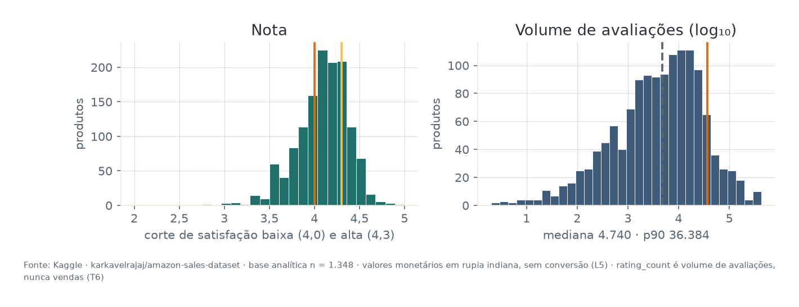

### 4.4 A faixa intermediária: 539 produtos que precisam de nome

Fechados os dois cortes, a base analítica se parte em três — e a reconciliação é obrigatória:

| Faixa de engajamento | Critério | Produtos | % da base analítica |
|---|---|---|---|
| Alto | ≥ 36.384 | 136 | 10,1% |
| **Intermediário** | 4.740 ≤ x < 36.384 | **539** | **40,0%** |
| Baixo | < 4.740 | 673 | 49,9% |
| **Total** | | **1.348** | **100%** |

136 + 539 + 673 = 1.348 ✅

**Este é o número que surpreende.** Dois cortes bem-comportados — um percentil 90 e uma mediana — deixam **quatro em cada dez produtos do catálogo sem rótulo**. Não são o topo, não são a cauda. Se o dashboard só oferecer os botões "alto engajamento" e "baixo engajamento", o maior bloco isolado do portfólio simplesmente desaparece da conversa — e desaparece silenciosamente, que é o pior modo de desaparecer.

Por isso a faixa recebe nome próprio e entra no filtro como categoria de primeira classe, não como "outros". O nome adotado é **engajamento intermediário**, com a definição sempre visível: *acima da mediana, abaixo do p90*. O rótulo não é enfeite — é o que impede que a soma dos filtros do dashboard seja diferente do total do portfólio, que é o primeiro erro que um avaliador atento procura.

O mesmo fenômeno acontece do lado da satisfação, e vale registrar o paralelo: nota < 4,0 tem 339 produtos e nota ≥ 4,3 tem 418, o que deixa **591 produtos (43,8%) na faixa 4,0–4,29** (`tab06_corpus`). 339 + 591 + 418 = 1.348 ✅.

**Alternativa descartada:** dividir engajamento em tercis (três blocos de ~33%) resolveria a nomenclatura de uma vez. Foi recusada porque os tercis não têm leitura de negócio: o limite superior do tercil não é "o topo do catálogo", é um artefato de contagem. Mediana e p90 respondem a perguntas que uma liderança faz em voz alta — *está acima da metade?* e *está entre os 10% mais avaliados?*. Tercil não responde a nenhuma.

---

### 4.5 Satisfação: por que 4,0 e por que 4,3

O corte de satisfação baixa é **fixo em 4,0** — número redondo, legível por qualquer pessoa, e que coincide quase exatamente com a mediana medida da nota (4,10). Ele isola **339 produtos, 25,1% do portfólio**: um quarto do catálogo. Não é uma cauda excêntrica, é um bloco que exige decisão.

O 4,0 tem uma segunda função, e ela é decisiva para a coerência do trabalho: é **o mesmo limiar usado como alvo do ML2** (`rating` < 4,0). Não existe critério paralelo — o modelo de atributos associados à baixa satisfação e o filtro do dashboard apontam para exatamente o mesmo conjunto de produtos. Um projeto que usa 4,0 no visual e 3,8 no modelo perde a rastreabilidade inteira em uma pergunta de banca.

O corte de satisfação alta é **4,3 — o p75 da nota** (`tab02`), com 418 produtos (31,0%). Aqui a escolha foi difícil e o trade-off merece registro: o p90 da nota é 4,4, e adotá-lo reduziria o grupo de "satisfação alta" a algo pequeno demais para cruzar com engajamento baixo em Q6. O p75 preserva o cruzamento — **187 produtos candidatos a Q6** — mantendo a exigência num patamar que ainda significa alguma coisa. O 4,3 não é generoso: metade do catálogo está abaixo de 4,10.

**Alternativa descartada:** um índice composto de "qualidade" somando nota, volume e desconto num único número de 0 a 100. Recusada na decisão D-2. Índice composto exige arbitrar pesos, e todo peso arbitrado vira a primeira pergunta da avaliação — sem resposta possível, porque não há variável de resultado na base para calibrar peso nenhum (L4). O projeto usa **matriz 2×2** de volume × nota, com a ordenação interna de cada quadrante feita pela nota corrigida: dois eixos, dois cortes declarados, leitura imediata. Menos elegante, infinitamente mais defensável.

---

### 4.6 Por que corte fixo e não clusterização para definir limiar

Esta é a decisão metodológica mais fácil de errar, e o projeto tem a evidência para defendê-la.

A tentação é óbvia: em vez de arbitrar 36.384 e 4,0, deixar um algoritmo "achar os grupos naturais". O projeto executou exatamente esse teste — a segmentação descritiva de QA7/ML4, k-means sobre preço de tabela (log), desconto, volume (log) e nota, todas padronizadas, semente 42, k testado de 2 a 7. O resultado:

| k | 3 | **4** | 5 | 6 |
|---|---|---|---|---|
| Silhueta | 0,215 | **0,234** | **0,237** | 0,227 |

*(ver **Figura 12**, seção 6.4)*

**A silhueta máxima é 0,237.** Esse número não é um detalhe técnico — é o veredito. Uma silhueta nesse patamar significa que **não há estrutura natural de agrupamento nesta base**: os pontos não se separam, eles formam uma nuvem contínua. Se os grupos não existem, um limiar derivado deles é uma linha desenhada sobre névoa, que muda de lugar a cada mudança de semente, de variável ou de escala.

E muda mesmo. A leitura de "preço" é decisiva na curva: trocando preço de tabela por preço com desconto, a curva achata e o máximo deixa de ter vencedor — k = 5 (0,236) e k = 2 (0,235) empatam dentro do ruído, e o k = 4 adotado (0,232) fica entre os dois. Um limiar de "engajamento alto" que depende de qual coluna de preço entrou no modelo não é um limiar de engajamento.

Daí a **fronteira declarada**: clusterização é **vedada para definir limiar de qualquer conceito univariado**. Relevância, engajamento, visibilidade e satisfação seguem cortes fixos, lidos da distribuição, escritos em uma linha, reproduzíveis em Python, em DAX e em Power Query por qualquer pessoa. A segmentação permanece — mas **apenas em QA7, como convenção descritiva**, e nunca apresentada como descoberta.

*(ver **Figura 9**, seção 5.16)*

A redação obrigatória do k, que aparece sempre que os arquétipos forem exibidos: *a silhueta foi calculada para k de 2 a 7 e atinge o máximo em k = 5 (0,237); adotou-se k = 4 (0,234) por interpretabilidade, com diferença desprezível entre os dois*. Dizer "k escolhido pela silhueta" seria impreciso — e derrubaria o argumento na primeira pergunta.

| Alternativa para definir limiar | Por que foi descartada |
|---|---|
| k-means / clusterização | silhueta ≤ 0,237: não há estrutura natural; limiar instável a semente e a escolha de variável |
| Quebras naturais (Jenks) | mesma fragilidade da clusterização, sem métrica de qualidade publicável |
| Média ± desvio-padrão | `rating_count` é assimétrico (mediana 4.740 · máx 426.973); a média não descreve a distribuição |
| Tercis / quartis puros | sem leitura de negócio; o limite não responde a nenhuma pergunta de liderança |
| Índice composto ponderado | exige arbitrar pesos sem variável de resultado para calibrá-los (L4, D-2) |
| **Percentil e mediana declarados** | **adotado — estável, reprodutível, explicável em uma frase** |

---

### 4.7 O piso amostral n ≥ 30 e a exceção que o salva

**A regra (T2):** nenhum grupo agregado — categoria, subcategoria, faixa ou cluster — com **n < 30** é ranqueado ou comparado. A supressão é declarada no rodapé do visual, nunca silenciosa.

O motivo está na tabela de categorias e é brutal:

| Categoria de nível 1 | Produtos | Situação |
|---|---|---|
| Electronics | 490 | acima do piso |
| Home & Kitchen | 447 | acima do piso |
| Computers & Accessories | 373 | acima do piso |
| Office Products | **31** | acima do piso, **no limite** |
| Musical Instruments · Home Improvement | 2 · 2 | abaixo do piso |
| Toys & Games · Health & Personal Care · Car & Motorbike | 1 · 1 · 1 | abaixo do piso |

490 + 447 + 373 + 31 + 7 = **1.348** ✅ (`tab04_categorias`)

*(ver **Figura 5**, seção 5.5)*

Sem o piso, "Car & Motorbike" — **um único produto** — apareceria num ranking de categorias com a nota desse produto como se fosse o desempenho de uma família inteira. É o erro mais comum e mais caro deste tipo de dashboard: um slide inteiro construído sobre n = 1.

Com o piso, a consequência precisa ser dita sem eufemismo (L3): **"análise por categoria" significa, na prática, três famílias mais uma no limite**, cobrindo 97,2% do portfólio. Office Products, com 31 produtos, passa por um produto de margem — e sempre aparece com o n ao lado, porque a diferença entre 31 e 29 é a diferença entre estar e não estar no gráfico.

O piso vale em todas as agregações, e nas três que importam ele foi verificado:

- **Subcategorias de nível 2:** 8 grupos acima do piso, cobrindo **88,3%** dos produtos. As demais ficam fora da comparação de dispersão (§5.17).
- **Faixas de desconto (QA1):** todas as cinco passam — 175 · 329 · 469 · 324 · 51 (`tab08_faixas_desconto`). A mais estreita, 81–100%, tem n = 51: acima do piso, mas exibida sempre com o n, porque é a faixa em que a nota corrigida cai para 3,906, a menor das cinco.
- **Arquétipos (QA7):** os quatro grupos têm n entre 268 e 447 (`tab05_arquetipos`), todos folgadamente acima do piso.

*(ver **Figura 10**, seção 5.17)*

*(ver **Figura 7**, seção 5.10)*

#### A exceção — e por que ela é indispensável

**Listas nominais de produtos não são grupos agregados e não estão sujeitas ao piso.** Q5 (19 produtos), Q6 (187 produtos) e QA5 (os 19 produtos de Q5, 147 avaliações) exibem o *n* de avaliações **produto a produto**, e por isso podem ser publicadas.

Sem essa segunda frase escrita na regra, a T2 se autodestrói: ela eliminaria, por engano, o achado de ação mais **imediata** do trabalho — os **19 produtos de alto engajamento com nota abaixo de 4,0**, que é a resposta direta a uma das oito perguntas do enunciado.

A distinção lógica é simples e vale a pena dizê-la em voz alta na defesa: o piso de 30 existe para proteger contra **estatística de grupo instável** — uma média de 1 produto não é média. Uma lista nominal não calcula média nenhuma; ela **nomeia produtos individuais**, cada um com seu próprio volume de avaliações exposto. O risco que o piso combate não existe ali. Aplicar o piso a listas nominais seria aplicar o remédio certo à doença errada.

---

### 4.8 O corte não basta: correção de variância (T1)

Um corte separa; ele não ordena. No momento em que o dashboard ordena produtos por nota, o corte precisa de um companheiro obrigatório.

**T1:** todo ranking por nota usa **limite inferior de Wilson a 95%**, com o *n* de avaliações exibido ao lado. Sem correção, um produto com 5 avaliações e nota 5,0 lidera o ranking de "melhores produtos" — e a lista inteira vira uma lista de produtos pouco avaliados, exatamente o oposto do que ela promete.

A escolha entre Wilson e média bayesiana foi decidida (D-3) a favor de **Wilson**, por um motivo prático: a média bayesiana exige arbitrar um *prior*, e todo *prior* arbitrado vira pergunta na banca sem resposta objetiva. Wilson não pede nada além do n e da proporção.

O efeito é visível em QA1: na faixa 0–20% de desconto, a nota mediana é 4,2 e a nota corrigida por Wilson é 4,136; na faixa 81–100%, a nota mediana é 4,0 e a corrigida cai para 3,906 (`tab08`). A ordenação não muda, mas a **distância entre as faixas muda** — e é a distância, não a ordem, que sustenta ou derruba uma recomendação comercial. Sobre a leitura dessa mesma faixa: desconto mais alto **está associado** a nota menor (ρ = −0,150 · p = 3,1e-08 · n = 1.348, `tab03` — o par medido é desconto × **nota bruta**) — associação significativa e de **magnitude pequena** (T4, T5). Nada aqui afirma que o desconto produz a nota.

---

### 4.9 Quadro-resumo dos cortes e suas alternativas

| Conceito | Corte adotado | Valor | Principal alternativa descartada | Motivo do descarte |
|---|---|---|---|---|
| Engajamento alto | p90 de `rating_count` | 36.384 | p80 (270 produtos) · p95 (68) | p80 não é lista de ação; p95 reduz Q5 a 8 produtos |
| Engajamento baixo | mediana de `rating_count` | 4.740 | média | distribuição assimétrica (máx. 426.973); a média não descreve |
| Engajamento intermediário | faixa residual nomeada | 539 produtos · 40,0% | deixar sem rótulo ("outros") | 40% do portfólio sumiria do filtro sem aviso |
| Satisfação baixa | `rating` < 4,0 | 339 · 25,1% | p25 da nota (3,9) | 4,0 é legível e é o mesmo alvo do ML2 — um único limiar no projeto |
| Satisfação alta | `rating` ≥ 4,3 (p75) | 418 · 31,0% | p90 da nota (4,4) | esvaziaria o cruzamento de Q6 (187 candidatos) |
| Definição de limiar | percentil/mediana fixos | — | clusterização | silhueta ≤ 0,237: sem estrutura natural; limiar instável |
| Piso de grupo | n ≥ 30 | — | sem piso · piso em 50 | sem piso, n = 1 vira categoria; em 50, Office Products (31) cairia |
| Exceção ao piso | listas nominais (Q5, Q6, QA5) | — | aplicar o piso a tudo | eliminaria por engano o quadrante de 19 produtos |
| Ordenação por nota | Wilson 95% | — | média bayesiana | exige arbitrar *prior*, indefensável em banca |

---

### 4.10 Checagem de consistência

Os cortes desta seção fecham por soma, e a soma é a prova:

| Checagem | Conta | Resultado |
|---|---|---|
| Faixas de engajamento | 136 + 539 + 673 | 1.348 ✅ |
| Faixas de satisfação | 339 + 591 + 418 | 1.348 ✅ |
| Categorias de nível 1 | 490 + 447 + 373 + 31 + 7 | 1.348 ✅ |
| Arquétipos QA7 | soma dos 4 grupos | 1.348 ✅ |

Quatro particionamentos independentes da mesma base analítica, todos fechando em 1.348. Não é decoração: é a evidência de que nenhum produto foi contado duas vezes nem perdido entre um filtro e outro — o que é exatamente o que um piso amostral e um conjunto de cortes bem definidos existem para garantir.


---

## 5. Análises — as 14 Perguntas

### 5.1 O contrato de leitura desta seção

O enunciado apresenta oito perguntas e diz, textualmente, que são **apenas sugestões**. O projeto tomou a decisão oposta à mais confortável: tratou as perguntas do enunciado como obrigatórias — inclusive as que terminam em conclusão negativa — e acrescentou perguntas próprias, numeradas com o prefixo QA. Esta seção traz as **14** cuja resposta aparece por inteiro no dashboard entregue: sete do enunciado e sete do grupo.

A justificativa é simples: o critério de avaliação **Análise** pede "capacidade de identificar padrões e oportunidades". Uma pergunta respondida com "não há associação" identifica um padrão — a ausência de relação entre preço e satisfação é um resultado, não uma falha. O que não pontua é a pergunta silenciada.

Antes dos resultados, cinco compromissos que valem para cada um dos parágrafos abaixo:

| Regra | O que significa nesta seção |
|---|---|
| **T3** | Todo número declara base e *n*. Cinco bases convivem no projeto (1.465 · 1.351 · 1.350 · 1.349 · 1.348). A **base analítica, n = 1.348**, é o padrão; quando outra aparece, está escrito |
| **T4** | Nenhuma frase afirma causa. Correlação e importância de variável indicam **associação**. "Desconto alto está associado a nota menor" é defensável; "provoca" não é |
| **T5** | Magnitude sempre ao lado da significância. Com n = 1.348 um coeficiente cruza o limiar de p < 0,05 sendo pequeno demais para decidir qualquer coisa — e isso é dito na mesma frase |
| **T6** | `rating_count` é **volume de avaliações**. Nunca vendas, receita, demanda ou popularidade real |
| **T2** | Nenhum grupo agregado com n < 30 é ranqueado ou comparado. **Listas nominais de produtos não são grupos agregados** e não estão sujeitas ao piso |

**A analogia para quem não é técnico.** A base é a vitrine de uma loja, fotografada uma única vez. Dá para contar quantos produtos há na prateleira, ler a etiqueta de preço, ver a nota e contar quantas pessoas deixaram comentário. Não dá para saber quantas unidades saíram, quanto a loja faturou, nem o que aconteceu no mês passado. Todas as catorze perguntas foram formuladas para caber dentro dessa fotografia.

### 5.2 Mapa das 14 perguntas

| # | Pergunta | Evidência | Situação |
|---|---|---|---|
| Q1 | Categorias e produtos de maior relevância | fig05 · tab04 · tab17 | ✅ respondida — **matriz de relevância** (D-2 fechada): Âncora 41 · Risco 19 · Subexplorado 187 · Cauda frágil 227 |
| Q3 | Relação entre descontos e avaliações | fig04 · tab03 | respondida — ρ = −0,150 · p = 3,14e-08 |
| Q4 | Categorias de maior e menor satisfação | fig05 · fig09 · fig11 · tab04 | respondida **com escopo reduzido** — 4 categorias elegíveis |
| Q5 | Alto engajamento e baixa avaliação | fig06 | respondida — **19 produtos** |
| Q6 | Boa avaliação e pouca visibilidade | fig06 | ✅ respondida (D-1 fechada) — **187** candidatos por nota bruta · **61** após Wilson, a lista acionável |
| Q7 | Padrões nas avaliações dos consumidores | tab06 · tab14 · fig12 | respondida — contraste de TF-IDF em Electronics: **som** na nota baixa, **imagem** na alta (§5.8) |
| Q8 | Oportunidades e riscos | consolida as demais | respondida por síntese |
| QA1 | Faixa de desconto em que nota e volume se sustentam | fig07 · tab08 | respondida |
| QA2 | Quantos produtos concentram 80% das avaliações | fig08 | respondida — **306 = 22,7%** |
| QA3 | Subcategorias de maior dispersão de notas | fig09 · tab16 | respondida — desvio-padrão de **0,346** na climatização contra **0,194** em celulares; 8 grupos, 88,3% de cobertura (§5.12) |
| QA4 | O preço de tabela explica a satisfação | fig04 · tab03 · tab24 | respondida — **não há associação**; e o preço de tabela não acompanha o desconto (§5.13) |
| QA5 | Temas de reclamação em alto engajamento e baixa nota | fig06 · tab19 · tab23 | ✅ respondida — leitura dirigida dos 19 executada (§7.6), com a composição medida e a lista nominal publicada |
| QA6 | O topo do ranking merece estar lá | fig07 · tab08 | ✅ respondida — Wilson 95% (D-3) **aplicado ao ranking do dashboard**: top 10 por nota bruta ao lado do top 10 corrigido |
| QA7 | Arquétipos comerciais | fig13 · fig10 · tab05 | respondida — k = 4 |

---

### 5.3 Q1 · Quais categorias e produtos apresentam maior relevância?

**Estado: respondida.** A definição de relevância foi fechada em 24/09/2026 (§5.18). O que segue documenta as alternativas consideradas e por que a matriz venceu.

"Relevância" não é uma variável da base. É um conceito que precisava ser **definido** antes de ser medido — a decisão **D-2**, reservada ao responsável pelo projeto e **fechada em 24/09/2026**. Publicar um ranking de relevância sem essa definição seria construir um índice composto por conveniência e chamá-lo de resultado, e o projeto preferiu esperar a decisão a improvisar o critério.

**A alternativa descartada, e por quê.** A saída mais rápida seria um índice composto — algo como `volume × nota × (1 − desconto)`, normalizado. Foi recusada por um motivo que qualquer avaliador encontra em quinze segundos: **todo peso de um índice composto é arbitrário, e todo peso arbitrário vira pergunta na banca**. "Por que volume pesa 40% e nota 30%?" não tem resposta defensável. O índice ganha uma casa decimal e perde a possibilidade de ser explicado.

**A decisão adotada** é não criar índice: usar **matriz 2×2 de volume × nota** (cortes p90/mediana e 4,0/4,3), com a ordenação **dentro de cada quadrante** feita pela nota corrigida de Wilson para produtos, e três colunas independentes para categorias. A matriz não pondera nada — mostra as duas dimensões lado a lado e deixa a priorização para quem decide. É exatamente o que a `fig06` já entrega.

**A estrutura do portfólio, que nunca dependeu da fórmula.** Ela estava medida antes de D-2 fechar, e é a metade de Q1 que responde "quais categorias":

*(ver **Figura 5**, seção 5.5)*

| Categoria nível 1 | Produtos | Acima do piso |
|---|---|---|
| Electronics | 490 | sim |
| Home & Kitchen | 447 | sim |
| Computers & Accessories | 373 | sim |
| Office Products | 31 | sim, no limite |
| Musical Instruments · Home Improvement · Toys & Games · Health & Personal Care · Car & Motorbike | **7 em 5 categorias** | **não** |

*Base analítica, n = 1.348. Reconciliação: 490 + 447 + 373 + 31 + 7 = 1.348.*

**O número que surpreende:** 97,2% do portfólio está em **três famílias**. Quem abre o dashboard esperando "análise de categorias" encontra, na prática, três categorias mais uma no limite amostral. Office Products, com 31 produtos, passa no piso por **um produto**. Essa fragilidade entra declarada no rodapé, não escondida na média.

---

### 5.4 Q3 · Existe relação entre descontos e avaliações?

**Estado: respondida. Sim, existe — e é pequena. As duas metades da frase são obrigatórias.**

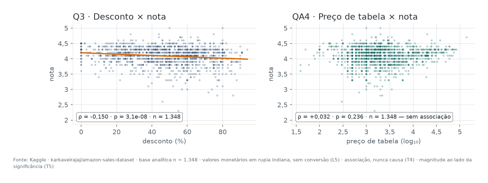

| Par | ρ (Spearman) | p | n | Leitura |
|---|---|---|---|---|
| **Desconto × nota** | **−0,150** | 3,14e-08 | 1.348 | significativa, magnitude pequena |
| Desconto × engajamento | −0,132 | 1,12e-06 | 1.348 | significativa, magnitude pequena |
| Engajamento × nota | +0,193 | 8,29e-13 | 1.348 | significativa, magnitude pequena |

*Fonte: tab03_correlacoes.csv · base analítica, n = 1.348.*

**Por que Spearman e não Pearson.** Preço e volume de avaliações têm caudas longas e assimétricas — o máximo de preço é 139.900 contra uma mediana de 1.795, e o de avaliações é 426.973 contra 4.740. Pearson mede associação **linear** e, sob distribuições desse formato, o coeficiente passa a ser governado por algumas dezenas de extremos. Spearman trabalha sobre postos: mede se a ordem sobe junto, e não se a reta se ajusta. A alternativa Pearson foi descartada por fragilidade a outlier, não por preferência metodológica.

**A leitura correta de ρ = −0,150 com p = 3,14e-08.** O p-valor diz que a associação **não é ruído amostral**. Ele não diz que a associação é grande. Com n = 1.348, o teste tem potência suficiente para declarar significativo um efeito que não muda decisão nenhuma. Em termos de variância compartilhada, ρ = −0,150 corresponde a cerca de **2% da variação dos postos de nota** compartilhada com os postos de desconto. Os 98% restantes não são compartilhados com o desconto — e esta seção não afirma com o que são, porque não mediu.

Dito para a liderança: **existe uma inclinação, e ela é rasa.** Se alguém apontar dois produtos, um com 30% e outro com 70% de desconto, e perguntar qual tem a nota maior, o coeficiente não autoriza chutar. Se alguém olhar mil produtos de cada lado, a diferença média aparece.

**A frase que este projeto nunca escreve:** "descontos agressivos derrubam a nota". Não há desenho experimental aqui, não há ordem temporal entre desconto e avaliação nos dados, e não há controle de categoria. O que existe é uma **associação negativa fraca**, medida, publicada com magnitude e significância lado a lado (T5), e sem verbo causal (T4). A `fig04` carrega essa declaração no próprio rodapé.

**Um resultado colateral que vale mais do que parece:** desconto × engajamento dá **ρ = −0,132**. Desconto mais profundo **não** acompanha volume maior de avaliações. Se a hipótese comercial implícita fosse "desconto atrai atenção", a base não a sustenta — o sinal medido aponta na direção contrária, e continua pequeno.

---

### 5.5 Q4 · Quais categorias apresentam maior ou menor satisfação?

**Estado: respondida com escopo reduzido e declarado.**

Esta é a pergunta do enunciado em que a regra T2 mais morde. Das 9 categorias de nível 1, **apenas 4 têm 30 produtos ou mais**. As outras 5 somam **7 produtos**. Um ranking de satisfação por categoria que incluísse Car & Motorbike (1 produto) colocaria a nota de um único item competindo com a mediana de 490.

**A alternativa descartada foi agrupar as pequenas em "Outros".** Parece elegante e resolve o piso amostral com um clique. Foi recusada porque o balde "Outros" com 7 produtos de 5 famílias sem nada em comum — instrumento musical, material de construção, brinquedo, saúde e acessório automotivo — não é um grupo interpretável. Um grupo cuja média não significa nada é pior do que um grupo suprimido, porque o suprimido está declarado e o balde parece um resultado.

**O que a decisão custa, dito na cara:** a resposta de Q4 vale para **três famílias de produto mais uma no limite amostral**. Nenhuma recomendação se estende às categorias suprimidas. Isso é a limitação L3, e ela aparece no rodapé do dashboard e na página de Recomendações.

**O que foi medido, apesar do escopo reduzido.** Três evidências convergentes:

1. **Elegibilidade e tamanho** (`fig05`, tab04): Electronics 490 · Home & Kitchen 447 · Computers & Accessories 373 · Office Products 31.
2. **A satisfação varia mais dentro do que entre famílias** — é o que mostra a tabela das oito subcategorias, na seção 5.17, e ela reposiciona Q4: comparar Electronics com Home & Kitchen esconde que a dispersão relevante está um nível abaixo, na subcategoria.
3. **A categoria carrega informação sobre baixa satisfação, e isso é mensurável.** No ML2, o bloco de preditores comerciais isolado alcança AUC 0,583; acrescentar a categoria de nível 1 eleva a métrica para **0,658** (tab07). O salto de 0,075 é a evidência quantitativa de que a família do produto está associada ao risco de nota abaixo de 4,0 — sem que isso autorize dizer que a categoria *causa* a nota.

*(ver **Figura 11**, seção 6.3)*

*Fonte: tab07_ml2_blocos.csv · base analítica, n = 1.348 · validação cruzada em 5 partes, barra = desvio entre partições.*

---

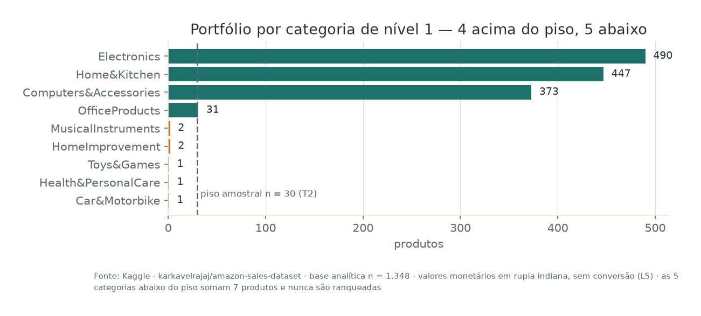

### 5.6 Q5 · Existem produtos com alto engajamento e baixa avaliação?

**Estado: respondida. Sim — 19 produtos.**

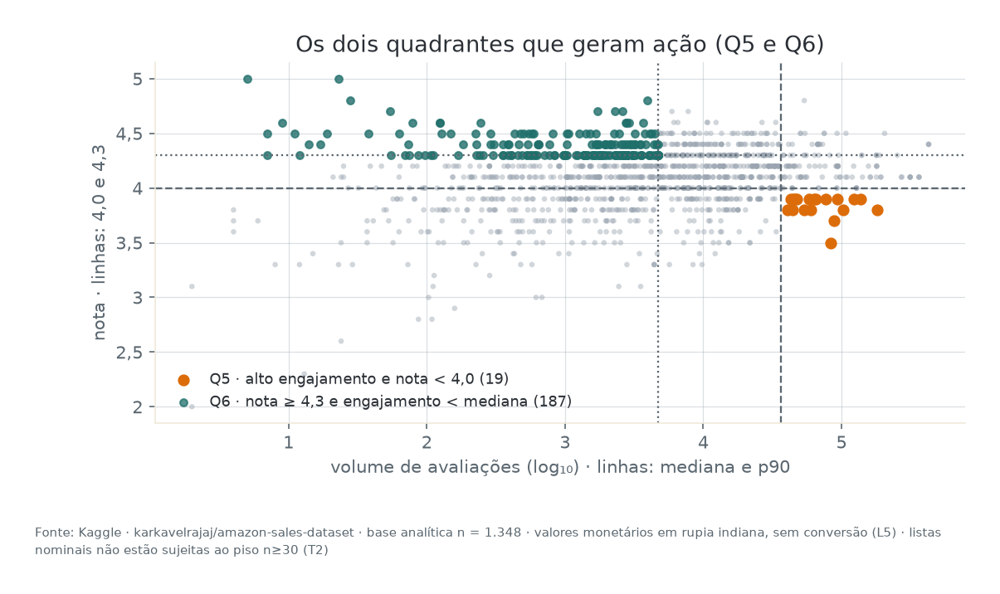

Regra: `rating_count ≥ 36.384` (p90) **e** `rating < 4,0`. Resultado: **19 produtos**, base analítica, n = 1.348.

**Por que este é o quadrante de ação mais imediata das catorze perguntas.** São produtos no decil superior de volume de avaliações — proxy declarado de exposição (D-1) — e que estão abaixo do limiar de satisfação. Não é um problema de exposição; é um problema de produto ou de expectativa. E são **dezenove**, um número que cabe numa reunião: dá para listar nome a nome, abrir a página de cada um e ler o que os clientes escreveram. Nenhum outro resultado deste projeto entrega uma lista desse tamanho.

**A regra T2 quase matou este achado, e a segunda frase da regra o salvou.** Um grupo de 19 está abaixo do piso de 30. Se T2 fosse lida ao pé da letra, o quadrante inteiro seria suprimido. Por isso a regra foi redigida com uma cláusula explícita: **listas nominais de produtos não são grupos agregados** e não estão sujeitas ao piso — elas exibem o *n* de avaliações produto a produto, e nenhuma média de grupo é publicada. O piso existe para impedir que a média de 5 produtos vire ranking, não para impedir que 19 produtos sejam nomeados.

**O material textual que esse quadrante gera:** 19 produtos, **147 avaliações** em 19 blocos, **49,5 mil caracteres de `review_content`** (53,1 mil contando os títulos, que é a unidade do pipeline de texto). É o corpus da QA5 (seção 5.14), e o tamanho dele é a razão de QA5 usar leitura dirigida em vez de TF-IDF.

**Alternativa descartada — coluna de probabilidade de risco por produto.** A formulação inicial do ML2 previa uma pontuação de risco por item. Foi revogada. Um modelo com AUC de 0,70 ± 0,01 tem poder de discriminação **moderado**: publicar "este produto tem 73% de chance de ser mal avaliado" veste uma incerteza grande com a roupa de uma previsão precisa. O ML2 entrega a **escada de AUC por bloco de preditores** — o quanto cada grupo de atributos está associado ao risco — e a lista nominal fica com o quadrante, onde é fato observado e não estimativa.

---

### 5.7 Q6 · Existem produtos com boa avaliação, mas pouca visibilidade?

**Estado: respondida.** O rótulo de visibilidade foi fechado em 24/09/2026 como **proxy declarado** (§5.18).

O problema é de vocabulário, e ele é real. "Visibilidade" — quantas pessoas **viram** o produto — exige impressões ou cliques. **A base não tem nenhum dos dois.** O que existe é `rating_count`, que já foi batizado de "engajamento". Usar a mesma variável para os dois conceitos e não dizer nada é o erro que a **D-1** existe para impedir: dois rótulos de negócio distintos apoiados na mesma coluna, sem declaração.

**A decisão adotada** foi unificar e declarar o limite: volume de avaliações como ***proxy* declarado** de exposição, dizendo em voz alta que visibilidade real não existe na base. Fica **vedado** escrever "baixa visibilidade" em visual, slide ou frame; o rótulo publicado é *"bem avaliados com baixo volume de avaliações"*.

**Duas contagens, e a segunda é a que se recomenda.** Aplicando o proxy — `rating ≥ 4,3` **e** `rating_count < 4.740` (mediana) — o resultado é **187 produtos**: é o **funil de triagem**, o grupo azulado da `fig06`. Mas T1 exige nota corrigida em todo ranking, e uma lista de oportunidades é um ranking: aplicando Wilson, **126 caem e restam 61**. Os 61 são a **lista acionável**, publicada nominalmente em `02_results/tables/tab20_q6_acionavel_nominal.csv` e materializada como medida **M22** no catálogo DAX. O detalhamento está em §5.18.

**Por que o corte de visibilidade é a mediana e o de engajamento alto é o p90.** Não é inconsistência; é assimetria proposital. Para *sinalizar risco* (Q5) o corte precisa ser exigente — o p90 seleciona o décimo superior, e 19 produtos cabem numa reunião. Para *encontrar oportunidade* (Q6) o corte precisa ser generoso — a mediana devolve um funil de 187 candidatos a triagem, não uma lista final. Cortes com propósitos opostos não têm por que ter a mesma severidade, desde que ambos estejam declarados no visual. Estão.

**O que 187 produtos significam e o que não significam.** Significa: existe um conjunto não trivial de produtos bem avaliados com pouco volume de avaliação. Não significa: que exista demanda reprimida, que promovê-los gere receita, ou que "pouca visibilidade" seja a causa do pouco volume. Sem variável de venda (L4), qualquer uma dessas três frases é extrapolação.

---

### 5.8 Q7 · Quais padrões podem ser identificados nas avaliações dos consumidores?

**Estado: respondida, no recorte Electronics.** É a página 4 do dashboard, no gráfico *"Som aparece onde a nota é baixa; imagem, onde é alta"*.

**Antes dos temas, o tamanho do corpus — e ele é parte da resposta.** Cada produto traz um bloco de até 8 avaliações, rotulado pela nota do produto (T8). As 10.588 referências de avaliação caem para **9.255 reviews distintos** depois da deduplicação por `review_id` (§7.3):

| Faixa de satisfação | Blocos (= produtos) | Reviews distintos |
|---|---|---|
| baixa (nota < 4,0) | 339 | 2.502 |
| média (4,0 a 4,29) | 591 | 3.875 |
| alta (nota ≥ 4,3) | 418 | 2.878 |
| **Total** | **1.348** | **9.255** |

*Fonte: `02_results/tables/tab06_corpus.csv` · base analítica, n = 1.348 · unidade: bloco de review (T8).*

*(ver **Figura 13**, seção 7.3)*

**Por que contraste, e não frequência.** Os termos mais frequentes são praticamente os mesmos nas três faixas: `good` aparece em 93% dos blocos de nota < 4,0. É consequência direta de **L1**: a vitrine mostra até 8 avaliações escolhidas pelo marketplace, e esse recorte é elogioso por construção. Publicar "os clientes valorizam qualidade e preço" a partir dessa contagem seria descrever o viés da vitrine. O que se mede, por isso, é **contraste**: a diferença de TF-IDF médio de cada termo entre os blocos de nota < 4,0 e os de nota ≥ 4,3. Δ positivo = mais característico da nota baixa; Δ negativo = da nota alta.

**Por que Electronics.** Sobre a base inteira, o contraste mistura famílias de vocabulário incompatível — cabo, aquecedor e liquidificador não disputam os mesmos termos — e o sinal se dilui: `remote` cai de +0,0349 para +0,0162. Electronics é a maior família do catálogo (490 produtos), com **128 blocos** de nota < 4,0 e **136** de nota ≥ 4,3 — massa suficiente dos dois lados. Os temas abaixo valem para Electronics, e não para o catálogo inteiro; a `tab14` publica os dois recortes, na coluna `recorte`.

**Os oito termos de cada lado, como o dashboard os mostra:**

| Termo (nota < 4,0) | Δ TF-IDF | Leitura |
|---|---|---|
| `remote` | +0,0349 | controle remoto |
| `bass` | +0,0328 | **som** |
| `original` | +0,0291 | peça genuína, autenticidade |
| `buttons` | +0,0247 | controles físicos |
| `working` | +0,0234 | funcionamento |
| `noise` | +0,0225 | **som** |
| `properly` | +0,0212 | funcionamento |
| `ear` | +0,0207 | **som** |

| Termo (nota ≥ 4,3) | Δ TF-IDF | Leitura |
|---|---|---|
| `cable` | −0,0300 | cabo |
| `picture` | −0,0233 | **imagem** |
| `excellent` | −0,0233 | avaliação geral |
| `service` | −0,0217 | atendimento |
| `speed` | −0,0213 | velocidade |
| `installation` | −0,0213 | instalação |
| `fast` | −0,0209 | velocidade |
| `hdmi` | −0,0207 | **imagem**, conexão |

*Fonte: `02_results/tables/tab14_ngramas.csv`, `secao = contraste`, `recorte = Electronics` · 128 blocos de nota < 4,0 e 136 de nota ≥ 4,3 · unidade: bloco de review (T8).*

**A leitura.** Na nota baixa aparecem três assuntos: **som** (`bass`, `noise`, `ear`), **funcionamento** (`working`, `properly`) e **controle remoto**, inclusive peça não original (`remote`, `original`, `buttons`). Na nota alta: **imagem** (`picture`, `hdmi`), **velocidade** (`speed`, `fast`), **instalação** e **atendimento**. O título do gráfico resume o contraste mais nítido: som aparece onde a nota é baixa; imagem, onde é alta.

**`working` pede cuidado.** O termo isolado é ambíguo: aparece tanto em "não está funcionando" quanto em "está funcionando". O Δ diz só que ele é mais característico da faixa baixa, e por isso é lido junto com `properly`, como tema de funcionamento — não como prova de defeito.

**TF-IDF vale aqui e é vedado em QA5.** As duas decisões coexistem; o que muda é o tamanho do corpus. Aqui são 128 e 136 blocos. Em QA5 são 19, e com 19 documentos um termo que aparece em dois blocos recebe peso alto sem ser tema (§7.6).

**O que estes termos não autorizam a dizer.**

- **Não são "a voz do cliente".** São os temas visíveis em até 8 avaliações por produto, escolhidas pelo marketplace (L1).
- **Não são causa.** `bass` estar associado à nota baixa não quer dizer que o som cause a insatisfação; quer dizer que quem escreveu sobre som estava, com mais frequência, num produto mal avaliado (T4).
- **Não confirmam sozinhos o achado dos fones.** Mais da metade dos fones (52,4%) está na faixa baixa, e o eixo de som aparece no contraste em boa parte por isso: é a mesma medição vista de outro ângulo, não uma segunda prova (§5.17).
- **A magnitude é pequena.** Os Δ ficam entre 0,02 e 0,035: ordenam os temas, não medem intensidade de sentimento (T5).
- **Não são exaustivos.** O pipeline descarta tokens não latinos (L2).

**Ficha de reprodução — ML3.** Notebook `01_notebooks/05_nlp` · pipeline: remoção de URLs → remoção de tokens não latinos → stopwords em inglês → n-gramas de 1 a 3 termos presentes em pelo menos 10 blocos (`min_df = 10`) → TF-IDF com `sublinear_tf` → diferença da média de TF-IDF entre as faixas · saída: `02_results/tables/tab14_ngramas.csv`.

---

### 5.9 Q8 · Quais oportunidades ou riscos podem ser identificados para o negócio?

**Estado: respondida por consolidação.**

Q8 não tem medição própria. Ela amarra as outras treze — e a amarração só é honesta porque cada peça já declarou sua base, sua magnitude e seu limite.

| Sinal | Evidência | Onde está | Leitura |
|---|---|---|---|
| **Risco — atenção concentrada e nota baixa** | 19 produtos | Q5 · fig06 | décimo superior de volume, abaixo de 4,0. Lista nominal, acionável em uma reunião |
| **Risco — desconto profundo sem tração** | arquétipo B: 335 produtos, desconto mediano 58%, **468 avaliações medianas**, nota mediana **3,9** | QA7 · tab05 | único arquétipo abaixo do limiar de satisfação. Candidato natural a revisão de sortimento |
| **Risco — fragilidade da base de comparação** | 4 categorias acima do piso, 5 somando 7 produtos | Q4 · L3 | "análise por categoria" significa três famílias mais uma no limite |
| **Risco — dependência de poucos itens** | **306 produtos = 22,7%** concentram 80% das avaliações | QA2 · fig08 | a atenção do consumidor está concentrada em menos de um quarto do catálogo |
| **Risco — insatisfação com endereço** | fones **52,4%** e climatização **37,9%** abaixo de 4,0, contra 25,1% da base | Q4 · QA3 · tab16 | as duas subcategorias concentram a insatisfação; a revisão começa por elas |
| **Oportunidade — bem avaliados com pouco volume** | **61 produtos** acionáveis (de um funil de 187) | Q6 · fig06 · tab20 | os 187 são triagem; os 61 sobrevivem à correção de Wilson e formam a lista nominal publicada |
| **Oportunidade — faixa comercial que se sustenta** | 21–40%: nota corrigida 4,083 e **maior volume mediano (7.241)** | QA1 · tab08 | a única faixa que combina nota alta e volume alto |

**O teto do que pode ser dito (L4).** A base não contém unidades vendidas, receita, margem, estoque ou data. Nenhuma recomendação deste projeto é expressa em receita, volume vendido ou retorno financeiro — e nenhuma afirmação sobre tendência, sazonalidade ou evolução é possível, porque não há dimensão temporal. A pergunta do enunciado fala em "oportunidades para o negócio"; a resposta devolve **prioridades de investigação com nome e número**, não projeções.

---

### 5.10 QA1 · Existe faixa de desconto em que nota e engajamento se sustentam?

**Estado: respondida. A resposta útil é a negativa.**

Q3 entrega um coeficiente, e coeficiente não vira decisão de preço. QA1 existe para traduzir a associação em faixas operáveis — e para **absorver** uma pergunta anterior do grupo, o teste de um corte em 60% de desconto.

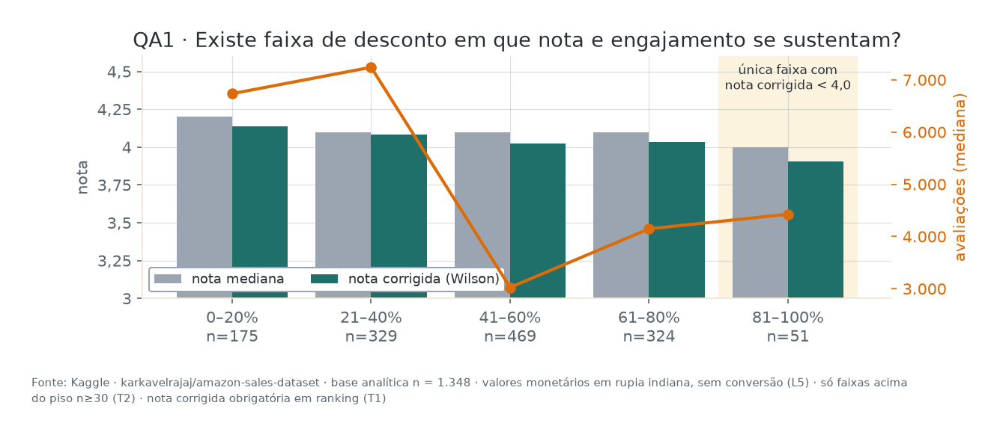

| Faixa de desconto | n | Nota mediana | **Nota corrigida (Wilson)** | Avaliações medianas |
|---|---|---|---|---|
| 0–20% | 175 | 4,2 | **4,136** | 6.736 |
| 21–40% | 329 | 4,1 | **4,083** | **7.241** |
| 41–60% | 469 | 4,1 | **4,025** | 3.025 |
| 61–80% | 324 | 4,1 | **4,035** | 4.147 |
| 81–100% | 51 | 4,0 | **3,906** | 4.426 |

*Fonte: tab08_faixas_desconto.csv · base analítica, n = 1.348 · soma 175 + 329 + 469 + 324 + 51 = 1.348 · todas as faixas acima do piso n ≥ 30 (T2) · nota corrigida obrigatória em ranking (T1).*

**Por que a nota corrigida e não a mediana simples.** Na coluna de mediana, três faixas empatam em 4,1 e o gráfico não decide nada. A correção de Wilson penaliza **cada produto** conforme o volume de avaliações que sustenta a sua nota — e a nota corrigida da faixa é a mediana dessas notas corrigidas —, e o empate se desfaz: 4,083 · 4,025 · 4,035. Sem a correção, a faixa 21–40% e a faixa 41–60% pareceriam idênticas — e elas diferem em 0,058 na medida corrigida e em **4.216 avaliações medianas**.

**O que a tabela responde.** A faixa **21–40%** é a única que combina a segunda maior nota corrigida com o **maior volume mediano** de toda a base. É a melhor candidata a "faixa que se sustenta". Mas a diferença de nota corrigida entre ela e a faixa 0–20% é de **0,053** — magnitude sem leitura de negócio, e isso se diz (T5).

**O achado defensável é o outro extremo.** Acima de 80% de desconto, a nota corrigida cai para **3,906** — a única faixa abaixo do limiar de satisfação de 4,0 — e o volume mediano (4.426) não compensa a queda. A faixa tem n = 51: acima do piso, mas a menor das cinco, e o *n* aparece no eixo da figura.

**Dois números que surpreendem, e por quê.**

1. **O volume não cai com o desconto.** O mínimo de volume mediano não está na faixa mais agressiva — está no **meio**, em 41–60%, com 3.025 avaliações medianas, menos do que a faixa 81–100%. A relação entre desconto e atenção não é monotônica, e qualquer narrativa de "quanto mais desconto, mais gente olha" é desmentida pela própria tabela.
2. **Não há degrau em 60%.** As faixas 41–60% e 61–80% diferem em **0,010** de nota corrigida. O corte de 60% que o grupo pretendia testar **não existe nos dados** — e é exatamente por isso que aquela pergunta foi absorvida por esta, em vez de virar uma pergunta separada com resposta nula.

**A alternativa descartada — faixas por quintil em vez de faixas fixas de 20 p.p.** Quintis dariam grupos de tamanho igual (≈270 cada) e um gráfico mais equilibrado. Foram recusados porque **a faixa de desconto é a linguagem de quem decide preço**: "de 21 a 40%" é uma política comercial; "segundo quintil de desconto" não é. O custo da escolha é o desequilíbrio de n — 469 contra 51 — e ele está impresso no eixo da figura, não escondido.

---

**O que a nota corrigida não mostra, e outro corte do mesmo dado mostra.** A mediana da nota corrigida é plana nas quatro primeiras faixas (de 4,025 a 4,136) e só a faixa acima de 80% cai abaixo de 4,0. Mas o KPI que o próprio projeto usa para insatisfação — a **fatia de produtos abaixo de 4,0** — conta uma história mais graduada:

| Faixa de desconto | n | Abaixo de 4,0 | % da faixa |
|---|---|---|---|
| 0–20% | 175 | 29 | 16,6% |
| 21–40% | 329 | 65 | 19,8% |
| 41–60% | 469 | 133 | 28,4% |
| 61–80% | 324 | 90 | 27,8% |
| 81–100% | 51 | 22 | **43,1%** |

*Fonte: `tab28_faixa_desconto_insatisfacao.csv` · base analítica, n = 1.348 · taxa da base: 25,1% (339 de 1.348) · nota bruta < 4,0.*

Os dois cortes não se contradizem: a mediana mede o **produto típico** da faixa, a fatia mede a **cauda de insatisfação**. A leitura que ambos autorizam é a mesma, e é modesta: *quanto maior o desconto, maior a presença de produtos abaixo de 4,0* — associação coerente com ρ = −0,150, de magnitude pequena (T5), e **não** causa (T4). Duas cautelas: a faixa acima de 80% tem n = 51, e seus 43,1% são 22 produtos; e as faixas de 41–60% e 61–80% estão acima da taxa da base sem formar um degrau entre si. Por isso a recomendação 3 pede **rever a política**, não atribuir ao desconto um efeito.

### 5.11 QA2 · Quantos produtos concentram 80% das avaliações?

**Estado: respondida. 306 produtos — 22,7% da base analítica.**

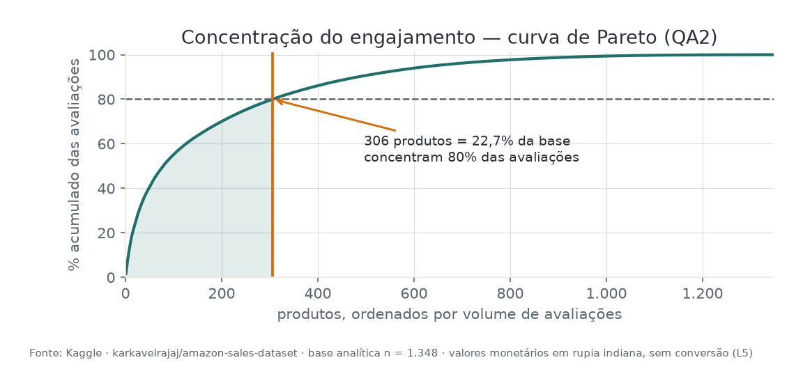

*Base analítica, n = 1.348. Soma de `rating_count` na base analítica: 23.801.471 avaliações.*

**Por que esta pergunta foi criada.** Saber quais produtos têm mais avaliações não diz se a atenção está espalhada ou concentrada — e a resposta muda a natureza da recomendação. Se 80% da atenção estivesse espalhada por 900 produtos, a conversa seria sobre portfólio. Estando em 306, a conversa é sobre um núcleo que dá para gerenciar item a item.

**E o resultado surpreende por ser pouco extremo.** A regra de bolso 80/20 preveria ~20%. O medido é **22,7%** — perto o bastante para que a intuição funcione, mas medido em vez de presumido. A diferença entre citar "80/20" e citar "306 produtos, 22,7%, base analítica n = 1.348" é a diferença entre um clichê e um resultado.

**O que 306 não é.** Não são os 306 produtos mais vendidos, nem os mais lucrativos, nem os mais populares. São os 306 com **maior volume de avaliações** (T6). A distinção não é preciosismo: um produto barato e muito comentado e um produto caro e pouco comentado podem ter receitas invertidas, e a base não permite saber.


**Onde está a insatisfação dentro dos 306.** Dos 306 produtos que concentram 80% das avaliações, **39 (12,7%)** têm nota abaixo de 4,0 — cerca de **metade da taxa da base** (339 de 1.348, 25,1%). O risco de reputação está concentrado e é pequeno, e por isso tratável: são esses 39, e dentro deles os **19 de Q5**, que estão todos entre os 306.

*Base analítica, n = 1.348 · subconjunto Pareto, n = 306 · `00_data/gold/base_analitica.csv`, colunas `pareto_80` e `nota`.*
---

### 5.12 QA3 · Quais subcategorias têm maior dispersão de notas?

**Estado: respondida. 8 subcategorias acima do piso, cobrindo 88,3% dos produtos.** É a página 2a do dashboard: o gráfico *"A dispersão quase dobra entre a primeira e a última subcategoria"* e a tabela das 8 subcategorias com *n*, desvio-padrão, IQR e % abaixo de 4,0.

Esta pergunta é a correção de rota de Q4. Comparar **médias** entre categorias esconde o que interessa: dentro de uma mesma família, a experiência do cliente é homogênea ou irregular? Uma subcategoria com nota mediana 4,1 e desvio 0,35 tem um problema de **consistência**; uma com 4,1 e desvio 0,19 está num patamar.

| Subcategoria (nível 2) | *n* | Desvio-padrão da nota |
|---|---|---|
| Home & Kitchen \| Heating, Cooling & Air Quality | 116 | **0,346** |
| Home & Kitchen \| Kitchen & Home Appliances | 307 | 0,336 |
| Electronics \| Wearable Technology | 62 | 0,326 |
| Electronics \| Home Theater, TV & Video | 156 | 0,310 |
| Computers & Acc. \| Networking Devices | 30 | 0,276 |
| Computers & Acc. \| Accessories & Peripherals | 305 | 0,258 |
| Electronics \| Headphones, Earbuds & Acc. | 63 | 0,224 |
| Electronics \| Mobiles & Accessories | 151 | **0,194** |

*Base analítica · n = 1.348 · 8 grupos acima do piso n ≥ 30 (T2) · cobertura de 88,3% dos produtos (1.190 de 1.348) · desvio-padrão **amostral** (ddof = 1), o mesmo do `STDEV.S` no dashboard · `02_results/tables/tab16_satisfacao_subcategoria.csv` · a tabela completa, com nota corrigida, IQR e % abaixo de 4,0, está em §5.17.*

*(ver **Figura 10**, seção 5.17)*

**A leitura.** A dispersão quase dobra entre os extremos: **0,346 na climatização contra 0,194 em celulares e acessórios**. Em Mobiles & Accessories, o cliente sabe o que vai receber. Em Heating, Cooling & Air Quality, o mesmo rótulo cobre experiências muito diferentes — e é nesse tipo de grupo que uma lista nominal rende mais do que uma média.

**Por que fones e climatização estão em laranja no dashboard.** São os dois extremos que interessam à ação: a climatização tem a maior dispersão e a segunda maior taxa abaixo de 4,0 (37,9%); os fones têm dispersão baixa (0,224) e a maior taxa (52,4%). **A diferença de dispersão entre os dois não é estatisticamente significativa** (Levene, p = 0,18; `tab30`), e o dashboard diz isso no subtítulo da página 2b. A sugestão que ela traz — fones como problema de categoria, climatização produto a produto — é hipótese (§5.17).

**Networking Devices passa no piso com n = 30 exatos.** Está na tabela porque a regra é n ≥ 30, e a regra não se dobra em nenhuma das duas direções. O *n* aparece ao lado do nome na tabela do dashboard, para que quem lê saiba que aquele desvio-padrão se apoia em trinta observações e não em trezentas.

**A alternativa descartada — comparar as categorias de nível 1 e pronto.** Seria mais simples e caberia numa barra. Foi recusada porque, no nível 1, três famílias concentram 97,2% e a comparação vira "Electronics contra Home & Kitchen" — rótulos grandes demais para gerar ação. O nível 2 devolve granularidade sem perder cobertura: **88,3% do portfólio** continua representado (§3.5).

---

### 5.13 QA4 · O preço de tabela explica a satisfação?

**Estado: respondida. Não. E a resposta negativa é publicada com o mesmo destaque das positivas.**

| Par | ρ (Spearman) | p | n | Leitura |
|---|---|---|---|---|
| **Preço de tabela × nota** | **+0,032** | **0,236** | 1.348 | **sem associação** |

*Fonte: tab03_correlacoes.csv · base analítica, n = 1.348 · painel direito da `fig04`.*

**Por que esta pergunta existe.** O problema de negócio do enunciado é uma cadeia: **Preço → Desconto → Engajamento → Satisfação**. Q3 testa o desconto contra a nota. QA4 testa se o preço de tabela, o começo da cadeia, chega à satisfação — ligação que o enunciado sugere e nenhuma das oito perguntas mede. O elo imediato, Preço → Desconto, está no fim desta seção. Sem os dois, a cadeia fica com o primeiro elo declarado e não verificado.

**O resultado.** ρ = +0,032 com **p = 0,236**. Com n = 1.348 — uma amostra grande o suficiente para tornar significativo quase qualquer efeito real — o teste **não rejeita** a hipótese de ausência de associação. Isso é informativo: não é "não conseguimos medir", é "medimos com potência de sobra e não há sinal".

**A frase para a liderança:** produto caro não é, nesta base, produto mais bem avaliado — nem menos. A hipótese de que o consumidor avalie contra a expectativa criada pelo preço é plausível e **não foi testada aqui** — a base não tem como medi-la. Qualquer tese de portfólio que assuma "subir o ticket melhora a percepção" não encontra apoio aqui.

**Por que a resposta negativa vale tanto quanto uma positiva.** Um relatório que só publica correlações significativas está selecionando resultados, e quem avalia sabe disso. Publicar ρ = +0,032 com p = 0,236 ao lado de ρ = −0,150 com p = 3,14e-08, no **mesmo gráfico** (`fig04`), é a evidência de que as quatro associações foram medidas antes de se saber quais dariam certo.

#### O primeiro elo, medido no dashboard: o preço de tabela não acompanha o desconto

QA4 liga o começo da cadeia ao fim. O elo imediato, **Preço → Desconto**, é o que o enunciado pede na área de Preços e Descontos: *"análise da relação entre preço original, preço com desconto e percentual de desconto"*. A página 3 do dashboard o mede no gráfico *"O preço de tabela não acompanha o desconto"*:

| Faixa de desconto | *n* | Preço de tabela mediano | Preço com desconto mediano |
|---|---|---|---|
| 0–20% | 175 | 1.052 | 980 |
| 21–40% | 329 | 3.045 | 1.999 |
| 41–60% | 469 | 1.899 | 899 |
| 61–80% | 324 | 1.299 | 389 |
| 81–100% | 51 | 1.499 | 199 |

*Rupia indiana, sem conversão (L5) · base analítica, n = 1.348 · mediana de `preco_tab` e `preco_desc` por `faixa_desconto` em `00_data/gold/base_analitica.csv`, os mesmos valores das medidas Preço de Tabela Mediano (T2) e Preço Mediano (T2) do dashboard · ρ e p em `02_results/tables/tab24_correlacoes_apoio.csv`.*

**A leitura.** O preço de tabela mediano **não tem ordem** ao longo das faixas: fica entre 1.052 e 3.045, e a faixa de maior desconto não é a de produto mais caro. Quem desce com o desconto é o preço final, de 980 para 199. A correlação diz o mesmo: preço de tabela × desconto, **ρ = −0,063, p = 0,020**, n = 1.348 — abaixo de 0,05, mas acima do limiar corrigido para os seis testes de Spearman do relatório (0,0083, §1.2). **Não resiste à correção de multiplicidade**, e o dashboard diz isso no subtítulo do gráfico.

**A frase para a liderança:** nesta base, desconto profundo não é marca de produto caro — a profundidade do desconto não acompanha o preço de partida. É mais um elo da cadeia que não sustenta a leitura do desconto como estratégia por si só (Q3).

---

### 5.14 QA5 · Quais temas de reclamação predominam em alto engajamento e baixa nota?

**Estado: respondida.** O protocolo está fechado e **a leitura foi executada** — a composição medida dos 19 produtos e os eixos temáticos verificados nos blocos estão em §7.6, e a lista nominal em `tab19`.

O alvo é o quadrante de Q5: **19 produtos, 147 avaliações em 19 blocos, 49,5 mil caracteres de `review_content`** — 53,1 mil com os títulos.

**A decisão de método, que é o conteúdo desta subseção.** O caminho automático — TF-IDF sobre os 19 blocos — foi **vedado**. Com 19 documentos, o TF-IDF devolve termos raros com peso alto por construção matemática: uma palavra que aparece em um único bloco recebe o IDF máximo e sobe ao topo da lista, sem que isso signifique que seja um tema. O gráfico sai bonito e a conclusão é um artefato do tamanho do corpus.

O que substitui: **leitura qualitativa dirigida com protocolo de codificação** — um livro de códigos de 9 eixos temáticos, fixado antes da contagem e aplicado de forma determinística aos 19 blocos (147 avaliações). O eixo é marcado quando um termo de inclusão aparece no bloco, e recebe marcador negativo quando um termo de insatisfação ocorre a até 60 caracteres dele. A contagem é **por bloco, sobre o denominador 19** — nunca por avaliação, nunca como proporção de clientes. É o método adequado a 19 unidades: não depende de estatística de frequência, e qualquer pessoa o reexecuta e chega ao mesmo número (`01_notebooks/05_nlp.ipynb` → `tab23_qa5_temas.csv`).

**O que sustenta o achado, e o que não sustenta.** Por L1, os temas encontrados serão **os temas visíveis na vitrine** — o recorte de até 8 avaliações que o marketplace exibe. Por L2, a leitura cobre o subconjunto em alfabeto latino; o pipeline remove tokens não latinos e **descarta conteúdo real** antes da análise, numa parcela que não foi quantificada por idioma. Nenhuma frase do tipo "a maioria dos clientes reclama de X" sai deste bloco.

**Um complemento que foi considerado aqui e recusado.** A ideia era cruzar os atributos de `about_product` com o que as avaliações dizem, nesses mesmos 19 produtos — a diferença entre o que a ficha promete e o que o comentário relata. **A decisão D-5, fechada em 01/10/2026, excluiu `about_product` da camada analítica**, e o motivo vale para este cruzamento também: a coluna descreve o que o **vendedor promete**, não o que o **consumidor percebe**. Customer Insights mede percepção, e misturar as duas fontes confundiria promessa com experiência. A coluna permanece fora, com o motivo registrado.

---

### 5.15 QA6 · Os produtos no topo do ranking merecem estar lá?

**Estado: respondida.** O método está fechado (Wilson 95%, decisão D-3) **e aplicado ao ranking que o dashboard exibe**: na página 2c, o top 10 por nota bruta — 11 produtos, por empate em 4,7 — aparece ao lado do top 10 por nota corrigida, com o *n* de avaliações em cada linha, como a regra operacional desta seção exige.

**O problema, em uma frase.** Sem correção, um produto com **nota 5,0 e 3 avaliações** lidera qualquer lista de "melhores produtos" e empurra para baixo um produto com 4,6 e 40.000 avaliações. O primeiro não é melhor — é menos medido.

**A solução adotada (T1, decisão D-3): limite inferior do intervalo de Wilson a 95%.** A nota de 1 a 5 é normalizada para 0–1, o limite inferior da proporção é calculado com z = 1,96 e o resultado é devolvido à escala original. O efeito é intuitivo: a nota publicada é **a nota que o produto consegue defender**, dado quantas pessoas a sustentam. Muita avaliação, correção pequena; pouca avaliação, correção grande.

**A alternativa descartada — média bayesiana.** É igualmente legítima e produz rankings parecidos. Foi recusada por um motivo prático: a média bayesiana exige arbitrar um *prior* — uma nota de referência e um peso —, e **todo *prior* arbitrado vira pergunta na banca**. "Por que o peso é 50 e não 100?" não tem resposta que não seja preferência. Wilson não pede esse arbítrio: precisa apenas da nota e do *n*.

**O efeito da correção, medido.** A tab08 (QA1) é a demonstração publicada. Na coluna de mediana simples, três das cinco faixas empatam em 4,1. Depois da correção, elas se separam — e a distância entre os extremos **aumenta**, de 0,200 (4,2 − 4,0) para **0,230** (4,136 − 3,906). A correção não achata as diferenças; ela remove o ruído que as escondia.

**A regra operacional que sai daqui:** **todo** ranking por nota no dashboard exibe a nota corrigida **e** o *n* de avaliações ao lado. As duas coisas juntas, sempre. Uma nota corrigida sem o *n* devolve o mesmo problema por outro caminho.

---

### 5.16 QA7 · Quais arquétipos comerciais emergem ao agrupar preço, desconto, nota e volume?

**Estado: respondida, e apresentada como convenção descritiva — nunca como descoberta.**

*(ver **Figura 12**, seção 6.4)*

**A redação obrigatória, porque a imprecisão aqui derruba o argumento inteiro.** O coeficiente de silhueta foi calculado para k de 2 a 7 e **atinge o máximo em k = 5 (0,237)**. Adotou-se **k = 4 (0,234)** por interpretabilidade, com diferença estatística desprezível entre os dois. Valores medidos: k = 3 → 0,215 · **k = 4 → 0,234** · k = 5 → 0,237 · k = 6 → 0,227.

Dizer "k escolhido pela silhueta" seria falso — a silhueta aponta 5. A frase honesta é "a silhueta aponta 5, adotamos 4 por interpretabilidade, e a diferença é 0,003". A primeira versão se desfaz na primeira pergunta; a segunda, não.

**A fraqueza declarada, que é o achado mais importante de QA7.** Silhueta **≤ 0,237** indica que **não há estrutura natural de agrupamento nesta base**. Os quatro grupos não são populações que os dados revelam — são uma **convenção descritiva útil** para conversar sobre o portfólio. Esta seção nunca os apresenta como descoberta, e a `fig10` carrega a ressalva no rodapé.

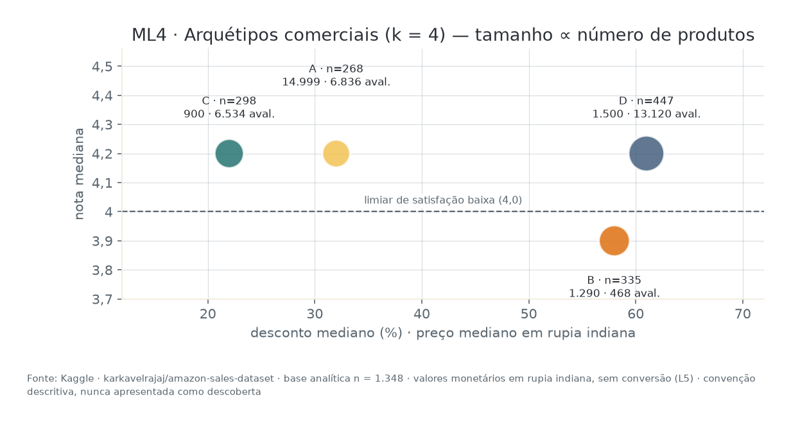

| Arquétipo | n | Preço de tabela mediano | Desconto mediano | Avaliações medianas | Nota mediana |
|---|---|---|---|---|---|
| A — ticket alto, desconto contido | 268 | 14.999 | 32% | 6.836 | 4,2 |
| **B — desconto agressivo sem tração** | **335** | 1.290 | **58%** | **468** | **3,9** |
| C — baixo preço, pouco desconto | 298 | 900 | 22% | 6.534 | 4,2 |
| D — alto giro com desconto alto | 447 | 1.500 | 61% | 13.120 | 4,2 |

*Fonte: tab05_arquetipos.csv · base analítica, n = 1.348 · soma 268 + 335 + 298 + 447 = 1.348 · k = 4, semente 42.*

**A diferença entre B e D é distinguível do acaso? Testada.** Comparar medianas não responde isso, e é a primeira pergunta que o achado central atrai. Mann-Whitney U bicaudal — não teste *t*, porque as três variáveis são assimétricas, a mesma razão pela qual o projeto usa Spearman — com tamanho de efeito pela correlação rank-biserial:

| Variável | Mediana B | Mediana D | p | Tamanho de efeito | Leitura |
|---|---|---|---|---|---|
| desconto (%) | 58 | 61 | 1,3e−03 | **+0,134** | significativo e **desprezível** |
| nota | 3,9 | 4,2 | 1,4e−58 | **+0,670** | significativo e **grande** |
| volume de avaliações | 468 | 13.120 | 2,5e−100 | **+0,888** | significativo e **grande** |

*Fonte: `02_results/tables/tab26_bxd_teste.csv` · base analítica · n = 1.348 · B com 335 produtos, D com 447 · Mann-Whitney U bicaudal · **efeito com sinal positivo = valores maiores em D** (rank-biserial: a diferença entre a probabilidade de D exceder B e a de B exceder D).*

**O que o teste mostra.** Com n = 782 entre os dois grupos, **até a diferença de 3 pontos percentuais no desconto atinge significância** (p = 0,0013) — e o tamanho de efeito, 0,134, diz que ela não ordena nada. Já nota e volume vêm com efeito 0,670 e 0,888, que é separação quase completa entre os grupos. É exatamente o que **T5** existe para tornar visível: p pequeno com amostra grande não significa diferença grande, e publicar o p sem o tamanho de efeito deixaria o leitor concluir que os três resultados têm o mesmo peso. Têm o oposto.

**Uma ressalva que o teste não dispensa: ele é circular para nota e volume.** Os grupos B e D foram formados pelo k-médias **com estas mesmas variáveis** (preço, desconto, volume e nota). Comparar depois, entre os grupos, as variáveis que serviram para formá-los é medir a separação que o algoritmo acabou de produzir — por isso os p de 1,4e−58 e 2,5e−100 **não são evidência inferencial independente**, e o que se lê neles é o tamanho de efeito como **descrição** de quão separados os grupos ficaram, não como prova de que a população tem dois tipos de produto. A silhueta de 0,23 já avisava a mesma coisa.

**A circularidade, bem lida, reforça o achado em vez de enfraquecê-lo.** O desconto também foi entrada do agrupamento — o algoritmo teve a chance de separar B e D por ele — e, **mesmo assim**, o efeito entre os dois ficou **desprezível (0,134)**, enquanto nota e volume saíram com 0,670 e 0,888. Se o desconto fosse a dimensão que organiza o portfólio, seria nela que os grupos mais se afastariam. É o oposto: foi a dimensão em que menos se afastaram. É isso que o teste sustenta, e é só isso que entra no material.

**A leitura que justifica ter feito a segmentação.** **B e D têm desconto praticamente igual — 58% contra 61% — e divergem em volume de avaliações e em nota.** D tem **28 vezes** mais avaliações medianas (13.120 contra 468) e nota 4,2; B é o **único** grupo abaixo do limiar de satisfação de 4,0. O desconto profundo não separa os dois. Se houvesse uma relação simples entre desconto e desempenho, B e D estariam no mesmo lugar do gráfico — e estão em lados opostos da linha de 4,0.

É a tradução visual do que Q3 disse em coeficiente: **a associação entre desconto e nota é real e é rasa**, e o desconto sozinho não classifica um produto. **B, com 335 produtos, é o candidato natural a revisão de sortimento** — e chega a essa posição por três evidências independentes (menor nota, menor volume, maior desconto entre os de nota baixa), não por um índice.

**A decisão de variável que muda tudo, e que precisa estar escrita.** As quatro variáveis são preço de tabela (log natural), desconto, volume de avaliações (log natural) e nota, todas padronizadas em z-score. **A leitura de "preço" é decisiva:** trocando preço de tabela por preço com desconto, a curva de silhueta achata e o máximo deixa de ter vencedor — k = 5 (0,236) e k = 2 (0,235) empatam dentro do ruído. Quem reproduzir com a outra coluna encontrará outro resultado — e concluirá, de boa-fé, que a segmentação não é estável. Por isso a especificação é publicada junto do resultado.

**A fronteira de uso, fechada.** Clusterização é **vedada** para definir limiar de qualquer conceito univariado. Relevância, engajamento, visibilidade e satisfação seguem cortes fixos e declarados (p90, mediana, 4,0, 4,3). Deixar o k-means desenhar o corte de "engajamento alto" tornaria o limiar dependente da semente e das variáveis escolhidas — e um limiar que muda quando se troca uma coluna não é um limiar. Fora de QA7, o método não entra.

---

#### O quadro completo dos quatro arquétipos

| Grupo | *n* | Preço de tabela | Preço com desconto | Desconto | Avaliações | Nota | Nota corrigida |
|---|---|---|---|---|---|---|---|
| **A** — Ticket alto, desconto contido | 268 | 14.999 | 8.994 | 32% | 6.836 | 4,2 | 4,094 |
| **B** — Desconto agressivo sem tração | **335** | 1.290 | 469 | **58%** | **468** | **3,9** | **3,637** |
| **C** — Baixo preço, pouco desconto | 298 | 900 | 651 | 22% | 6.534 | 4,2 | 4,151 |
| **D** — Alto giro com desconto alto | **447** | 1.500 | 599 | **61%** | **13.120** | 4,2 | 4,172 |

*Valores medianos. Rupia indiana, sem símbolo e sem conversão (L5). Base analítica · n = 1.348 · soma 268 + 335 + 298 + 447 = 1.348 ✅ · `02_results/tables/tab05_arquetipos.csv`.*

**O perfil de cada grupo, em uma frase:**

- **A — Ticket alto, desconto contido.** Um dos dois grupos que praticam desconto abaixo de um terço (**C desconta menos ainda, 22%**) e ainda assim sustenta volume respeitável. Produto caro que não precisa de etiqueta agressiva para ser comentado.
- **B — Desconto agressivo sem tração.** Desconta 58% e recebe 468 avaliações medianas. É o único dos quatro **abaixo do limiar de satisfação**.
- **C — Baixo preço, pouco desconto.** O grupo mais barato de todos em preço de tabela, e o que menos desconta. Nota e volume saudáveis.
- **D — Alto giro com desconto alto.** Desconta 61% — mais que B — e acumula 13.120 avaliações medianas, o maior volume dos quatro.

**A leitura que importa: B contra D.**

Os dois praticam desconto praticamente igual — **58% e 61%, três pontos percentuais de distância** — e divergem em volume de avaliações e em nota. D tem **vinte e oito vezes mais avaliações**. B é o único abaixo de 4,0.

A correção de Wilson **alarga** a distância em vez de suavizá-la: a nota corrigida de B cai para **3,637**, contra 4,172 de D. Isso acontece porque B soma pouca nota ruim *e* pouco volume, e a correção penaliza as duas coisas ao mesmo tempo (T1). Um ranking por nota bruta colocaria B a 0,3 ponto de D; corrigido, a distância é de 0,535 — quase o dobro.

Se profundidade de desconto explicasse o destino de um produto, B e D estariam no mesmo lugar. **Estão nos extremos opostos do portfólio.**

**A ressalva obrigatória sobre estes grupos.** O coeficiente de silhueta máximo é 0,237, o que indica que **não há estrutura natural de agrupamento** nesta base. Os quatro grupos são **convenção descritiva útil**, jamais apresentados como descoberta (§6.4). Servem para organizar a conversa sobre o portfólio, não para afirmar que o catálogo "se divide naturalmente" em quatro perfis.

---

### 5.17 Q4 e QA3 · Satisfação consolidada por categoria e subcategoria

#### A tabela consolidada das quatro categorias elegíveis

| Categoria | *n* | Nota mediana | **Nota corrigida** | % abaixo de 4,0 |
|---|---|---|---|---|
| Office Products | 31 | 4,3 | **4,248** | **0,0%** |
| Computers & Accessories | 373 | 4,2 | 4,150 | 17,4% |
| Electronics | 490 | 4,1 | 4,076 | 26,1% |
| Home & Kitchen | 447 | 4,1 | **3,975** | **32,2%** |

*Ordenado pela nota corrigida de Wilson (T1). Base analítica · n = 1.348 · só categorias com n ≥ 30 (T2) · `02_results/tables/tab15_satisfacao_categoria.csv`.*

**Duas leituras:**

1. **Office Products lidera, e a leitura exige cuidado.** Nenhum dos seus 31 produtos está abaixo de 4,0 — o único caso assim entre as quatro categorias acima do piso. Mas 31 é o **limite exato** do piso amostral: um grupo desse tamanho é volátil, e a liderança não deveria tratar essa primeira posição com a mesma confiança que trataria a de Electronics, que tem 490. A correção de Wilson já embute parte dessa cautela; o piso T2 embute o resto.
2. **Home & Kitchen é o oposto de Office Products.** Última em nota corrigida e primeira em insatisfação — **32,2% dos 447 produtos abaixo do limiar**, contra 25,1% da base.

#### As oito subcategorias de nível 2, ordenadas por satisfação corrigida

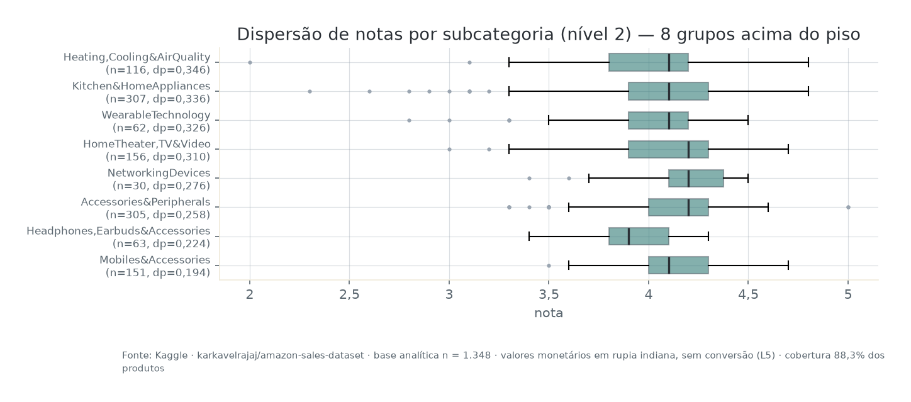

| Subcategoria (nível 2) | *n* | Nota mediana | **Nota corrigida** | Desvio-padrão | IQR | % abaixo de 4,0 |
|---|---|---|---|---|---|---|
| Computers & Acc. \| Networking Devices | 30 | 4,2 | **4,192** | 0,276 | 0,275 | 16,7% |
| Electronics \| Home Theater, TV & Video | 156 | 4,2 | 4,110 | 0,310 | 0,400 | 28,2% |
| Computers & Acc. \| Accessories & Peripherals | 305 | 4,2 | 4,092 | 0,258 | 0,300 | 18,0% |
| Electronics \| Mobiles & Accessories | 151 | 4,1 | 4,076 | **0,194** | 0,300 | 13,9% |
| Electronics \| Wearable Technology | 62 | 4,1 | 4,028 | 0,326 | 0,300 | 29,0% |
| Home & Kitchen \| Kitchen & Home Appliances | 307 | 4,1 | 3,998 | 0,336 | 0,400 | 30,9% |
| Home & Kitchen \| Heating, Cooling & Air Quality | 116 | 4,1 | 3,918 | **0,346** | 0,400 | 37,9% |
| **Electronics \| Headphones, Earbuds & Acc.** | 63 | **3,9** | **3,888** | 0,224 | 0,300 | **52,4%** |

*Base analítica · n = 1.348 · 8 grupos acima do piso, cobrindo 88,3% dos produtos (1.190 de 1.348) · desvio-padrão **amostral** (ddof = 1), o mesmo do `STDEV.S` no dashboard · `02_results/tables/tab16_satisfacao_subcategoria.csv`.*

**O achado desta tabela — o mais acionável em escala estrutural.** Dois achados deste relatório disputam o rótulo "mais acionável", e eles não competem: operam em escalas diferentes. Os **19 produtos de Q5** são a ação mais *imediata* — lista nominal, acionável numa reunião. O achado abaixo é o de maior *concentração* de insatisfação — pede leitura da subcategoria, e não de um produto isolado.

**Headphones, Earbuds & Accessories tem 52,4% dos produtos abaixo do limiar de satisfação.** Mais da metade. A taxa da base é 25,1%: a subcategoria é **duas vezes pior** que o portfólio, e é a única em que a insatisfação é maioria.

A dispersão das notas dela é baixa **em estimativa pontual** — desvio-padrão de 0,224, o segundo menor das oito subcategorias —, o que sugere uma **distribuição deslocada**, e não poucos produtos puxando a média. **Mas isso é hipótese, não conclusão:** a diferença de dispersão para a climatização não é estatisticamente distinguível (Levene, p = 0,18; `tab30`). O que está bem sustentado é a **taxa**: 52,4% abaixo de 4,0, o dobro dos 25,1% da base. "É um problema de categoria" é a leitura mais provável e fica como **ponto de partida da revisão**, não como diagnóstico fechado.

**Onde a dispersão é maior:** Heating, Cooling & Air Quality (dp 0,346). Em estimativa pontual, a qualidade é mais irregular *dentro* do grupo que em Headphones, onde as notas são mais uniformemente fracas — mas a diferença não é estatisticamente significativa (Levene, p = 0,18). Sugere abordagens diferentes — produto a produto na climatização, categoria nos fones —, **como hipótese**.

**Dois focos.** A climatização tem **37,9%** dos produtos abaixo do limiar, também acima da base. A insatisfação do portfólio, portanto, não está espalhada, mas também não tem um único endereço: tem dois, fones e climatização (`tab30_levene_fones_climatizacao.csv`).

---

### 5.18 Q1 e Q6 · As duas definições que fecharam em 24/09/2026

Estas duas perguntas do enunciado estiveram com a definição em aberto até esta versão. Ambas foram fechadas por decisão de Ricardo, e nenhuma das duas criou limiar novo.

> **Ressalva metodológica sobre a nota corrigida.** O limite inferior de Wilson é um intervalo de confiança para **proporção binomial**. Aqui ele é aplicado à nota média, normalizada de 1–5 para 0–1, com *n* = número de avaliações. É uma **aproximação deliberada**, não o uso canônico: ela penaliza nota alta apoiada em pouco volume, que é o efeito desejado, mas não deve ser lida como intervalo de confiança formal da nota. A alternativa — média bayesiana — exigiria arbitrar um *prior*, e todo *prior* vira pergunta na banca. A escolha está registrada como decisão **D-3**, fechada em 01/10/2026.

#### A definição de relevância — fechada em 24/09/2026

Q1 esteve com a fórmula em aberto até esta versão. A definição adotada **não cria nenhum limiar novo**: ela cruza os dois eixos que o projeto já operava, e é isso que a torna defensável.

| Volume × Nota | Nota alta (≥ 4,3) | Nota baixa (< 4,0) |
|---|---|---|
| **Volume alto** (≥ p90 = 36.384) | **Âncora** — 41 produtos (3,0%) | **Risco de vitrine** — 19 produtos (1,4%) → **Q5** |
| **Volume baixo** (< mediana = 4.740) | **Subexplorado** — 187 produtos (13,9%) → **Q6** | **Cauda frágil** — 227 produtos (16,8%) |

*Os 874 produtos restantes (64,8%) ficam na faixa intermediária de um dos dois eixos. Soma: 41 + 19 + 187 + 227 + 874 = 1.348 ✅ · base analítica · `02_results/tables/tab17_matriz_relevancia.csv`.*

**No dashboard, o quadro aparece como os quatro grupos de ação.** A página 1 o apresenta assim — *474 produtos estão num dos quatro grupos de ação: 874 são intermediários* —, porque os 874 não formam quadrante de ação: estão na faixa intermediária de pelo menos um dos dois eixos. O nome muda; os cortes, as contagens e a regra de ordenação são os desta seção.

**Por que os eixos usam nota bruta, e não a corrigida.** Os cortes 4,0 e 4,3 são os mesmos que Q5 e Q6 já usavam — e é por isso que a matriz **reproduz 19 e 187 exatamente**, em vez de criar uma quinta definição concorrente. Usar nota corrigida nos eixos daria outros quadrantes (23 âncoras e 61 subexplorados) e desalinharia a matriz das duas perguntas do enunciado que ela serve. A correção de Wilson entra onde T1 a exige: **na ordenação dentro de cada quadrante**.

**Por que uma matriz e não um índice composto.** Um índice único — do tipo `0,4 × volume + 0,6 × nota` — convida à pergunta *"por que esses pesos?"*, e não existe resposta boa: qualquer par de pesos é arbitrário e atacável. A matriz é defensável porque **não pondera nada**. Ela apenas cruza dois cortes que já estavam medidos, publicados e justificados, e cada quadrante vira uma ação diferente.

**E ela absorve Q5 e Q6 em vez de competir com eles.** Os quadrantes de risco e de subexploração reproduzem exatamente as contagens já publicadas — 19 e 187. A matriz não é uma quinta definição de relevância; é o **quadro que dá nome aos dois quadrantes que ainda não tinham** (Âncora e Cauda frágil).

**Dentro de cada quadrante, o ranking usa nota corrigida de Wilson** (T1), com o *n* de avaliações ao lado. A correção importa no ranking geral por nota, onde um produto com 5 avaliações lideraria sem ela — é o que T1 impede.

#### Categorias, por relevância

| Categoria | Produtos | Participação no volume | Nota corrigida |
|---|---|---|---|
| Electronics | 490 | **59,7%** · *53,1% colapsando variantes (L8)* | 4,076 |
| Computers & Accessories | 373 | 26,6% | 4,150 |
| Home & Kitchen | 447 | 12,6% · *16,4% colapsando variantes (L8)* | **3,975** |
| Office Products | 31 | 0,6% | **4,248** |

*Base analítica · só categorias com n ≥ 30 (T2) · `02_results/tables/tab18_relevancia_categoria.csv`.*

**A leitura que esta tabela permite, e que a contagem de produtos sozinha esconde:**

1. **Electronics é a categoria mais relevante.** Concentra 59,7% de todo o volume de avaliações — 53,1% sem contar as listagens variantes (L8).
2. **Computers & Accessories é a segunda em volume (26,6%) e em nota corrigida (4,150).**
3. **Home & Kitchen é a mais frágil.** Tem quase o mesmo número de produtos que Electronics (447 contra 490) e apenas 12,6% do volume — recebe pouca atenção pública para o seu tamanho. Tem a pior nota corrigida (3,975) e a maior taxa abaixo de 4,0 (32,2%).
4. **Office Products lidera em nota e não existe em volume.** 0,6% do total. A liderança não deveria tirar conclusão de portfólio de um grupo de 31 produtos no limite exato do piso.

#### A ressalva de T1 sobre os 187 — e a lista realmente acionável

Q6 seleciona por **nota bruta** ≥ 4,3, por continuidade com o enunciado. Mas T1 exige nota corrigida em todo ranking, e aplicá-la muda o quadro:

| Medida sobre os 187 | Valor |
|---|---|
| Produtos em Q6 (nota bruta ≥ 4,3) | **187** |
| Menor volume entre eles | **5 avaliações** |
| Com menos de 30 avaliações | 11 |
| **Que caem abaixo de 4,3 após Wilson** | **126 (67%)** |
| **Lista acionável, já corrigida** | **61 produtos** |

Um produto com 5 avaliações e nota 5,0 é exatamente o caso que T1 existe para barrar — e ele está entre os 187. Por isso o relatório publica os dois números e **recomenda os 61**: a frase "percepção já validada por quem comprou" só é verdadeira depois da correção.

**A pergunta que um avaliador atento faz aqui, respondida com o número.** Se o projeto impõe piso de n ≥ 30 em T2, a lista de 61 respeita o próprio piso? **Exatamente um produto dos 61 fica abaixo dele: 23 avaliações, nota bruta 5,0, nota corrigida 4,428.** A mediana da lista é de **2.116 avaliações**, e só esse um fica abaixo de 100.

E ele é compatível com a regra por duas razões, não por tolerância. A primeira: **o piso de T2 vale para grupo agregado**, e lista nominal é a exceção declarada — válida justamente porque exibe o *n* produto a produto, o que `tab20` faz. A segunda é mais interessante: **a correção de Wilson já cobrou o preço do n baixo nesse produto** — ele entra na lista com 4,428 em vez de 5,0, uma penalização de 0,57 ponto, e ainda assim passa. É o mecanismo funcionando, não escapando: um produto com 23 avaliações e nota 5,0 real é diferente de um com 5 avaliações e nota 5,0, e Wilson é o que distingue os dois.

*Fonte: base analítica · n = 1.348 · `00_data/gold/base_analitica.csv`, colunas `q6_subexplorado` e `nota_corrigida`.*

#### A definição de visibilidade — fechada em 24/09/2026

Q6 esteve com o rótulo em aberto até esta versão. A definição adotada é deliberadamente modesta:

> **Visibilidade não é mensurável nesta base.** Impressões, cliques e posição na busca não existem no dado. Adota-se o **volume de avaliações abaixo da mediana (< 4.740)** como **proxy declarado de exposição de vitrine** — e "engajamento" permanece o único rótulo de negócio de `rating_count` (T6).

**Por que esta saída e não um índice de visibilidade construído.** Seria possível estimar visibilidade a partir de preço, categoria e desconto. Seria também indefensável: o índice não teria como ser validado contra nada, porque a variável que ele pretende estimar não existe na base. Reconhecer o limite do dado pontua em *Compreensão do problema*; fabricar o número custa nos dois.

**Consequência para Q6:** a pergunta fecha em **187 produtos** — nota ≥ 4,3 com volume abaixo da mediana —, e passa a ser lida como *"produtos bem avaliados com pouco volume de avaliações"*, **nunca** como *"produtos que a vitrine não mostra"*. A diferença não é retórica: a segunda leitura afirma algo sobre o comportamento do marketplace que o dado não sustenta.

**Ação comercial associada.** Os **61** da lista corrigida por Wilson (T1) são os candidatos a **teste controlado de exposição**; os 187 são o funil de onde eles saem, e não a lista de ação. A base não permite afirmar que exposição adicional converteria em tração — não há variável de venda (L4) e não há dimensão temporal para medir antes e depois. O que se pode afirmar é mais estreito e mais útil: *são produtos cuja percepção já está validada por quem comprou, e cujo volume de avaliações é pequeno.*

---

### 5.19 O que as catorze respostas dizem juntas

A cadeia do enunciado — **Preço → Desconto → Engajamento → Satisfação** — foi testada elo a elo, e o resultado é consistente em toda a seção:

- **Preço → Desconto:** ρ = −0,063, p = 0,020. Não resiste à correção de multiplicidade: o preço de tabela **não acompanha** o desconto (QA4, §5.13).
- **Preço → Satisfação:** ρ = +0,032, p = 0,236. **Sem associação** (QA4).
- **Desconto → Satisfação:** ρ = −0,150, p = 3,14e-08. Associação **real e pequena** (Q3).
- **Desconto → Engajamento:** ρ = −0,132, p = 1,12e-06. Negativa e pequena — desconto **não** acompanha volume (Q3).
- **Engajamento → Satisfação:** ρ = +0,193, p = 8,29e-13. A mais forte das cinco, e ainda assim pequena (Q3).

**Nenhum elo isolado explica o desempenho de um produto.** Este é o resultado central, e ele é confirmado por um caminho inteiramente independente: no ML2, nenhum bloco de preditores sozinho se aproxima do conjunto — volume 0,556 · comerciais 0,583 · comerciais + categoria 0,658 · **completo 0,704 ± 0,006** (tab07, validação agrupada por variante). O sinal é **multivariado**, e é por isso que o modelo existe.

Duas consequências práticas, ditas sem verbo causal:

1. **A alavanca única não existe.** Uma política de preço, ou uma política de desconto, tomada isoladamente, tem associação fraca demais com a satisfação para justificar uma aposta. O que separa B de D na `fig10` não é o desconto — é a combinação.
2. **O que decide é a lista, não a média.** Os achados de ação imediata das catorze perguntas são listas nominais: **19 produtos** de alto volume e nota baixa (Q5) e, em Q6, **61 produtos** bem avaliados e pouco comentados — os que restam dos 187 candidatos depois da correção de Wilson (§5.18). Ambos sobrevivem à ausência de variável de venda, porque não prometem receita — prometem uma fila de investigação com nome e número. O achado de **maior alcance estrutural** é outro e não é uma lista: a subcategoria de fones, com 52,4% do sortimento abaixo do limiar (§5.17).

### 5.20 O que ficou de fora destas catorze perguntas, e por quê

Registrar o que **não** foi feito é parte da defesa. Cinco recusas, com o motivo:

| Fora de escopo | Motivo |
|---|---|
| Previsão de vendas, receita ou demanda | **Não existe variável de venda na base.** Qualquer previsão seria sobre `rating_count`, rebatizado (L4, T6) |
| Séries temporais, tendência e sazonalidade | **Ausência total de dimensão temporal.** Não há data em nenhuma coluna |
| Filtragem colaborativa / recomendação | Apenas **909 de 9.036 usuários distintos (10,1%)** avaliam mais de um produto. A matriz é esparsa demais |
| Índice composto de relevância | Todo peso é arbitrário e todo peso arbitrário vira pergunta na banca (Q1, D-2) |
| Divergência entre desconto declarado e recalculado | **Máximo de 0,50 p.p., média 0,21, nenhum caso acima de 1 p.p.** Deixou de ser pergunta e virou **controle de qualidade** — reportado em uma linha, como achado positivo |

A última linha merece atenção. Era uma pergunta candidata; a medição mostrou que a base é internamente coerente. Uma pergunta cuja resposta é "está tudo certo" não vira uma página de dashboard — vira uma linha de rodapé. Reconhecer isso é o que impede o material de crescer sem ganhar informação, que é o critério que o próprio enunciado enuncia: *o objetivo não é criar a maior quantidade possível de gráficos*.


---

## 6. Machine Learning

O enunciado da Fase 4 não pede modelagem: os nove critérios de avaliação cobrem tratamento de dados, análise, dashboard, storytelling e entrega. Modelo, aqui, é meio — e só entra quando responde a uma pergunta do escopo que a estatística descritiva não responde sozinha. Foi esse o critério de entrada, e ele eliminou mais aplicações do que aprovou.

Quatro aplicações estão registradas aqui. Uma foi absorvida por outra e três chegaram à entrega; uma delas, ML3, é estatística de texto e não modelo preditivo, e está descrita com a pergunta que atende (§5.8). Cada uma tem destino declarado, métrica publicada e ficha de reprodução — sem as três coisas, o número não é verificável e não entra no material.

| # | Aplicação | Status | Pergunta que atende | Métrica publicada |
|---|---|---|---|---|
| ML1 | Regressão explicativa da nota | **Absorvida no ML2** | — | R² = 0,10 (justificativa da absorção) |
| ML2 | Atributos associados à baixa satisfação | Adotado | Q5, apoio a Q8 | AUC = **0,70 ± 0,01** |
| ML3 | Contraste de termos por TF-IDF | Adotado | Q7 | Δ TF-IDF por termo, Electronics: 128 e 136 blocos (§5.8) |
| ML4 | Segmentação descritiva multivariada | Obrigatório | QA7 | k = 4, silhueta **0,234** |

Base de todas as medições deste capítulo: **base analítica, n = 1.348** (regra T3). As outras quatro bases oficiais — 1.465 bruta, 1.351 produtos, 1.350 nota válida, 1.349 engajamento válido — não são usadas em nenhuma modelagem, porque toda modelagem aqui é cruzada e exige `rating` e `rating_count` simultaneamente válidos.

### 6.1 Duas regras de leitura antes dos números

**Regra de precedência das fontes.** Quando o registro de método e a tabela publicada em `02_results/tables/` divergem, **vale a tabela publicada** — ela é regenerada por `src/gera_figuras.py` e carrega no rodapé a fonte, a base e o *n*. Duas divergências existiram e ficam declaradas aqui em vez de apagadas: (i) os AUCs por bloco do ML2 apareciam no registro como 0,640 · 0,655 · 0,715 · 0,755 e foram medidos, na execução de então, em 0,622 · 0,624 · 0,691 · 0,750 — valores que a correção de 31/10/2026 (validação agrupada por variante, §6.3) superou: 0,556 · 0,583 · 0,658 · 0,704; (ii) os tamanhos dos arquétipos do ML4 apareciam no registro como 267 · 337 · 299 · 445 e na execução publicada como 268 · 335 · 298 · 447. Em ambos os casos a soma fecha em 1.348, a ordem dos blocos não muda e a leitura não muda. Eram resíduos de execuções diferentes da mesma especificação. O registro de método foi alinhado à tabela, com os valores antigos revogados por escrito — o episódio está em §8.4.4.

**Regra de linguagem (T4 e T6).** Nada neste capítulo afirma causa. Correlação, coeficiente e importância de variável indicam **associação**, e é assim que estão escritos. E `rating_count` é **volume de avaliações** — proxy de engajamento, nunca vendas, receita, demanda ou popularidade real. A base não tem variável de venda (L4); um modelo não cria o que o dado não tem.

### 6.2 ML1 — a regressão que virou classificação

**O que foi feito.** Uma regressão linear explicativa da nota, com preço de tabela, preço com desconto, percentual de desconto, volume de avaliações e categoria nível 1 como regressores.

**O resultado.** R² = **0,10** (0,1035, medido sobre a base analítica com a especificação acima). As variáveis comerciais e de engajamento explicam cerca de **10%** da variação da nota; os outros 90% estão fora da base.

**Por que foi absorvida.** Um R² de 0,10 não sustenta previsão de nota, e o projeto nunca precisou prever nota — precisava saber **quais atributos acompanham a baixa satisfação**, que é a pergunta Q5 e a matéria-prima de Q8. Essa pergunta é de classificação, não de regressão: o corte operacional de satisfação baixa (`rating` < 4,0) já existe, é o mesmo usado em todo o projeto, e transforma a variável contínua em um alvo binário com 339 casos positivos — **25,1% da base analítica**. Manter as duas aplicações significaria publicar dois modelos sobre o mesmo fenômeno com dois critérios paralelos de "nota baixa". O ML1 foi absorvido, e o R² permanece publicado como justificativa da absorção — não como resultado.

**A alternativa descartada.** Insistir na regressão e reportar coeficientes por variável. Descartada porque, com R² = 0,10, coeficientes individuais dariam uma aparência de precisão que o ajuste não sustenta, e porque a decisão de negócio que interessa ("quais produtos olhar primeiro") é binária.

### 6.3 ML2 — atributos associados à baixa satisfação

#### O que foi feito

Classificador de floresta aleatória com alvo `rating` < 4,0 e cinco preditores: preço de tabela, preço com desconto, percentual de desconto, volume de avaliações e categoria nível 1.

Três decisões de formulação merecem ser ditas:

1. **O limiar do alvo é o mesmo corte operacional do projeto** (`rating` < 4,0). Não se criou um critério paralelo de "nota baixa" para agradar ao modelo. Se o corte mudar, muda em todo o projeto ao mesmo tempo.
2. **Vedação de vazamento, em duas frentes.** Primeira: nenhuma variável derivada de `rating` entra nos preditores — nota corrigida de Wilson, faixa de nota e qualquer rótulo de satisfação estão fora, e usá-los produziria um AUC alto e vazio. Segunda: **nenhuma listagem-gêmea (L8) fica dividida entre treino e teste** — a frente que a validação ingênua deixava aberta, tratada na cláusula do agrupamento, abaixo.
3. **A saída é comparação de blocos de preditores, não escore por produto.** Não existe, e não existirá, uma coluna de "probabilidade de risco" produto a produto. Uma coluna dessas seria lida como previsão operacional, e a base não sustenta previsão: sustenta a leitura de quais famílias de atributo acompanham a insatisfação.

#### O resultado

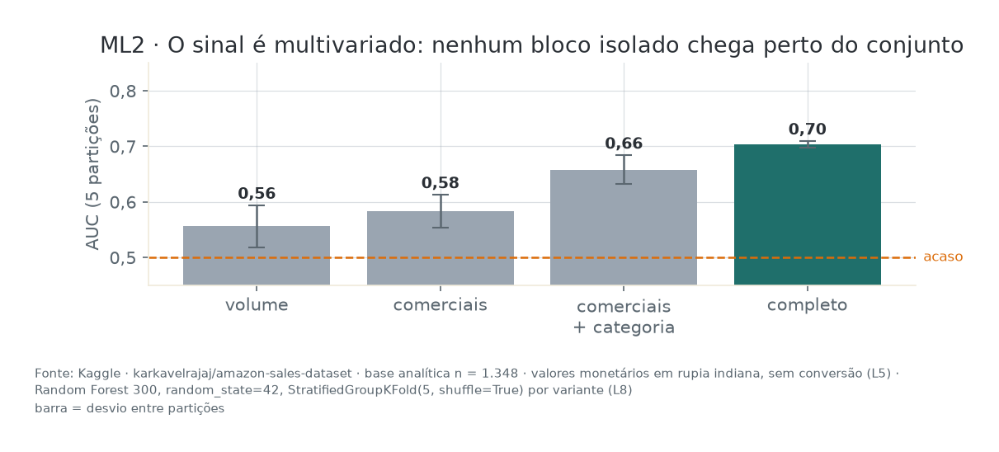

| Bloco de preditores | AUC (validação agrupada) | Desvio entre partições | AUC da validação ingênua | Inflação |
|---|---|---|---|---|
| volume de avaliações | 0,556 | 0,038 | 0,622 | +0,066 |
| comerciais (preços + desconto) | 0,583 | 0,029 | 0,624 | +0,041 |
| comerciais + categoria | 0,658 | 0,026 | 0,691 | +0,034 |
| **completo** | **0,704** | **0,006** | 0,750 | +0,047 |

*Fonte: `tab07_ml2_blocos.csv` (a coluna que se publica) e `tab27_ml2_vazamento.csv` (a comparação) · base analítica, n = 1.348 · taxa de eventos 25,1%.*

O achado é a **escada**, não o número do topo. Nenhum bloco isolado passa de 0,58 — e o volume de avaliações sozinho, com 0,556, fica a seis centésimos do acaso. A categoria acrescenta 7,5 pontos de AUC ao bloco comercial, e o conjunto completo acrescenta outros 5. Ou seja: **o sinal é multivariado**. É exatamente por isso que o modelo existe. Se um único atributo explicasse a baixa satisfação, a tabela cruzada da EDA já teria resolvido, e o modelo seria enfeite.

Isso conversa diretamente com o que as correlações univariadas mostraram (`tab03`): desconto × nota tem ρ = −0,150 (p = 3,1e-08) e preço de tabela × nota não tem associação alguma (ρ = +0,032, p = 0,236). Olhada uma a uma, nenhuma variável comercial diz muito. Olhadas juntas e com a categoria, dizem o suficiente para ordenar produtos melhor do que o acaso — e não muito mais do que isso.

**A leitura honesta da magnitude (T5).** AUC de 0,70 significa: sorteando um produto com nota abaixo de 4,0 e um com nota igual ou acima, o modelo ordena o par corretamente em cerca de sete de cada dez sorteios. **O piso de referência é 0,50 — é o que um sorteio aleatório obtém**, e sem essa âncora o número 0,70 não significa nada para quem lê. O teto prático de um modelo útil nesta base está bem abaixo de 1,0, porque metade do catálogo cabe em quatro décimos de nota. É **poder de discriminação moderado**, útil para priorizar uma fila de revisão de sortimento e insuficiente para decidir o destino de um produto isolado. E é **0,70 ± 0,01** entre as cinco partições: publicar 0,704, com três casas, é precisão que a medição não sustenta. O desvio vai ao lado do número em toda peça do material — figura, slide e fala do vídeo.

#### A cláusula do agrupamento — o vazamento que a L8 já anunciava

A L8 declara que **254 produtos (96 grupos) são listagens-gêmeas**: variantes do mesmo anúncio, com exatamente o mesmo par `(rating_count, rating)`. O alvo do ML2 é `rating` < 4,0 e `rating_count` é preditor. Numa validação cruzada que sorteia produto por produto, uma gêmea cai no treino e a outra no teste — e o modelo recebe de graça o rótulo que deveria prever, porque a gêmea tem **o mesmo volume e a mesma nota**. É vazamento de dado, e o AUC que o projeto publicou até 30/10/2026 estava inflado por ele.

**Medido, bloco a bloco** (tabela acima, coluna *Inflação*; `tab27_ml2_vazamento.csv`): a validação ingênua inflava o AUC em **todos** os quatro blocos, de 0,034 a 0,066, e `gera_figuras.py` **falha** se algum deixar de inflar. O efeito é maior onde o preditor é justamente o volume de avaliações — de 0,622 para **0,556** —, o que é coerente com o mecanismo: o atributo que a gêmea copia é o que mais ajuda a decorar o rótulo. O modelo completo cai de 0,750 para **0,704**.

**O que muda e o que não muda.** O sinal **sobrevive**: 0,704 está bem acima de 0,50, e a escada continua subindo bloco a bloco. O que se perde é a leitura de que o volume sozinho carregava 0,62: ele carrega 0,556, quase acaso — e isso reforça, em vez de enfraquecer, o achado de que **o sinal é multivariado**. O que não muda é a recomendação, que nunca dependeu do AUC: o ML2 prioriza uma fila, não decide um produto.

**A correção** é agrupar: todas as gêmeas de um anúncio ficam na mesma partição. `StratifiedGroupKFold` mantém a proporção do alvo e o embaralhamento, e o grupo é definido pela **mesma regra da L8** — o par `(rating_count, rating)` repetido —, de modo que o ML2 passa a obedecer a uma limitação que o projeto já declarava. A validação mora em `src/ml2.py`, **uma só**, usada pela figura, pelo notebook 04 e pela tabela do vídeo: antes eram três cópias, e foi essa duplicação que deixou o defeito passar.

#### A cláusula do embaralhamento — não é detalhe de implementação

A **camada gold é gravada em ordem decrescente de volume de avaliações** — e não o `amazon.csv`, que a §3.3.2 mostra não estar ordenado por categoria. Uma validação ingênua sem embaralhamento (`StratifiedKFold`) corta essa ordem em cinco fatias por faixa de volume: o modelo treina em Electronics e Home & Kitchen e é testado em Computers & Accessories, com um *one-hot* de categoria que nunca viu o valor do teste. O AUC medido nessas condições cai para **≈ 0,33** — pior que o acaso, que é 0,50. Um modelo que acerta menos que uma moeda não está errado; está sendo avaliado em partições que não representam o problema.

A analogia serve à liderança: é como avaliar um comprador de eletrônicos pedindo que ele precifique móveis, e concluir que ele não sabe comprar.

**No splitter agrupado o colapso não acontece, e mesmo assim `shuffle=True` continua obrigatório.** O `StratifiedGroupKFold` sem embaralhamento devolve 0,72 — não 0,33 —, porque distribui grupos inteiros pelas partições. Mas 0,72 **não é o número publicado** (0,704): a atribuição dos grupos às partições muda com o embaralhamento, e quem reproduzir sem a cláusula obtém outro valor, de boa-fé e com o script certo. Por isso `shuffle=True` e `random_state=42` são **cláusulas obrigatórias da especificação**, não preferência. Essa é a razão de a ficha de reprodução abaixo existir com esse nível de detalhe.

#### Ficha de reprodução — ML2

| Item | Valor |
|---|---|
| Base | analítica, n = 1.348 |
| Alvo | `rating` < 4,0 (339 positivos · 25,1%) |
| Preditores | preço de tabela · preço com desconto · desconto (%) · volume de avaliações · categoria nível 1 |
| Pré-processamento | numéricos padronizados (z-score); categoria nível 1 em *one-hot*, `handle_unknown="ignore"` |
| Algoritmo | `RandomForestClassifier(n_estimators=300, random_state=42)` |
| Validação | `StratifiedGroupKFold(n_splits=5, shuffle=True, random_state=42)`, **agrupada por `(rating_count, rating)`** — a regra de variante da L8 —, métrica `roc_auc` |
| **Cláusulas críticas** | **(1) as listagens-gêmeas ficam na mesma partição — a validação ingênua infla o AUC de 0,034 a 0,066 por bloco; (2) `shuffle=True` e semente fixos — a gold é gravada em ordem de volume de avaliações, e sem eles o resultado muda** |
| Vedação | nenhuma variável derivada de `rating` entre os preditores · nenhuma gêmea dividida entre treino e teste |
| Script | `src/ml2.py` (a validação, única) · `src/gera_figuras.py` (fig11, tab07, tab27) |

#### Alternativas descartadas no ML2

| Alternativa | Por que foi descartada |
|---|---|
| Escore de risco por produto | seria lido como previsão operacional; a base não sustenta previsão produto a produto, e o quadrante Q5 já entrega a lista nominal de 19 produtos |
| Ajuste de hiperparâmetros por busca | ganho esperado pequeno diante do desvio entre partições (até 0,04), e cada rodada extra de busca exige um conjunto de validação que a base de 1.348 não comporta sem encolher o teste |
| Balanceamento do alvo (SMOTE ou pesos) | 25,1% de positivos não é desbalanceamento severo; AUC é insensível à prevalência, e o balanceamento distorceria a leitura das importâncias |
| Regressão logística no lugar da floresta | descartada como modelo principal por não capturar interação entre categoria e faixa de preço, que é justamente onde o ganho de AUC aparece na escada de blocos |

### 6.4 ML4 — segmentação descritiva, e a redação honesta do k

#### O que foi feito

Agrupamento por k-médias sobre quatro variáveis padronizadas: **preço de tabela** (log natural), percentual de desconto, **volume de avaliações** (log natural) e nota. É a única aplicação obrigatória do bloco, porque responde diretamente a QA7 — quais arquétipos comerciais emergem ao agrupar por preço, desconto, nota e volume.

**A leitura de "preço" é decisiva, e quebra o resultado se trocada.** Com **preço de tabela**, a curva de silhueta tem máximo em k = 5. Com **preço com desconto** no lugar do de tabela, a curva achata e o máximo deixa de ter vencedor — k = 5 (0,236) e k = 2 (0,235) empatam dentro do ruído —, ou seja, a escolha entre duas colunas que um leitor distraído consideraria intercambiáveis decide se existe uma estrutura de cinco grupos ou nenhuma que se destaque. Adotou-se o preço de tabela por ser o atributo de posicionamento do produto; o preço com desconto é a promoção do momento e já entra na análise pela variável de desconto. Quem reproduzir com a outra coluna obterá outro resultado, e terá razão em obtê-lo.

#### O k — dito como foi decidido, não como conviria

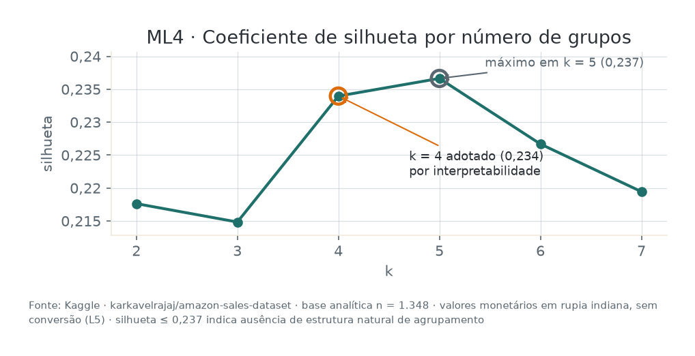

O coeficiente de silhueta foi calculado para k de 2 a 7 e **atinge o máximo em k = 5 (0,237)**. Adotou-se **k = 4 (0,234) por interpretabilidade**, com diferença desprezível entre os dois. Quatro arquétipos têm leitura comercial imediata e cabem em uma página do dashboard; o quinto grupo, na inspeção, dividia um dos quatro sem acrescentar leitura.

Dizer "k escolhido pela silhueta" seria impreciso, e derrubaria o argumento na primeira pergunta da banca — porque a curva está publicada na figura e o máximo está anotado nela. A frase acima é a redação obrigatória do projeto para este ponto, em qualquer peça do material.

#### A fraqueza declarada — e por que ela não invalida o uso

Silhueta ≤ 0,237 é baixa. Ela indica que **não há estrutura natural de agrupamento nesta base**: os produtos formam uma nuvem contínua, não ilhas separadas. A analogia: é um mapa sem fronteiras naturais, em que dividir o território em quatro províncias é decisão administrativa, não descoberta geográfica.

A consequência para a redação é rígida: os arquétipos são **convenção descritiva útil**, e **nunca** são apresentados como descoberta. Nenhuma frase do material diz "identificamos quatro segmentos de produto". As frases dizem "convencionamos quatro arquétipos para descrever o portfólio". A figura carrega isso no rodapé.

**Fronteira de uso:** a clusterização é **vedada para definir limiar de qualquer conceito univariado**. Relevância, engajamento, visibilidade e satisfação seguem cortes fixos e declarados (p90 = 36.384, mediana = 4.740, `rating` < 4,0, `rating` ≥ 4,3). Fora de QA7, o método não entra. Isso impede o uso circular mais comum — deixar o algoritmo escolher o corte e depois apresentar o corte como achado.

#### Os quatro arquétipos

*(ver **Figura 9**, seção 5.16)*

| Grupo | n | Preço de tabela mediano | Desconto mediano | Avaliações medianas | Nota mediana |
|---|---|---|---|---|---|
| A — ticket alto, desconto contido | 268 | 14.999 | 32% | 6.836 | 4,2 |
| **B — desconto agressivo sem tração** | 335 | 1.290 | 58% | 468 | **3,9** |
| C — baixo preço, pouco desconto | 298 | 900 | 22% | 6.534 | 4,2 |
| D — alto giro com desconto alto | 447 | 1.500 | 61% | 13.120 | 4,2 |

*Fonte: `tab05_arquetipos.csv` · base analítica · 268 + 335 + 298 + 447 = **1.348** ✅ · convenção descritiva, nunca descoberta.*
*Os rótulos A–D são atribuídos pelo perfil de cada grupo (maior preço → A; menor nota → B; menor desconto entre os restantes → C; maior volume → D), porque a numeração interna do k-médias varia entre execuções. Sem essa amarração, os rótulos trocariam de lugar a cada rodada.*

**O que surpreende na tabela.** B e D têm desconto praticamente igual — 58% contra 61% — e divergem em volume de avaliações e em nota: **D tem 28 vezes mais avaliações que B** (13.120 contra 468), e **B é o único grupo abaixo do limiar de satisfação de 4,0**. Os dois grupos aplicam desconto profundo; um está associado a alto volume de avaliações e nota na média do portfólio, o outro a volume baixíssimo e a única nota mediana abaixo de 4,0.

A leitura correta, em linguagem T4: **desconto profundo não separa os dois grupos**. Ele aparece nos dois. O que os separa é o volume de avaliações e a nota — e nada aqui autoriza dizer que o desconto de B causou sua nota, nem que o desconto de D causou seu volume. Em linguagem T6: as 13.120 avaliações de D são volume de avaliações, não unidades vendidas.

**O uso de negócio, e só ele:** B é o candidato natural a revisão de sortimento — 335 produtos com desconto alto, pouquíssimo engajamento e a nota mais baixa do portfólio. É uma fila de investigação, não um veredito sobre 335 produtos.

#### Ficha de reprodução — ML4

| Item | Valor |
|---|---|
| Base | analítica, n = 1.348 |
| Variáveis | ln(preço de tabela) · desconto (%) · ln(volume de avaliações) · nota — todas padronizadas (z-score) |
| **Cláusula crítica** | **"preço" é preço de tabela**; com preço com desconto a curva achata e k = 2 (0,235) e k = 5 (0,236) empatam |
| Algoritmo | `KMeans(k, random_state=42, n_init=10)` |
| k testados | 2 a 7; silhueta: k=2 → 0,218 · k=3 → 0,215 · **k=4 → 0,234** · k=5 → **0,237 (máximo)** · k=6 → 0,227 · k=7 → 0,219 |
| k adotado | **4**, por interpretabilidade |
| Rotulagem A–D | por perfil (maior preço · menor nota · menor desconto · maior volume), não pela ordem do algoritmo |
| Estatura do resultado | convenção descritiva; silhueta ≤ 0,237 indica ausência de estrutura natural |
| Script | `src/gera_figuras.py` (blocos fig13 e fig10) |

#### Alternativas descartadas no ML4

| Alternativa | Por que foi descartada |
|---|---|
| Adotar k = 5, o máximo da silhueta | ganho de 0,003 em silhueta contra a perda de uma leitura comercial direta; o quinto grupo dividia um arquétipo sem acrescentar interpretação |
| Clusterização hierárquica ou DBSCAN | com silhueta nesse patamar, o problema não é o algoritmo — é a ausência de estrutura na nuvem; trocar de método produziria outra convenção, não mais evidência |
| Incluir categoria nível 1 nas variáveis | os grupos passariam a reproduzir a concentração de portfólio (97,2% em três famílias, L3) e os arquétipos virariam rótulos de categoria |
| Usar os clusters para definir cortes de engajamento ou satisfação | vedado por fronteira de método: transformaria o resultado do algoritmo em limiar de conceito univariado, num raciocínio circular |

### 6.5 O que este bloco não permite concluir

Três frases que o material **não** dirá, com a razão de cada uma:

- **"Desconto alto causa nota baixa."** Vedado por T4. O que se mede é associação: ρ = −0,150 (p = 3,1e-08) entre desconto e nota, e um arquétipo de desconto alto com nota 3,9 convivendo com outro de desconto igual e nota 4,2.
- **"O modelo prevê quais produtos vão ter problema."** O ML2 discrimina de forma moderada (AUC 0,70 ± 0,01) e não emite escore por produto. Prioriza uma fila; não decide um caso.
- **"Os produtos do grupo D vendem mais."** Vedado por T6 e L4. `rating_count` é volume de avaliações. A base não contém unidades vendidas, receita, margem, estoque nem data — e por isso nenhuma recomendação deste capítulo é expressa em receita ou retorno financeiro.

Acrescente-se a magnitude (T5): com n = 1.348, coeficientes atravessam o limiar de significância com facilidade. Significativo e irrelevante são estados que convivem, e a publicação traz sempre os dois números lado a lado.

### 6.6 Aplicações avaliadas e descartadas

O que não foi feito é parte do método, e é aqui que o critério de entrada fica visível.

| Aplicação avaliada | Motivo do descarte |
|---|---|
| Previsão de vendas, receita ou demanda | não existe variável de venda na base (L4); qualquer alvo seria `rating_count`, e chamá-lo de venda viola T6 |
| Séries temporais e forecast | ausência total de dimensão temporal — não há data em nenhuma coluna |
| Filtragem colaborativa / sistema de recomendação | apenas **909 de 9.036 usuários distintos (10,1%)** avaliam mais de um produto na base analítica; a matriz usuário × item é esparsa demais para sustentar vizinhança |
| Detecção de anomalia em preço | sem histórico de preço, a técnica se reduz a *outlier* univariado — o boxplot da EDA já entrega isso, com menos aparato |
| Classificador de sentimento pré-treinado | reprodutibilidade frágil no escopo do módulo: resultado dependente da versão e dos pesos de um modelo externo, que o projeto não controla — contra uma entrega cujo valor está em ser reproduzível |
| Regressão para prever `rating_count` | prever volume de avaliações não gera decisão — nenhuma ação de sortimento ou de preço decorre do número previsto |
| Regressão explicativa da nota (ML1) | R² = 0,10; a pergunta de negócio é binária e foi absorvida pelo ML2 |

**Teto de esforço declarado.** Os nove critérios de avaliação do enunciado não incluem modelagem. Nenhuma aplicação deste capítulo consumiu tempo adicional depois que seu destino no dashboard ou no vídeo estivesse definido. Modelo que não tem destino declarado não foi construído — e essa foi a regra que manteve a lista de descartes maior que a de adotados.


---

## 7. Customer Insights e Padrão Visual

Esta seção trata das duas partes do trabalho em que o erro é invisível no número e visível no resultado. A primeira é o texto das avaliações: um corpus mal contado infla o material em 14% sem que nenhuma conta esteja errada. A segunda é a cor: uma paleta bonita e mal ordenada produz gráficos que um leitor com deuteranopia não consegue ler, e nada no arquivo acusa o problema.

### 7.1 O que o enunciado pede em Customer Insights, e onde cada pergunta foi respondida

As perguntas de Customer Insights do enunciado não viraram análises novas: foram absorvidas pelas duas perguntas do escopo que tratam de texto — Q7 e QA5. A amarração é esta:

| Pergunta do enunciado | Onde é respondida | Método | Corpus |
|---|---|---|---|
| O que os clientes mais valorizam? | **Q7** | contraste de TF-IDF, lado da nota ≥ 4,3 | Electronics · 136 blocos |
| Quais problemas aparecem com maior frequência? | **QA5** | leitura qualitativa dirigida — **não** TF-IDF | 19 produtos · 147 avaliações · ≈ 49,5 mil caracteres |
| Quais padrões estão presentes em avaliações positivas? | **Q7** | contraste de TF-IDF, lado da nota ≥ 4,3 | Electronics · 136 blocos |
| Quais temas aparecem em avaliações negativas? | **Q7** + **QA5** | contraste de TF-IDF, lado da nota < 4,0, e leitura dirigida dos 19 produtos de Q5 | Electronics · 128 blocos · 19 blocos · 147 avaliações |

*Base: analítica, n = 1.348. Fonte: Kaggle — `karkavelrajaj/amazon-sales-dataset`.*

A tabela acima é a resposta formal a **D-8, fechada em 01/10/2026**: declarar onde cada pergunta de Customer Insights é respondida.

### 7.2 A unidade de modelagem: o bloco de review, não a avaliação

A origem traz uma linha por produto, com as avaliações **concatenadas em um único campo**. Não existe, no arquivo, uma tabela de avaliações: existe um bloco de texto por produto. Três unidades diferentes convivem e precisam de nome próprio, porque cada uma dá um número diferente para a pergunta "quantas avaliações temos?":

| Unidade | Definição | Contagem (base analítica, n = 1.348) |
|---|---|---|
| **Bloco de review** | conjunto truncado de até 8 avaliações de um produto — 1 por produto | **1.348** |
| **Referência de avaliação** | item obtido ao explodir o bloco por `,` | **10.588** |
| **Review individual** | referência após deduplicar por `review_id` | **9.255** |

A unidade adotada é o **bloco**, rotulado pela nota do produto. Essa escolha não é neutra e precisa ser justificada, porque a alternativa parecia mais natural: tratar cada avaliação como documento independente.

A alternativa foi descartada por dois motivos. Primeiro, o rótulo: a nota existe **no produto**, não na avaliação individual — não há nota por review na base. Atribuir a nota do produto a cada uma das suas 8 avaliações replicaria o rótulo oito vezes e daria a produtos com bloco cheio oito vezes mais peso do que a produtos com bloco curto, sem que isso signifique nada sobre o mercado. Segundo, o peso. Com o bloco como documento, cada produto entra exatamente uma vez no corpus — a mesma granularidade de todas as outras análises do projeto, o que permite reconciliar as contagens de texto com as contagens de portfólio linha a linha.

**Em linguagem de liderança:** cada produto tem uma "página de comentários". O projeto analisa a página inteira como um documento, e não cada comentário solto, porque o que sabemos (a nota) é da página, não do comentário.

### 7.3 A deduplicação por `review_id`: 10.588 referências, 9.255 reviews

Ao explodir os blocos da base analítica, o corpus tem **10.588 referências de avaliação**. Depois de deduplicar por `review_id`, sobram **9.255 reviews distintos**. A diferença é de **1.333 referências repetidas** — 12,6% de tudo que foi explodido. Publicar 10.588 como "avaliações analisadas" faria o corpus parecer **14% maior do que é** (10.588 ÷ 9.255 = 1,144), e nenhuma conta estaria errada: apenas a palavra "avaliações" estaria cobrindo duas coisas diferentes.

A repetição não é aleatória. **759 `review_id` aparecem em mais de um produto** — o mesmo identificador de avaliação associado a itens distintos do catálogo, o que é inconsistência da origem, não do tratamento.

A regra fechada, que é a regra T8 do projeto, tem três partes e todas são obrigatórias: **declarar a unidade** (bloco ou review individual), **deduplicar por `review_id`** ao dimensionar o corpus e **citar o truncamento em 8 avaliações**. Falta uma delas, o número publicado deixa de ser verificável.

Um ponto de método que merece precisão, porque é onde a regra costuma ser mal aplicada: **a deduplicação serve para dimensionar o corpus, não para mutilar os blocos**. O bloco de cada produto permanece íntegro na modelagem — é ele que carrega o rótulo. O que a deduplicação governa é o número que vai ao slide e ao rodapé do visual. E a repetição não atravessa faixas de nota: **zero `review_id` aparece em mais de uma faixa** — as repetições ocorrem inteiramente dentro da mesma faixa.

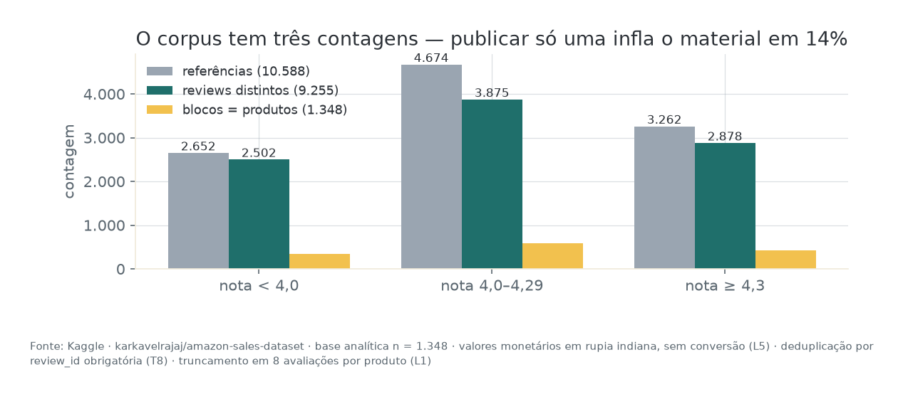

**Tabela 7.1 — Corpus textual por faixa de nota** (`tab06_corpus.csv`)

| Faixa de nota | Blocos (= produtos) | Referências | Reviews distintos |
|---|---:|---:|---:|
| < 4,0 | 339 | 2.652 | 2.502 |
| 4,0–4,29 | 591 | 4.674 | 3.875 |
| ≥ 4,3 | 418 | 3.262 | 2.878 |
| **Total** | **1.348** | **10.588** | **9.255** |

*Base: analítica, n = 1.348. As três colunas fecham nos três totais oficiais — é essa reconciliação que autoriza usar qualquer uma das contagens, desde que declarada.*

### 7.4 L1 — o truncamento em 8 avaliações, e por que é a limitação mais importante do projeto

A base disponibiliza **no máximo 8 avaliações por produto**; a média medida é **7,85**. Os blocos estão quase todos cheios, o que parece bom e não é: significa que o teto foi atingido em praticamente todo o catálogo. Um produto com 426.973 avaliações registradas em `rating_count` contribui com as mesmas 8 avaliações de texto que um produto com 200.

A consequência é de interpretação, não de cálculo. **O texto analisado não é uma amostra aleatória do que os consumidores escreveram: é o recorte que o marketplace escolheu exibir na página do produto.** Avaliações exibidas em vitrine são selecionadas por critérios do próprio marketplace — utilidade, recência, destaque — que não conhecemos e não podemos reconstruir.

Por isso a redação é fixada e não é negociável:

> Os achados de Customer Insights descrevem **os temas visíveis na vitrine**, não a distribuição real das opiniões. Nenhuma conclusão deste bloco pode ser expressa como "a maioria dos clientes pensa que…".

É a limitação mais importante do projeto inteiro por uma razão prática: ela é a única que derruba o bloco inteiro se for omitida. Apresentado como "a voz do cliente", este capítulo cai na primeira pergunta de quem conhece a base. Apresentado como "os temas visíveis", o mesmo achado permanece íntegro — e continua útil, porque a vitrine é justamente o que o consumidor lê antes de comprar. A limitação não diminui o resultado; ela troca o resultado por outro, menor e verdadeiro.

**Em linguagem de liderança:** não lemos a caixa de entrada do SAC. Lemos a vitrine — os oito comentários que o site escolheu mostrar. Isso responde "o que o cliente vê antes de comprar", e não "o que a maioria dos clientes acha".

Uma segunda limitação incide sobre o mesmo bloco (L2): as avaliações estão predominantemente em inglês, e o pipeline **remove tokens não latinos**, o que descarta conteúdo real antes da análise. Os temas extraídos representam o subconjunto em alfabeto latino. A parcela descartada não foi quantificada por idioma — e isso está declarado como lacuna, não resolvido por estimativa.

### 7.5 O que este bloco não afirma

Três vedações se aplicam com força particular ao texto, porque é aqui que a linguagem escorrega com mais facilidade:

- **T4 — nenhuma frase causal.** "Clientes reclamam de durabilidade porque o produto tem desconto alto" é indefensável a partir de co-ocorrência de termos. A forma correta é "o eixo falha e durabilidade aparece com marcador negativo em 7 dos 19 blocos de Q5".
- **T6 — `rating_count` é volume de avaliações.** Um produto muito comentado não é um produto muito vendido. Não há variável de venda na base (L4).
- **T7 — nenhum identificador de consumidor.** `user_id` e `user_name` não aparecem em visual, slide ou frame de vídeo, e a base versionada do projeto não os contém. Comentários são tratados de forma agregada; nenhum autor é identificado.

---

### 7.6 QA5 — os 19 produtos de alto risco, lidos um a um

Q5 devolve uma lista de **19 produtos** com volume ≥ p90 (36.384 avaliações) e nota < 4,0. Eles concentram **147 avaliações** no corpus, distribuídas em **19 blocos** (um por produto, como T8 exige): **49,5 mil caracteres de `review_content`**, ou 53,1 mil contando também os títulos, que é a unidade que o pipeline de texto usa.

**Por que aqui não se usa TF-IDF.** Dezenove blocos não sustentam estatística de texto: qualquer termo que apareça em três deles já vira 16% do corpus. A vedação está registrada em `escopo_perguntas.md` §4 e é a razão de QA5 usar **leitura qualitativa dirigida com protocolo de codificação**, e não estatística de frequência. Em Q7 o mesmo método vale porque o contraste tem 128 e 136 blocos (§5.8): o que muda entre as duas decisões é o tamanho do corpus.

**A resposta de QA5.** A pergunta é *quais temas de reclamação predominam*, e o livro de códigos tem nove eixos. Ordenados pelo número de blocos com marcador negativo:

| Eixo temático | Blocos com o eixo | Com marcador negativo | % dos 19 |
|---|---|---|---|
| Som, ruído e microfone | 15 | **15** | 78,9% |
| Preço e custo-benefício | 18 | **14** | 73,7% |
| Bateria e autonomia | 11 | **10** | 52,6% |
| Desempenho na tarefa | 13 | **9** | 47,4% |
| Conforto e encaixe | 11 | **9** | 47,4% |
| Construção e acabamento | 9 | **8** | 42,1% |
| Falha e durabilidade | 8 | **7** | 36,8% |
| Expectativa versus descrição | 8 | **7** | 36,8% |
| Entrega, embalagem e pós-venda | 5 | **2** | 10,5% |

*Fonte: `tab23_qa5_temas.csv` · base analítica · quadrante Q5, 19 produtos · unidade: bloco de review (= produto), até 8 avaliações por bloco (L1) · marcador negativo a até 60 caracteres do termo · denominador 19, nunca por avaliação.*

O tema que mais aparece com marcador negativo é **som, ruído e microfone** (15), mas o segundo é **preço e custo-benefício** (14 — o eixo está presente em 18 dos 19 blocos), seguido de **bateria e autonomia** (10). A leitura que a lista autoriza é de **presença**, e não de proporção de clientes (L1): o eixo de preço é frequente porque quase todo bloco comenta preço, e o marcador negativo a 60 caracteres não distingue "caro" de "vale o preço". Com 19 blocos, a ordem entre eixos próximos — conforto e desempenho, com 9 cada — não é informativa.

**A lista nominal dos 19 produtos está publicada em `02_results/tables/tab19_q5_risco_vitrine_nominal.csv`**, com nome, categoria, nível 2, volume de avaliações, nota bruta, nota corrigida, preço de tabela e desconto — produto a produto, como T2 exige para que a exceção ao piso amostral seja válida.

**A outra lista nominal do relatório também está publicada**, e a razão de estar é a mesma: recomendar ação sobre um conjunto que o leitor não consegue recuperar não é recomendação.

| Lista | Arquivo | *n* |
|---|---|---|
| Q5 — risco de vitrine | `tab19_q5_risco_vitrine_nominal.csv` | **19** |
| Q6 — lista acionável, já corrigida por Wilson (M22) | `tab20_q6_acionavel_nominal.csv` | **61** |

As duas são geradas por `src/gera_figuras.py`, que **falha** se as contagens divergirem de 19 e 61 — a lista não pode silenciosamente deixar de bater com o número publicado no texto.

> **Por que estes 19 são a ação mais imediata do relatório:** são os produtos **mais avaliados** — todos no decil superior de volume, proxy declarado de exposição (D-1) — e que **pior avaliação recebem**. São poucos e nominais: dá para agir produto a produto, em vez de sobre centenas de produtos de cauda.

---

### 7.7 Padrão visual: a paleta v06 e a regra 60-30-10

O padrão visual do projeto é uma **tabela única de tokens** (v06, de 24/09/2026), e não uma sugestão de estilo. A estrutura segue a regra 60-30-10 — 60% de base, 30% de estrutura, 10% de chamada — que existe para garantir que o olho encontre o ponto importante da página em vez de disputar atenção com seis elementos coloridos.

| Faixa | Papel | Tokens |
|---|---|---|
| **Base — 60%** | fundo de página, fundo de visual, bordas | `canvas` `#FFF4D6` · `card` `#FFFFFF` · `divisor` `#F0EADA` |
| **Estrutura — 30%** | texto, rótulos, eixos, grade | `tinta` `#2A2F35` (12,31:1) · `secundario` `#5B6770` (5,30:1) · `grade` `#9AA5B1` (2,28:1, nunca em texto) |
| **Chamadas — 10%** | série em foco, leitura positiva, ponto de atenção | `destaque` `#F2C14E` · `favoravel` `#1F6F6B` (5,41:1) · `atencao` `#DC6C09` (3,09:1) |

Os contrastes foram **calculados pela fórmula WCAG 2.1** (linearização sRGB, limiar 0,04045, coeficientes 0,2126/0,7152/0,0722) sobre o fundo creme, não estimados a olho. É esse cálculo que produz a regra mais contraintuitiva do padrão: **laranja nunca em texto corrido**. `atencao` mede 3,09:1, abaixo do mínimo AA de 4,5:1 — ele vale para elemento gráfico e para texto a partir de 18pt. Rótulo de leitura negativa usa `tinta`; quando for indispensável dar cor, a cor vai no ícone ou no marcador ao lado, nunca na palavra.

A versão anterior (v05) resolvia esse caso criando um token extra, `atencao_texto` `#B05607`. Ele **foi removido**: não existia na prancha aprovada, e a regra acima cobre o mesmo caso sem acrescentar cor. Saíram também `serie_ameixa` `#6E5C7B`, que não é uma das séries da prancha, e `#FFFBF0`, substituído por `canvas` na zebra de tabela. Toda remoção seguiu o mesmo princípio: **menos cor, mais regra.**

A **regra dos 10%** é verificada ao fechar cada página: há **um único** elemento em âmbar. Se há dois, não há foco — há decoração.

### 7.8 Por que a ordem das séries foi alterada

A prancha aprovada trazia a escala categórica nesta ordem: `âmbar · teal · ardósia · laranja · azul · ardósia clara`. A v06 usa `âmbar · azul · ardósia clara · laranja · teal · ardósia`. **Nenhuma cor foi trocada — só a ordem de atribuição.** E a razão não é estética.

Medido em ΔE (CIE76) sobre a simulação de deuteranopia de Viénot, o par **teal `#1F6F6B` × ardósia `#5B6770` fica em ΔE 1,6** — abaixo do limiar de percepção humana, que é ≈ 2,3. Sob deuteranopia, teal vira `#5F5F6C` e ardósia vira `#636370`: duas cores praticamente idênticas. Na ordem da prancha, esse par caía nas posições **2 e 3**, ou seja, **todo gráfico com 3 ou mais séries nascia com duas cores indistinguíveis** para um leitor com deuteranopia — que é a deficiência de visão de cores mais comum.

Pior separação do conjunto, por número de séries no visual:

| Séries no visual | Ordem da prancha | Ordem v06 |
|---|---|---|
| 2 | ΔE 82,9 ✅ | **ΔE 94,2** ✅ |
| 3 | ΔE 1,6 ❌ | **ΔE 32,8** ✅ |
| 4 | ΔE 1,6 ❌ | **ΔE 20,5** ✅ |
| 5 | ΔE 1,6 ❌ | **ΔE 16,7** ✅ |
| 6 | ΔE 1,6 ❌ | ΔE 1,6 ❌ |

**O trade-off foi real.** A ordem da prancha é mais bonita: âmbar e teal juntos dão o contraste quente-frio que caracteriza a identidade do projeto, e a v06 empurra o teal para a quinta posição, onde ele quase nunca aparece. Trocamos identidade visual imediata por legibilidade de todos os gráficos de 3 a 5 séries. Foi a escolha certa porque a primeira é percebida por quem olha o slide; a segunda decide se uma parte da plateia consegue ler o gráfico.

### 7.9 O limite de 5 séries é uma regra de leitura, não de gosto

A reordenação não resolve tudo, e o padrão diz isso em voz alta. Teal e ardósia estão ambos na paleta, então **nenhuma ordem** salva o caso de 6 séries: em algum momento os dois aparecem juntos. Não é defeito da ordem — é da composição da paleta.

A regra, portanto:

- visual com **até 5 séries** usa a escala categórica normalmente;
- visual com **6 séries** exige **rótulo direto** em teal e ardósia, ou agrupamento de categorias até caber em 5;
- **acima de 6 séries, o visual não existe.** Inventar uma sétima cor é descumprimento de T9; o caminho é agrupar.

Os outros 14 pares da paleta ficam todos em ΔE ≥ 16,7 sob deuteranopia — o problema é exclusivamente esse par, e por isso a regra é cirúrgica em vez de genérica. Duas regras acompanham: **âmbar e laranja nunca como séries adjacentes** (separação de 2,02:1, e ambos migram para o mesmo amarelo sob deuteranopia), e **escala certa para o dado certo** — categórica para grupos sem ordem, sequencial teal para intensidade sem ponto neutro, divergente **só** quando o zero tem significado.

### 7.10 T9 — a paleta vale em todo artefato, e é aplicada por ferramenta

A regra T9 foi acrescentada em 24/09/2026 e é a que dá dentes ao padrão: **toda saída visual do projeto usa exclusivamente a paleta v06** — `.pbix`, notebook, gráfico em Python, tabela, relatório, deck, vídeo, diagrama e qualquer arquivo gerado. A rubrica de avaliação pontua dashboard **e** vídeo; se os dois não parecerem o mesmo produto, a inconsistência é visível antes de qualquer número.

A segunda metade da regra é o que a torna cumprível: **a aplicação é sempre por ferramenta, nunca à mão.**

- **Power BI:** importar `tema_fase4_ambar_ardosia.json` **antes do primeiro visual**. Depois não funciona — cor aplicada manualmente se sobrepõe ao tema e o padrão se perde silenciosamente.
- **Python:** `from paleta import aplicar; aplicar()` na primeira célula de código. O módulo configura o ciclo de cores do matplotlib, os fundos, a grade e a tipografia de uma vez.
- **Conferência:** `python3 src/paleta.py` compara o módulo Python contra o tema `.json` e falha se divergir, inclusive acusando qualquer hex presente no tema que não esteja na tabela v06. A função `checar_series(n)` avisa quando o visual passa de 5 séries e recusa acima de 6.

**Cor escolhida no seletor, herdada de template ou de biblioteca é descumprimento.** A razão é operacional: uma regra que só existe em documento não é cumprida — é torcida. Escrita como módulo executável e como tema importável, ela passa a custar uma linha para obedecer e um comando para auditar.

Uma limitação de formato ficou registrada, porque é do Power BI e não do padrão: o JSON de tema comporta apenas `minimum`/`center`/`maximum` para escala de cor, sem campo para uma rampa de 6 ou 7 passos. O tema carrega a escala sequencial nesse trio (`#EAF3F2` → `#96C6C2` → `#12504D`), que o Power BI interpola; a escala divergente e qualquer uso em faixas discretas são aplicados pela formatação condicional do visual, com os hex lidos da tabela v06. Não é escolha manual de cor — é a mesma fonte, aplicada onde o formato do arquivo não alcança.

### 7.11 As cinco áreas do dashboard, em sete páginas analíticas

O enunciado apresenta a estrutura de cinco áreas como **referência, não obrigação**. O grupo a adotou por decisão própria: ela separa o material pelo eixo do problema — Preço → Desconto → Engajamento → Satisfação — e evita a página-depósito onde todo gráfico que sobra vai parar. Cada área existe para responder um conjunto declarado das 14 perguntas do escopo, e nenhum visual entra sem esse vínculo.

**As cinco áreas ocupam sete páginas analíticas**, precedidas de uma página inicial com o roteiro de navegação, os compromissos metodológicos e a equipe. O motivo da divisão é de leitura, não de conteúdo. A área 2 — *Produtos e Categorias* — concentra **seis das catorze perguntas** (Q4, QA3, Q5, Q6, QA6 e QA7), e é a §9.3 que fixa a distribuição página a página. Espremer isso numa tela significaria visuais pequenos demais para serem lidos numa gravação em 1080p, ou um acúmulo de abas internas que esconde metade do trabalho. Ela foi dividida em três páginas — **Categorias**, **Quadrantes** e **Rankings e arquétipos** —, cada uma cabendo inteira numa tela e podendo ser mostrada de uma vez no vídeo.

A divisão não cria área nova: a numeração das áreas continua a do enunciado, e as três páginas carregam o mesmo número de origem — 2a, 2b e 2c.

| # | Área | O que responde | Perguntas |
|---|---|---|---|
| 1 | **Visão Executiva** | tamanho e forma do portfólio, e onde o engajamento se concentra: corte de engajamento alto em p90 = 36.384 avaliações; **306 produtos (22,7% da base analítica) concentram 80% das avaliações**; os quatro grupos de volume × nota — Âncora 41 · Risco de vitrine 19 · Subexplorado 187 · Cauda frágil 227, 474 produtos ao todo; os outros 874 são intermediários | Q1 · QA2 |
| 2 | **Produtos e Categorias** | quem merece atenção produto a produto e categoria a categoria: os **19 produtos** de alto engajamento e nota abaixo de 4,0; os **187** candidatos a boa nota com pouco engajamento, dos quais **61** sobrevivem à correção de Wilson; as 4 categorias de nível 1 acima do piso; as **8 subcategorias** de nível 2 com 88,3% de cobertura, e o quanto a nota varia dentro de cada uma; os **4 arquétipos** comerciais e o contraste B × D | Q4 · QA3 · Q5 · Q6 · QA6 · QA7 |
| 3 | **Preços e Estratégia Comercial** | se desconto e nota andam juntos, e se o preço de tabela tem associação com a nota: desconto × nota **ρ = −0,150, p = 3,1e-08** — significativo e pequeno; preço de tabela × nota **ρ = +0,032, p = 0,236 — sem associação**; as 5 faixas de desconto com nota corrigida e volume; e se o preço de tabela acompanha o desconto: preço de tabela e preço com desconto medianos por faixa, **ρ = −0,063, p = 0,020** — não resiste à correção de multiplicidade | Q3 · QA1 · QA4 |
| 4 | **Customer Insights** | o que aparece no texto das avaliações, com o corpus declarado nas três contagens (1.348 blocos · 10.588 referências · 9.255 reviews distintos) e o truncamento em 8 avaliações dito na própria página; o contraste de termos entre nota baixa e alta em Electronics — som na baixa, imagem na alta —; os temas das 147 avaliações dos 19 produtos de Q5 | Q7 · QA5 |
| 5 | **Recomendações** | o que fazer com o que foi encontrado, e o que não pode ser afirmado: as cinco decisões, cada uma com o seu número, e o bloco completo das limitações L1 a L8 | Q8 |

Três regras de construção valem para as **oito páginas**:

1. **Rodapé com fonte, base usada, *n* efetivo e limiar aplicado** (T3). Toda página fecha com a fonte, a base analítica e o seu *n*, o *n* filtrado pelas segmentações, o corte de engajamento alto (p90) e a moeda (L5). Cinco bases convivem no projeto — 1.465 · 1.351 · 1.350 · 1.349 · 1.348 — e a analítica de 1.348 é o padrão. Um número sem base declarada é um número não verificável.
2. **No máximo um elemento em âmbar por página** (regra dos 10%).
3. **Cada limitação aparece onde morde.** L5 está no rodapé de todas as páginas; T6 — volume de avaliações, nunca vendas — está no cartão de volume e no "como ler" da Visão Executiva; L1 abre a página de Customer Insights; o bloco completo das oito limitações fica na página de Recomendações.

A área 4 recebe uma exigência a mais, e é a aplicação direta de tudo que está em 7.4: **o truncamento em 8 avaliações abre a própria página, antes de qualquer número do corpus, e não fica só no bloco de limitações da página 5** — e, no vídeo, imediatamente antes do bloco de Customer Insights, nunca depois. Uma limitação que só aparece depois da conclusão chega tarde.


---

## 8. Riscos, Limitações e Governança

Esta seção não é um disclaimer no rodapé. Ela é o mecanismo que separa um número que pode ser defendido na banca de um número que só pode ser repetido. Três perguntas a organizam: **o que esta base não permite afirmar** (limitações), **o que pode dar errado entre a medição e a fala do vídeo** (riscos e mitigação) e **como qualquer pessoa confere se o que dizemos é verdade** (reprodutibilidade e conformidade). Fecha com as decisões que ainda não foram tomadas e o que cada uma trava.

*Em linguagem de liderança: até aqui o relatório mostrou o que os dados dizem. Aqui ele mostra onde os dados calam — e por que continuar falando além desse ponto custaria caro.*

### 8.1 L8 — listagens variantes compartilham as mesmas avaliações

Esta limitação foi descoberta na revisão de 25/09 e **não constava das versões anteriores**. Ela é o achado de dados mais consequente do projeto.

Na Amazon, variantes de um mesmo anúncio — cor, tamanho, embalagem — **compartilham o contador de avaliações do produto-pai**. Medido na base analítica: **254 produtos (18,8%)** têm exatamente o mesmo par `(rating_count, rating)` que outro produto, em **96 grupos**.

**Consequência:** a soma de `rating_count` **não é** a soma de avaliações distintas. Dos 23.801.471, cerca de **5.564.434 (23,4%)** são contagem repetida.

**O que resiste e o que não resiste:**

| Métrica | Publicado | Colapsando variantes | Robusto? |
|---|---|---|---|
| Pareto 80% | 306 / 1.348 = **22,7%** | 266 / 1.190 = **22,4%** | ✅ sim |
| Electronics — share de volume | **59,7%** | **53,1%** | ❌ **não** |
| Computers & Accessories | 26,6% | 29,1% | ❌ não |
| Home & Kitchen | 12,6% | **16,4%** | ❌ não |
| Volume mediano do arquétipo D | 13.120 | 11.772 | ⚠️ desloca 10% |

*Fonte: base analítica, n = 1.348, contra a **base colapsada**, n = 1.190 — obtida fundindo os 254 produtos que repetem o par `(rating_count, rating)` nos seus 96 grupos (1.348 − 254 + 96). Esse 1.190 coincide por acaso com a cobertura das subcategorias acima do piso (§5.17): são contagens de coisas diferentes.*

**Regra adotada:** toda leitura de "participação no volume" por categoria passa a citar **as duas versões**. A concentração de Pareto segue publicada com um único número, porque é robusta.

**Por que a deduplicação não pegou isto:** os `product_id` das variantes são legitimamente diferentes — são produtos distintos no catálogo. O que coincide é a origem das avaliações, e isso só aparece procurando por volume e nota idênticos entre produtos diferentes.

---

### 8.2 As oito limitações e o que cada uma proíbe dizer

Uma limitação só vale alguma coisa quando vira uma frase vedada. Abaixo, cada uma está traduzida na restrição prática que impõe ao `.pbix`, ao vídeo e a este relatório.

| # | Limitação | O que fica **vedado afirmar** | Onde a restrição morde |
|---|---|---|---|
| **L1** | Truncamento em 8 avaliações por produto (média medida **7,85**; máximo **8**) | "a maioria dos clientes pensa que…" | Todo o bloco de Customer Insights |
| **L2** | Corpus predominantemente em inglês; o pipeline remove tokens não latinos | "os temas cobrem todas as avaliações" | QA5 |
| **L3** | Só **4** das **9** categorias de nível 1 têm n ≥ 30 | "análise de portfólio por categoria" sem ressalva | Q1, Q4 |
| **L4** | Não existe variável de venda, receita, margem, estoque ou data | qualquer recomendação em reais, unidades ou tendência | Recomendações, Q8 |
| **L5** | Marketplace indiano, valores em rupia indiana, sem conversão | transpor faixas de preço para o mercado brasileiro como resultado | Toda a página de Preços |
| **L6** | **114** linhas excedentes em **92** `product_id`, **31** com `rating_count` divergente | "a base está limpa na origem" | Preparação dos dados |
| **L7** | Recorte do catálogo, sem pesos amostrais | generalizar para o marketplace inteiro ou para o e-commerce | Toda conclusão |
| **L8** | **254** produtos (18,8%) em **96** grupos repetem o mesmo par nota × volume — listagens variantes do mesmo item | participação por categoria sem citar as **duas** versões, com e sem variantes | Q1, Q4, §5.18, página 2a |

**L1 — truncamento.** A base entrega no máximo 8 avaliações por produto, e a média medida é 7,85 (base analítica, n = 1.348). Esse recorte não é amostra aleatória: é o que o marketplace escolheu exibir na página. A consequência é dura e vale a pena dizê-la sem rodeio — o bloco de Customer Insights descreve **os temas visíveis na vitrine**, não a distribuição real das opiniões. Apresentada como "a voz do cliente", a análise cai na primeira pergunta de quem conhece a base; apresentada como "os temas visíveis", o achado sobrevive intacto. *A analogia: lemos os depoimentos que a loja pendurou na parede, não o livro de reclamações.*

**L2 — idioma.** A limpeza que torna o texto analisável também descarta conteúdo real. A parcela removida **não foi quantificada por idioma** — e declarar isso é mais honesto do que estimar.

**L3 — concentração de categorias.** Electronics (490), Home & Kitchen (447) e Computers & Accessories (373) somam **97,2%** da base analítica; Office Products tem **31**, exatamente um produto acima do piso de 30. As outras cinco categorias somam **7 produtos** e nunca são ranqueadas (regra T2). Há uma fragilidade extra aqui: **um único** produto reclassificado tira Office Products do piso e reduz a "análise por categoria" a três famílias.

*(ver **Figura 5**, seção 5.5)*

**L4 — ausência de variável de venda.** `rating_count` é **volume de avaliações**, um proxy de engajamento (regra T6). A base não traz unidades, receita, margem, estoque nem data. Isso elimina de uma vez toda a família de análises temporais — tendência, sazonalidade, evolução — e proíbe qualquer recomendação expressa em retorno financeiro. Foi também o critério que descartou previsão de vendas e séries temporais do registro de machine learning: não há alvo para treinar.

**L5 — mercado e moeda.** Mediana de preço de tabela 1.795 e de preço com desconto 899 (base analítica, n = 1.348) descrevem o comportamento **daquele** mercado. A transposição para outro país é analogia, e precisa ser dita na abertura do vídeo, não no fim.

**L6 — inconsistências da origem.** A medição em `src/valida_base.py` (seção *Inconsistências da origem — L6*) mostra que as duplicidades são coletas repetidas do mesmo produto com defasagem no contador: **nota, categoria e nome nunca divergem**; a divergência relativa máxima de `rating_count` é **0,17%**; a diferença agregada entre as duas regras candidatas é de **40 avaliações em 23.802.463** (0,0002%). **O preço de tabela diverge em um produto e o preço com desconto em três**; em dois deles a divergência está dentro de um empate de `rating_count` (`B096MSW6CT`, 999 × 1.899, e `B0B5LVS732`). É justamente esse caso que torna o desempate obrigatório — sem ele, o preço desse produto depende do algoritmo de ordenação da biblioteca.

**L7 — amostragem.** Sem pesos amostrais, o alcance de qualquer conclusão é o recorte. Dito de forma útil: o que este trabalho entrega é um **método** aplicável ao catálogo completo, não um retrato do catálogo completo.

---

### 8.3 Matriz de riscos e mitigação

A classificação de severidade abaixo é **julgamento do grupo**, não medição — e está marcada como tal para não se confundir com os números da base. O que é medido aparece na coluna de evidência.

| # | Risco | Gatilho observável | Mitigação | Evidência que prova |
|---|---|---|---|---|
| **R1** | Número publicado sem base declarada | cinco bases convivem: 1.465 / 1.351 / 1.350 / 1.349 / 1.348 | regra T3 + rodapé obrigatório em todo visual | `tab01_bases_oficiais.csv` · fig01 |
| **R2** | Leitura causal chegar ao vídeo | "desconto alto **causa** nota baixa" | regra T4; toda associação escrita como "está associado a" | `tab03_correlacoes.csv` |
| **R3** | Coeficiente pequeno apresentado como achado forte | ρ = −0,150 é significativo (p = 3,1e-08) **e** pequeno | regra T5: magnitude sempre ao lado da significância | fig04 |
| **R4** | `rating_count` narrado como venda ou demanda | qualquer frase com "vendeu", "receita", "procura" | regra T6 + L4 lida junto às recomendações | — |
| **R5** | Ranking por nota dominado por produto com poucas avaliações | topo do ranking com n baixo | regra T1: nota corrigida (Wilson) com o *n* ao lado | `tab08_faixas_desconto.csv` (coluna Wilson) |
| **R6** | Grupo pequeno ranqueado | 5 categorias somam 7 produtos | regra T2, com supressão declarada no rodapé | `tab04_categorias.csv` |
| **R7** | Dado pessoal em tela | `user_id` / `user_name` em visual ou frame | regra T7; a base versionada **não contém** as duas colunas | `00_data/README.md` |
| **R8** | **Métrica de ML não reproduzir em outra máquina** | tamanhos de cluster e AUC por bloco divergentes entre fontes | pinagem de versões em `requirements.txt` + semente 42 + ordem canônica das linhas · assertion do ML4 na geração da `tab22` | **materializado e fechado — ver 8.4.4** |
| **R9** | Falso verde no controle | validador sai com código 0 mesmo com asserções puladas | ler a linha "PULADAS" antes de aceitar o resultado | **materializado — ver 8.4.1** |
| **R10** | Evidência datada inexistente ou velha | `docs/evidence/` sem `E01`/`E02`/`E03` | regerar a cada alteração de base ou medida | **aberto** |
| **R11** | Cor fora do padrão | cor escolhida no seletor, herdada de template | regra T9 aplicada por ferramenta (tema `.json`, `src/paleta.py`) | `python3 src/paleta.py` sai 0 |
| **R12** | Decisão aberta virar improviso na véspera | Q1 e Q6 sem fórmula fechada | **materializado e encerrado em 24/09/2026** — as duas fecharam sem criar limiar novo (§8.6) | `method/open_decisions.md` |
| **R13** | Esforço migrar para artefatos que não pontuam | relatório e deck consumindo tempo do `.pbix` e do vídeo | teto de esforço declarado: os 9 critérios recaem sobre as duas entregas, `.pbix` e vídeo | `README.md` |

Três riscos merecem comentário, porque **já aconteceram** dentro do próprio projeto — e é melhor que um avaliador os encontre aqui, descritos, do que os descubra sozinho.

---

### 8.4 Reprodutibilidade: cinco controles e o que cada um não cobre

O princípio é simples: **afirmação sem comando que a reproduza é opinião**. O projeto tem **cinco** controles, em ordem crescente de fragilidade — o mais recente deles, o validador do dicionário, nasceu de um defeito que os outros quatro não pegavam.

#### 8.4.1 O validador de 107 asserções

`src/valida_base.py` reexecuta, como asserção, todo número publicado em `method/definitions/base_factual_e_bases_de_calculo.md`. Cada linha da saída declara **sobre qual das cinco bases** foi medida — o que é a regra T3 virada em código, não em recomendação.

```bash
python3 src/valida_base.py 00_data/bronze/amazon.csv
```

Execução de **31/10/2026**, em ambiente criado a partir do `requirements.txt` do projeto: **107 asserções executadas, 0 falhas, 0 puladas, código de saída 0**.

**A linha "Puladas" é parte do resultado, não enfeite.** Numa execução anterior, feita sem `scipy` instalado, o script reportou **94 executadas e 8 puladas** — os quatro pares de Spearman, com ρ e *p* cada. Ele **não as aprovou em silêncio**: declarou que não as verificou. É a diferença entre um validador que afirma o que mediu e um que afirma o que gostaria de ter medido, e é por isso que a checklist de publicação exige *"saiu com 0 **e** a linha Puladas está zerada"* — as duas condições, não só a primeira.

Duas leituras, e a segunda é a que importa:

1. O script se recusa a aprovar em silêncio: ele imprime `PULA` e lista o que não verificou, sob o rótulo *"não foram verificadas"*. Essa escolha de projeto está certa.
2. **Mesmo assim ele sai com código 0** e imprime "Todas as asserções conferem". Um portão automatizado que olhe só o código de saída aceitaria uma execução em que **8** asserções — todas as correlações, que sustentam Q3 e QA4 — jamais rodaram. A mitigação hoje é humana: ler a linha "Puladas: 8" antes de aceitar o verde. A correção estrutural (sair com 1 quando houver pulada, ou exigir `--permitir-puladas`) está registrada em 8.5 como lacuna.

*A analogia: o alarme tocou e avisou que oito sensores estavam desligados — mas a luz do painel continuou verde.*

**Alternativa descartada:** conferir os números "olhando o notebook". Foi descartada porque o notebook prova que o número saiu de um cálculo, não que o cálculo **ainda** dá aquele número depois de qualquer alteração. A asserção falha; a célula executada em outro dia apenas mostra outro valor, e ninguém percebe.

#### 8.4.2 O validador do dicionário — e o defeito que o criou

Um segundo validador foi acrescentado em 01/10/2026, e o defeito que o justifica vale ser explicado porque é instrutivo: o **dicionário de dados descrevia cinco campos derivados com nomes que o pipeline havia abandonado** — `desconto_recalculado`, `engajamento_alto`, `visibilidade_baixa`, `satisfacao_baixa` e `subcategoria` não existiam em nenhum artefato —, enquanto três colunas que existem de verdade (`q5_risco_vitrine`, `faixa_desconto`, `pareto_80`) não estavam documentadas.

**A divergência atravessou três revisões sem ser notada**, e a razão é simples: ninguém cruza um `.md` com um `.csv` a olho. Ela também não aparece em nenhum número publicado — aparece para quem tenta **modelar o `.pbix` usando o dicionário como referência** e não encontra as colunas.

```bash
python3 src/valida_dicionario.py
```

Confere quatro coisas e falha na primeira divergência:

| Verificação | O que pega |
|---|---|
| Todo campo declarado em §2 do dicionário existe na gold | nome de coluna que o pipeline renomeou |
| §3 lista **exatamente** as colunas de cada arquivo | coluna acrescentada ao esquema e não documentada — e o contrário |
| A contagem de colunas é **lida do dicionário**, não fixada no script | contagem escrita errada no documento. O script valida o que o texto afirma, não uma constante sua |
| Nenhum artefato versionado tem `user_id` ou `user_name` | T7 mecanizada numa segunda camada, independente de `valida_base.py` |

**A leitura do dicionário é estrutural, não por busca de texto** — e essa escolha tem consequência prática. Só contam as posições em que um nome de coluna pode estar: as primeiras células das tabelas de §1 e §2 e as listas de §3. Varrer todas as crases do arquivo produziria falso positivo em `alto`, `baixa`, `media` e nos demais **valores** de coluna categórica, que também aparecem em crase e não são colunas. A primeira versão deste script fazia exatamente isso e acusou sete divergências, das quais **seis eram falso positivo**. Um validador que acusa o que está correto é desligado na segunda semana — e um validador desligado não protege nada.

---

#### 8.4.3 O SHA-256 da base

A base bruta **não é versionada** — ela contém `user_id` e `user_name`, e o repositório é público (ver 8.5). No lugar do arquivo, o projeto versiona a sua identidade:

```
4ba126c4ba8edd35e62e94ce1c853073d832de380184ab4f5f97d1e314882c77
```

O validador confere esse hash **antes** de qualquer contagem, e `EXECUCAO.md` instrui a parar se ele divergir. Não é formalidade: o Kaggle pode republicar um dataset com o mesmo nome e conteúdo diferente, e nesse cenário todos os números ficariam errados de uma vez, sem nenhum sintoma visível. O hash converte uma falha silenciosa em uma falha barulhenta. Na execução de 24/09/2026 o arquivo local confere com o hash publicado.

**Alternativa descartada:** versionar a base bruta e comparar arquivos. Descartada por conflito direto com a LGPD — subir `user_id` e `user_name` para um repositório público é exatamente o que a regra T7 existe para impedir.

#### 8.4.4 A pinagem de versões — e o risco R8 materializado

`requirements.txt` fixa versão exata de onze bibliotecas — sete de análise e quatro de geração dos documentos, e o cabeçalho do arquivo explica por quê: **`random_state=42` só reproduz os números publicados com a mesma versão do `scikit-learn`**. Semente fixa garante que *o mesmo código, na mesma versão* produza o mesmo resultado — não que duas versões produzam o mesmo resultado.

Isso deixou de ser hipótese. O projeto teve **duas fontes** para os mesmos números de ML, e elas divergiram:

| Arquétipo (ML4, k = 4) | registro, antes do alinhamento | `tab05_arquetipos.csv` — publicado | Δ |
|---|---|---|---|
| A — ticket alto, desconto contido | 267 | 268 | +1 |
| B — desconto agressivo sem tração | 337 | 335 | −2 |
| C — baixo preço, pouco desconto | 299 | 298 | −1 |
| D — alto giro com desconto alto | 445 | 447 | +2 |
| **Soma** | **1.348** ✅ | **1.348** ✅ | — |

A magnitude — 1 a 2 produtos por grupo — é **exatamente** a que `requirements.txt` documenta como efeito de troca de versão. A leitura de negócio não muda: B continua sendo o único grupo abaixo do limiar de satisfação (nota mediana 3,9) e o candidato natural a revisão de sortimento. Mas o número publicado muda, e publicar dois números diferentes para a mesma medida é o defeito que este relatório passou oito seções evitando.

O mesmo vale para o ML2. O registro de método trazia AUCs de 0,640 · 0,655 · 0,715 · 0,755 e a tabela publicada, 0,622 · 0,624 · 0,691 · 0,750 — diferenças de 0,005 a 0,031, dentro da dispersão entre partições. **Os dois conjuntos foram superados em 31/10/2026**, quando a validação passou a agrupar as listagens-gêmeas (§6.3): 0,556 · 0,583 · 0,658 · 0,704. A conclusão estrutural não se move — nenhum bloco isolado chega perto do conjunto, e por isso o sinal é multivariado —, e é essa frase que entra no material, acompanhada de **AUC 0,70 ± 0,01**, nunca de três casas decimais que a medição não sustenta.

*(ver **Figura 11**, seção 6.3)*

**Como fechou.** Pela regra de precedência de §6.1, vale a tabela publicada: o registro de método foi alinhado à `tab05` e à `tab07`, e os valores antigos ficaram revogados por escrito, não apagados. E o ML4 ganhou o controle que não tinha. O dashboard passou a depender da letra de cada produto — a `tab22_arquetipo_por_produto.csv` é mesclada à `BaseAnalitica` no Power Query —, e por isso `src/gera_figuras.py` agora **falha** se os tamanhos dos arquétipos se moverem um produto que seja. A verificação independente da `tab22` mediu ainda uma segunda sensibilidade, além da versão: **a ordem das linhas**. Reordenada por `product_id`, a mesma especificação desloca 2 produtos de letra. A ordem canônica — volume de avaliações decrescente, desempate pela ordem de origem — é a mesma na gold, no gerador e no notebook `04_analises`, e é ela que reproduz 268 · 335 · 298 · 447.

**O ambiente de trabalho também não obedecia à pinagem, e isso foi corrigido.** Medido em 24/09/2026: `pandas 3.0.4` (fixado 3.0.6), `numpy 2.5.0` (fixado 2.5.3), `matplotlib 3.11.0` (fixado 3.11.2); **`scipy` e `scikit-learn` ausentes**. Naquele dia, duas consequências concretas: as correlações de Q3 e QA4 não podiam ser verificadas, e o ML2 e o ML4 não podiam sequer ser reexecutados. Os números descritivos, esses, conferiram — 94 de 94 —, o que também informava: a divergência de ML não vinha do `pandas`. **Desde 01/10/2026 o ambiente é criado do `requirements.txt`**, e é nele que as 107 asserções passam com 0 falhas e 0 puladas e que ML2 e ML4 são reexecutados.

Há ainda um segundo modo de falha, documentado e mais perverso que o primeiro. A gold é gravada **em ordem decrescente de volume de avaliações**; sem `shuffle=True` no `StratifiedKFold` ingênuo, as partições ficam quase puras por faixa de volume e o AUC medido cai para **≈0,33** — pior que o acaso. Quem reproduzir sem essa cláusula concluirá, de boa-fé, que o modelo não funciona. Por isso a especificação de reprodução é obrigatória e não uma nota de rodapé: Random Forest, 300 árvores, `random_state=42`, preditores numéricos padronizados, categoria de nível 1 em *one-hot*, `StratifiedGroupKFold(n_splits=5, shuffle=True, random_state=42)` agrupada por variante (§6.3).

**O que o validador não cobre, e por quê.** As 107 asserções cobrem a base descritiva — contagens, cortes, distribuição, categorias, corpus, correlações. **Nenhuma cobre ML2 ou ML4.** É precisamente onde a divergência apareceu, e a coincidência não é acidental: o que não tem asserção é o que diverge sem aviso. A justificativa registrada para não cobrir é o teto de esforço — os 9 critérios do enunciado não incluem modelagem. A justificativa é defensável para o esforço de **construção** do modelo; é fraca para o **controle** do número publicado. Consta em §8.3, risco R8. **Desde 26/10/2026 o ML4 deixou de estar descoberto:** as contagens dos arquétipos são conferidas por assertion na geração da `tab22`. O ML2 continua sem controle automático — e por isso seus AUCs só se publicam com o desvio entre partições ao lado.

#### 8.4.5 O módulo de paleta

A regra T9 diz que a paleta v06 vale em todo artefato. Uma regra que só existe em documento não é cumprida — é torcida. `src/paleta.py` transforma a regra em duas linhas de código (`from paleta import aplicar; aplicar()`) e, mais importante, torna o descumprimento **detectável**:

```bash
python3 src/paleta.py
```

O script compara os tokens do módulo Python com `tema_fase4_ambar_ardosia.json` do Power BI e varre o tema atrás de qualquer hex fora da tabela v06. Execução em 24/09/2026: **19 cores distintas, 6 séries categóricas, 6 passos sequenciais, 7 divergentes, nenhuma cor fora da paleta** — código de saída 0.

A função `checar_series()` implementa o limite que a paleta impõe por composição, não por gosto: **teal e ardósia ficam em ΔE 1,6 sob deuteranopia**, abaixo do limiar de percepção (≈2,3). Até 5 séries, a escala funciona; com 6, os dois aparecem juntos em qualquer ordem, e rótulo direto passa a ser obrigatório. O módulo avisa em `stderr` na sexta série e levanta erro na sétima.

**Alternativa descartada:** manter a paleta apenas como tabela no documento de design. Descartada porque o `.pbix` e o vídeo são avaliados por critérios separados — se não parecerem o mesmo produto, a inconsistência é visível antes de qualquer número, e nenhuma tabela em Markdown impede alguém de clicar no seletor de cor.

---

### 8.5 Conformidade: LGPD, termos da base e ética em avaliações

O bloco regulatório deste projeto tem três itens, e **nenhum** deles é do setor financeiro.

**LGPD (Lei nº 13.709/2018).** A base bruta contém `user_id` e `user_name` — na base analítica (n = 1.348) são **9.036 usuários distintos**; o arquivo bruto traz **9.050** `user_id` e **7.699** `user_name` distintos. São dados pessoais. Três controles operam em camadas, e a ordem importa:

1. **Minimização na origem.** As bases versionadas no repositório — silver com **9 colunas** e gold analítica com **17** — não incluem `user_id` nem `user_name`, e o arquivo de **texto livre não é versionado** (§3.4). O dado pessoal não é escondido no dashboard — ele não entra no repositório. É a única medida que continua valendo se alguém errar as outras duas.
2. **Vedação de exibição (T7).** Nenhum identificador aparece em visual, slide ou frame do vídeo. O validador declara explicitamente que não imprime nenhum dos dois.
3. **Vedação de reidentificação.** Cruzar avaliações para reconstruir o comportamento de um consumidor está proibido, mesmo com o dado disponível localmente.

Vale registrar um ponto de fronteira, porque ele aparece no registro de ML: a estatística "**909 de 9.036 usuários (10,1%) avaliam mais de um produto**" é agregada e não identifica ninguém — e foi exatamente ela que **descartou filtragem colaborativa** do escopo. Medir a esparsidade da matriz é conformidade; listar quem são os 909 não seria.

**Termos da base pública (Kaggle).** A fonte — `karkavelrajaj/amazon-sales-dataset` — é de citação obrigatória em **todo** visual e no material final, não apenas na bibliografia. Uso acadêmico, **sem redistribuição do arquivo bruto**: o repositório publica o **hash** dele e as camadas **derivadas** (silver e gold), que trazem identificador de produto, nome, preço, desconto, nota e volume de avaliações. Ficam de fora o arquivo de origem, o texto das avaliações e todo identificador de consumidor. Quem quiser reproduzir baixa o bronze no Kaggle e confere o hash.

**Ética em dados de avaliação pública.** O fato de um comentário estar visível na internet não o torna material livre para qualquer tratamento. Três regras: comentários entram **sempre agregados**; nenhum autor é identificado; nenhuma citação literal de avaliação individual vai para o vídeo ou para o dashboard. Some-se a isso a limitação L1 — o corpus é o recorte da vitrine —, e a postura ética e a postura estatística convergem: nenhuma frase de Customer Insights começa com "a maioria dos clientes".

*(ver **Figura 13**, seção 7.3)*

A regra T8 fecha o ciclo no lado técnico: há **1.333 referências repetidas** entre **10.588** referências e **9.255** `review_id` distintos (**759** aparecem em mais de um produto). Quem publicar "referências" no lugar de "reviews distintos" apresenta um corpus **14% maior do que ele é**. Declarar a unidade não é preciosismo de método — é a diferença entre dimensionar e inflar.

---

### 8.6 As oito decisões registradas, e como cada uma fechou

`method/open_decisions.md` é arquivo vivo e existe para encolher até zero. **Chegou a zero: as oito estão fechadas.** D-1, D-2 e D-4 em 24/09/2026; D-3, D-5, D-7 e D-8 em 01/10/2026; D-6 em 12/10/2026. A regra de governança é explícita: **apontar o risco é obrigação de quem revisa; decidir a mudança é de Ricardo** (Lei de Falkland).

| # | Decisão | O que trava **hoje** | Resolução registrada |
|---|---|---|---|
| ~~D-1~~ | ~~Visibilidade~~ | — | ✅ **fechada em 24/09/2026** — proxy declarado (§5.18) |
| ~~D-2~~ | ~~Fórmula de relevância~~ | — | ✅ **fechada em 24/09/2026** — matriz 2×2 (§5.18) |
| ~~D-3~~ | ~~`nota_corrigida`: Wilson ou média bayesiana~~ | — | ✅ **fechada em 01/10/2026** — Wilson 95%, com a ressalva metodológica declarada em §3.7 |
| ~~D-4~~ | ~~Promover as 4 cores da escala teal a tokens~~ | — | ✅ **fechada em 24/09/2026** — as 4 cores entraram na v06 como escala categórica; nenhum token novo |
| ~~D-5~~ | `about_product`: destino ou exclusão justificada | — | ✅ **fechada em 01/10** — exclusão justificada: `about_product` descreve promessa do vendedor, não percepção do consumidor |
| ~~D-6~~ | ~~Confirmar com a instituição a data oficial de entrega~~ | — | ✅ **fechada em 12/10/2026** por decisão de Ricardo — a data não condiciona nenhum número, análise ou conclusão; segue como informada, com a procedência declarada |
| ~~D-7~~ | Recriar o catálogo de medidas M01–M10 e a matriz de aderência C1–C9 | — | ✅ **fechada em 01/10/2026** — catálogo de **22 medidas** (M01–M22) + matriz C1–C9 |
| ~~D-8~~ | Declarar a cobertura das perguntas de Customer Insights do enunciado | — | ✅ **fechada em 01/10** — amarração no relatório e no escopo |

**A ordem que foi efetivamente seguida, e por quê.** D-1, D-2 e D-4 primeiro (24/09): bloqueavam medidas, duas das oito perguntas do enunciado e o primeiro visual — nenhuma página de ranking fechava sem elas. Depois D-3, D-5, D-7 e D-8 (01/10): D-3 porque materializa T1 em toda ordenação; D-7 e D-8 porque pontuam direto em dois dos nove critérios, com a melhor relação esforço/retorno da lista; D-5 porque a exclusão de `about_product` precisava de motivo registrado, não de silêncio. **D-6 ficou por último de propósito**: era a única que dependia de terceiro e a única que não bloqueava nada — e fechou exatamente por isso, ao se constatar que a resposta não mudaria nada no material.

**Por que D-6 pôde fechar sem resposta da instituição.** Antes de decidir, mediu-se o que era mensurável sem terceiro. Extraímos a camada de texto do enunciado (`docs/enunciado_fase4.pdf`, 8 páginas):

| Verificação | Resultado |
|---|---|
| O enunciado traz a data de 17/11/2026? | **Não** |
| O enunciado traz **qualquer** data de entrega? | **Não** — nenhuma data em formato numérico, nenhum ano, nenhuma expressão de prazo ("prazo", "data limite", "entrega até") |

*Fonte: enunciado do Tech Challenge, camada de texto extraída integralmente · verificação de ausência, não de valor.*

**A data não vem do enunciado, e o projeto já declara isso.** `method/open_decisions.md` (D-6) registra que *"17/11/2026 foi informada pelo grupo e **não consta do enunciado**"*. A procedência está correta e declarada — e isso basta, porque a confirmação oficial não alteraria nada do que este relatório afirma.

**Por isso D-6 fechou por decisão, e não por resposta.** Ela não condicionava nenhuma análise, nenhuma medida, nenhuma figura e nenhum bloco do vídeo — a pior hipótese, a data estar errada, seria um erro de **calendário do grupo**, que nenhuma escolha metodológica deste relatório pode causar ou evitar. Aguardar uma confirmação que não mudaria o conteúdo seria manter aberta uma pendência sem objeto.

**A lição que vale generalizar.** Das oito decisões, a última a fechar foi a única que dependia de alguém de fora. As sete internas fecharam porque bastava decidir; esta fechou quando se perguntou o que a resposta mudaria — e a resposta era nada. É útil distinguir os dois tipos num registro de decisões, e fazer essa pergunta antes de esperar: *uma pendência externa que não condiciona o conteúdo não é pendência, é curiosidade.*

---

### 8.7 Ponto de verificação antes de publicar

Toda página do `.pbix` e todo bloco do vídeo passam por esta lista. Ela não é resumo desta seção: é o instrumento que a torna executável.

- [ ] todo número declara fonte, base e *n* efetivo (**T3**)
- [ ] todo ranking por nota está corrigido, com o *n* ao lado (**T1**)
- [ ] nenhum grupo agregado com n < 30 foi ranqueado ou comparado (**T2**)
- [ ] nenhuma frase afirma causa (**T4**)
- [ ] toda associação mostra magnitude **e** significância (**T5**)
- [ ] `rating_count` não foi chamado de venda, receita ou demanda (**T6**)
- [ ] nenhum identificador de consumidor aparece (**T7**)
- [ ] todo corpus textual declara unidade, deduplicação e truncamento (**T8**)
- [ ] a saída usa a paleta v06 aplicada por ferramenta e respeita o limite de séries (**T9**)
- [ ] `src/valida_base.py` saiu com 0 **e** a linha "Puladas" está zerada
- [ ] `src/valida_dicionario.py` saiu com 0 — o dicionário não divergiu do esquema
- [ ] `src/paleta.py` saiu com 0
- [ ] a evidência datada em `docs/evidence/` foi regerada após a última alteração

O último item merece a frase com que a própria pasta de evidências se descreve: **evidência velha é pior que evidência nenhuma — ela afirma algo que já não é verdade**.


---

## 9. O Dashboard em Power BI

### 9.1 Estado desta entrega

O dashboard **está construído**: uma página inicial e as sete páginas analíticas, na versão **TC4.R**, exportada em PDF em 13/11/2026. Este capítulo descreve o arquivo entregue: o modelo de dados, as **22 medidas** com valor de referência calculado em Python, o que cada uma das oito páginas mostra e o tema visual. O que cada elemento de cada página representa, item a item e com as telas, está no **manual de leitura** (`docs/manual_leitura_dashboard_v1.pdf`).

O `.pbix` foi o último artefato construído, e não por atraso — é a ordem fixada do projeto (§1.3). E a razão dela mudou de ênfase com a decisão de refazer a preparação no Power Query (§1.6): não é mais que o Power BI apenas consome o que o Python produziu, e sim que **definição que muda tarde custa caro nele e barato no Python**. Mudar um corte de engajamento é uma constante num notebook; no `.pbix` é um conjunto de medidas, filtros, títulos e rótulos espalhados por sete páginas.

O que o Python continua fazendo, e o Power BI não substitui, são **três coisas que o `.pbix` não consegue mostrar sobre si mesmo**: a trava de integridade da origem (o Power Query não tem função de hash), os testes automáticos (o Power BI não executa testes) e o valor de referência de cada medida — porque uma ferramenta não confere a si mesma. Quando uma medida DAX devolve 4,065, o que atesta esse número é um segundo cálculo, feito por outro caminho.

### 9.2 O modelo de dados

**A preparação é refeita dentro do `.pbix`**, em consultas encadeadas do Power Query que partem do arquivo de origem e chegam às duas tabelas de fato do modelo. Cada etapa recebe nome descritivo — é o que o avaliador vê ao abrir o Power Query, e é a evidência do critério C2.

| Consulta | Origem | Carrega no modelo | Resultado |
|---|---|---|---|
| `bronze_amazon` | o arquivo como veio do Kaggle | **não** | 1.465 × 17 (16 + `ordem_origem`) |
| `silver_produtos` | `bronze_amazon` | **não** | 1.351 produtos |
| `gold_intermediaria` | `silver_produtos` | **não** | 1.348 produtos |
| **`BaseAnalitica`** | `gold_intermediaria` + `tab22` | sim | **1.348 × 25** |
| **`Reviews`** | `gold_intermediaria` | sim | **9.255 × 5** |
| `tab22` | `02_results/tables/` | **não** — só para a mesclagem | 1.348 × 2 |
| `tab03` `tab05` `tab07` `tab14` `tab23` | `02_results/tables/` | sim, **sem relacionamento** | as linhas de cada arquivo |
| `Conferencia` | `03_dashboard/conferencia_referencia.csv` | sim, **sem relacionamento** | 33 × 9 |
| `gold_python` | `00_data/gold/base_analitica.csv` | **não** — o gabarito | 1.348 × 17 |
| `qa_compara_gold` | `BaseAnalitica` × `gold_python` | **não** | **zero linhas** |

**Duas consequências dessa arquitetura, e as duas são deliberadas.**

A primeira é de conformidade: as consultas intermediárias **não carregam no modelo**. É isso que impede o `.pbix` de gravar `user_id`, `user_name` e o texto das avaliações — eles existem dentro do Power Query, durante a transformação, e não chegam ao arquivo. Carga ativa numa consulta intermediária gravaria dado pessoal no entregável mesmo sem exibi-lo em visual nenhum.

A segunda é de verificação: a consulta **`qa_compara_gold`** compara a `BaseAnalitica` com a camada gold do Python, coluna a coluna — as 17 colunas que a gold tem —, com tolerância de `1e-9` na nota corrigida. Ela **tem de devolver zero linhas**, e nenhuma página é montada antes disso. É o que impede o projeto de ter duas verdades — o Power BI mostra a transformação, a camada gold continua canônica, e a divergência entre as duas é detectada antes de virar visual.

**A camada gold do Python, portanto, não sai de cena: ela passa a ser o gabarito.**

| Arquivo da gold | Linhas | Papel no `.pbix` |
|---|---|---|
| `base_analitica.csv` | **1.348** | gabarito da `BaseAnalitica`, coluna a coluna, pela `qa_compara_gold` |
| `reviews.csv` | **9.255** | gabarito da contagem da `Reviews`, deduplicada por `review_id` (T8) |

Relacionamento **um para muitos** de `BaseAnalitica[product_id]` para `Reviews[product_id]`, com filtro **unidirecional**. Bidirecional criaria ambiguidade sem ganho: nenhum visual precisa filtrar produto a partir de avaliação.

**Seis arquivos vêm prontos do Python, e o modelo diz o que cada um vira.** O Power Query refaz a preparação, mas não treina modelo, não tem TF-IDF nativo e não pode carregar o texto das avaliações (T7). O que depende disso entra como resultado: a `tab22_arquetipo_por_produto.csv` é **mesclada** à `BaseAnalitica` por `product_id` e traz a letra do arquétipo de cada produto. A `BaseAnalitica` fica com **25 colunas**: as 17 da gold, sete derivadas no próprio Power Query (relevância, referências por bloco, posição e acumulado de Pareto, colunas de ordem) e `arquetipo` — as oito que a gold não tem ficam fora da `qa_compara_gold` e são conferidas no passo onde nascem. Os outros cinco entram como tabelas **sem relacionamento**: `tab03` (Spearman), `tab05` (resumo dos arquétipos — o gabarito da matriz da 2c, que é medida sobre `BaseAnalitica[arquetipo]` e responde aos segmentadores), `tab07` (AUC por bloco), `tab14` (n-gramas) e `tab23` (eixos da QA5). A eles se soma a tabela `Conferencia` (§9.4), também sem relacionamento. Sem relação é deliberado: elas descrevem a base inteira, ou os 19 blocos de Q5, e um filtro de categoria que as alcançasse exibiria um número que ninguém mediu. Completa o modelo a tabela vazia `_Medidas`, onde moram todas as medidas — as 22 do catálogo, as variantes T2, as auxiliares das páginas e as de conferência. O detalhe, com o diagrama gerado dos arquivos, está em `03_dashboard/modelo_de_dados.md`.

**O que deliberadamente não existe no modelo:**

| Ausência | Por quê |
|---|---|
| Dimensão de tempo | a base não tem data (L4). Sem ela, nenhuma análise de tendência ou sazonalidade é possível |
| Dimensão de cliente | seria construída sobre `user_id`/`user_name`, vedados por T7 e ausentes da camada gold |
| Tabela de vendas | não existe variável de venda. `rating_count` é volume de avaliações (T6) |
| `tab22` como tabela | é consulta sem carga — existe só para mesclar `arquetipo` na `BaseAnalitica` |

Inventar dimensões que o dado não sustenta é o erro mais comum em modelagem de portfólio. O modelo é pequeno porque a base é honesta sobre o que tem.

### 9.3 A página inicial e as sete páginas analíticas

| Área | Página | Perguntas |
|---|---|---|
| — | **Página inicial** | — |
| 1 · **Visão Executiva** | **1** · Visão Executiva | Q1 · QA2 |
| 2 · **Produtos e Categorias** | **2a** · Categorias | Q4 · QA3 |
| | **2b** · Quadrantes | Q5 · Q6 |
| | **2c** · Rankings e arquétipos | QA6 · QA7 |
| 3 · **Preços e Estratégia Comercial** | **3** · Preços e estratégia | Q3 · QA1 · QA4 |
| 4 · **Customer Insights** | **4** · Customer Insights | Q7 · QA5 |
| 5 · **Recomendações** | **5** · Recomendações | Q8 |

**O que cada página mostra**, na ordem da barra de navegação. O detalhe item a item, com as telas, está no manual de leitura.

- **Página inicial** — título do projeto e base analítica (n = 1.348); roteiro de navegação das sete páginas analíticas, com as perguntas que cada uma responde; compromissos metodológicos (T1–T9 · L1–L8); equipe.
- **1 · Visão Executiva** — cinco cartões: nota mediana 4,10 · desconto mediano 49% · preço de tabela mediano 1.795 · volume mediano de avaliações 4.740 · engajamento alto a partir de 36.384 avaliações. Histograma da nota nas faixas baixa, média e alta: um quarto do catálogo está abaixo de 4,0. Curva de Pareto: 306 produtos (22,7% da base) concentram 80% das avaliações, e 39 deles (12,7%) têm nota abaixo de 4,0, metade da taxa da base (§5.11). Os quatro grupos de volume × nota (Q1), com 474 produtos, e os 874 restantes declarados como intermediários, com o "como ler" (§5.18).
- **2a · Categorias** — % abaixo de 4,0 e nota corrigida mediana nas 4 categorias com n ≥ 30 (T2), com o *n* de cada grupo na dica de ferramenta. Participação no volume de avaliações com e sem listagens variantes (L8): Electronics responde por 59,7%, ou 53,1% sem contar as variantes. Desvio-padrão da nota nas 8 subcategorias acima do piso (QA3, cobertura 88,3%), com climatização e fones em laranja. Tabela das 8 subcategorias com *n*, desvio-padrão, IQR e % abaixo de 4,0.
- **2b · Quadrantes** — mapa volume de avaliações (escala logarítmica) × nota bruta, um ponto por produto, com os cortes p90 e mediana × 4,0 e 4,3 e a cor do grupo. % abaixo de 4,0 nas 8 subcategorias, contra 25,1% da base, com a ressalva de que a diferença de dispersão entre fones e climatização é hipótese (Levene p = 0,18). As listas nominais dos **19** de Q5 e dos **61** que sobrevivem à correção de Wilson, dos 187 do funil de Q6 — cada produto com o *n* de avaliações ao lado.
- **2c · Rankings e arquétipos** — o top 10 por nota bruta (11, por empate em 4,7), só para contraste, ao lado do ranking homologado, ordenado pela nota corrigida de Wilson, com o *n*. Os 4 arquétipos (k = 4, semente 42, silhueta 0,234) com *n*, desconto, avaliações e nota medianos. O contraste B × D em desconto (58% e 61%), volume de avaliações (468 e 13.120) e nota (3,9 e 4,2).
- **3 · Preços e estratégia** — três cartões: preço mediano com desconto (899), preço de tabela mediano (1.795) e desconto mediano (49%). Nota corrigida mediana e volume mediano nas 5 faixas de desconto, todas com n ≥ 30: acima de 80% a nota corrigida cai para 3,906, a única faixa abaixo de 4,0. ρ de Spearman dos quatro pares do eixo, em barras e em tabela com p e *n* (T5): só preço de tabela × nota não tem associação detectável (p = 0,24). Preço de tabela e preço com desconto medianos por faixa: o preço de tabela não acompanha o desconto (ρ = −0,063, p = 0,020, sem significância depois da correção de multiplicidade, §5.13).
- **4 · Customer Insights** — L1 no alto da página. O corpus nas três contagens (1.348 blocos · 10.588 referências · 9.255 reviews distintos) e por faixa de satisfação (339 · 591 · 418 blocos; 2.502 · 3.875 · 2.878 reviews distintos). Os temas das 147 avaliações dos 19 produtos de Q5, por leitura dirigida (QA5, §7.6). O contraste de termos entre os blocos de nota < 4,0 e ≥ 4,3 em Electronics, 8 termos de cada lado: som na nota baixa, imagem na alta (Q7, §5.8).
- **5 · Recomendações** — as cinco decisões, cada uma com o seu número (19 · 335 · 61 · ρ −0,150 · 97,2%). AUC por bloco de preditores, de 0,56 (volume) a 0,70 (completo), com a linha do acaso em 0,50. As oito limitações. Como os números foram conferidos: a página Conferência (§9.4), o `verifica_pbix.py`, o teste do sumário executivo e o teste do achado B × D.

*O enunciado apresenta essa estrutura como **referência**, não obrigação — "a estrutura do dashboard ficará sob responsabilidade da equipe". O grupo a adotou por decisão própria, e registra que foi decisão. A área 2 ocupa três páginas porque responde sozinha a seis das catorze perguntas (§7.11).*

**Navegação, segmentações e rodapé.** Uma barra no topo de todas as páginas leva a qualquer uma das oito. As páginas 2a, 2b, 2c e 3 têm quatro segmentações — Categoria, Faixa de desconto, Engajamento e Satisfação —, sincronizadas: a escolha feita numa vale para as quatro. As páginas 1, 4 e 5 não têm, e dizem isso no topo: mostram a base inteira (1.348 produtos). Toda página fecha com o mesmo rodapé: fonte, base analítica, *n* filtrado, corte de engajamento alto e moeda (L5).

**Três páginas ocultas** completam o arquivo. *Detalhe do produto* abre pelo detalhamento — botão direito numa linha das listas dos 19 e dos 61, ou do ranking pela nota bruta — e mostra nota bruta e corrigida, avaliações, preço de tabela, desconto e o perfil do produto. *Dica de ferramenta* é a caixa que aparece ao passar o mouse nos gráficos da 2a, com o *n* e a nota corrigida do grupo. *Conferência* está descrita em §9.4 e é citada na página 5. O PDF exportado traz só as oito páginas visíveis.

### 9.4 As medidas e a reconciliação com Python

São **22 medidas** catalogadas em `03_dashboard/medidas_dax.md` (M01–M22), cada uma com expressão DAX, unidade, denominador, base declarada (T3) e **o valor que o Python calculou para ela reproduzir**.

**Por que o arquivo de referência tem 25 linhas e não 22.** `valores_referencia.csv` desdobra **M15** nas quatro categorias elegíveis mais a parcela suprimida por T2 — cinco linhas para uma medida. E **M21** não tem linha própria: é o rodapé, texto composto de M01 e M18, de modo que reconciliar as duas reconcilia o rodapé. Logo: **22 medidas catalogadas · 21 com valor de referência · 25 linhas de verificação.** Quem conferir contando linhas encontra 25, e esta é a razão.

| Medida | Valor de referência | Base |
|---|---|---|
| M01 · Produtos Ativos | 1.348 | analítica |
| M02 · Volume Total de Avaliações | 23.801.471 | analítica |
| M03 · Preço Mediano | 899 | analítica |
| M04 · Preço de Tabela Mediano | 1.795 | analítica |
| M05 · Desconto Mediano | 49% | analítica |
| M06 · Nota Mediana | 4,10 | analítica |
| M07 · Nota Corrigida Mediana | 4,065 | analítica |
| M08 · Volume Mediano de Avaliações | 4.740 | analítica |
| M09 · % Satisfação Baixa | 25,1% (339 produtos) | analítica |
| M10 · % Satisfação Alta | 31,0% (418 produtos) | analítica |
| M11 · Produtos Q5 | 19 | analítica |

*Tabela parcial — as **22** estão em `03_dashboard/medidas_dax.md`, com a expressão DAX de cada uma. Valores gerados por `03_dashboard/valores_referencia.py` em `03_dashboard/valores_referencia.csv` — é esse arquivo, de 25 linhas, que a reconciliação DAX × Python confere, medida a medida. A `tab12_valores_referencia.csv`, com 64 valores, serve à auditoria ampla do relatório.*

**Como a reconciliação é feita: dentro do próprio `.pbix`, por conta, não por olho.** A tabela `Conferencia` traz os 25 valores de referência — 33 linhas ao todo, contando as conferências sob filtro descritas abaixo —, e uma medida recalcula cada um pelo DAX do catálogo; uma página oculta mostra a diferença linha a linha, e o cartão `Conf · Divergentes` tem de mostrar **zero**. A tolerância é por linha — 0 em contagens, 1e-12 em frações, 1e-8 na nota corrigida —: só diferença de ponto flutuante passa. **O total não basta**, e a página sabe disso: esquecer o `ALL` de um corte dá o mesmo número na base inteira e outro sob filtro — M18 iria de 36.384 a 67.330,9 em Electronics. Por isso ela confere também 6 medidas sob filtro de categoria e as linhas da `Reviews`, que provam a deduplicação. O que nem assim aparece — `ALLSELECTED` no lugar de `ALL` — é pego por `verifica_pbix.py`, que compara a expressão de cada medida do arquivo com a do catálogo. A página é montada **logo depois** das 22 medidas — o DAX não aceita referência a medida que ainda não existe — e fica no arquivo entregue, como evidência de que os números do dashboard são os do Python. Medidas e tabela são geradas por `03_dashboard/gera_conferencia.py`, que falha se o catálogo e a referência se desencontrarem. Divergência significa erro no DAX ou no modelo — nunca "arredondamento diferente". Se o `.pbix` mostra 1.351 produtos onde o Python mostra 1.348, o filtro de base está errado, e é por isso que as cinco bases são declaradas em toda medida.

### 9.5 O tema visual

`method/design_system/tema_fase4_ambar_ardosia.json` é importado **antes do primeiro visual**. Cor aplicada à mão se sobrepõe ao tema, e o padrão se perde.

Regras que valem em toda página: no máximo um elemento em âmbar (regra dos 10%) · máximo de 5 séries por visual, com rótulo direto obrigatório se forem 6 · rodapé com fonte, base e *n* (T3) · valores monetários sem símbolo, em rupia indiana (L5).

---

## 10. O Vídeo Executivo

### 10.1 Estado desta entrega

A gravação **ainda não foi produzida**. O roteiro está fechado: `04_video/roteiro.md`, também em `04_video/roteiro_video_v1.pdf` e `.docx`, com cada número falado rastreado em `04_video/tab_roteiro_numeros.csv` (indicador · valor · base · *n* · regra). **Nenhum número falado no vídeo foi estimado** — o que não estiver naquela tabela não é dito.

O vídeo é uma apresentação executiva feita **dentro do dashboard**. Abre com a preparação dos dados e o método; depois passa pelas páginas na ordem da barra de navegação e, em cada uma, diz para que ela serve, o que ler primeiro e onde clicar. As telas citadas no roteiro usam a numeração dos itens do manual de leitura.

### 10.2 Cronometragem

| # | Bloco | O que o enunciado pede | Início | Fim | Duração |
|---|---|---|---|---|---|
| 1 | Contexto, preparação dos dados e método | Contexto do problema | 0:00 | 1:10 | 1:10 |
| 2 | Página inicial e Visão Executiva | Principais indicadores | 1:10 | 1:56 | 0:46 |
| 3 | Categorias, Quadrantes, Rankings e Preços | Principais insights | 1:56 | 3:30 | 1:34 |
| 4 | Como usar o painel: filtro e ficha do produto | Demonstração do dashboard | 3:30 | 4:00 | 0:30 |
| 5 | Customer Insights | Customer Insights | 4:00 | 4:40 | 0:40 |
| 6 | Recomendações | Recomendações para o negócio | 4:40 | 5:20 | 0:40 |
| 7 | As três mensagens | Conclusão executiva e mensagens para a liderança | 5:20 | 5:50 | 0:30 |
| — | margem | | 5:50 | 6:00 | 0:10 |
| | **Total** | | | | **5:50 de 6:00** |

Os sete blocos são os exigidos pelo enunciado, na ordem em que ele os lista. **A meta de 6 minutos é do grupo**; o enunciado admite até 7. O roteiro anterior, de 6:36, foi refeito em 12/11/2026 por dois motivos: caber na meta nova e mostrar o próprio painel — o Power Query e a página de conferência no bloco 1, o filtro e o detalhamento no bloco 4.

**As limitações são ditas onde mordem.** L5 e L4 na abertura ("um marketplace indiano, com preços em rupia, sem conversão. Não há dado de venda"); L1 no primeiro trecho de Customer Insights, antes de qualquer tema; e L4 de novo nas recomendações, junto com o limite do modelo de risco — AUC de 0,70 serve para triagem, não para veredito.

**A fala cabe no tempo, e isso é medido.** São **749 palavras em 350 s (2,14 por segundo)**; contando cada numeral como é lido, ≈ 2,41. O `04_video/confere_amarracao.py` reprova o roteiro se um número falado não estiver na tabela de amarração ou se o ritmo passar dos tetos — 2,6 palavras por segundo, ou 3,0 lendo os numerais por extenso, no total e por bloco —, e o `04_video/gera_storyboard.py` reprova se os blocos saírem de ordem ou passarem de 6:00.

**As cinco recomendações são faladas**, na ordem da página 5: os 19, o perfil B, os 61, o desconto como alavanca isolada e a governança em três famílias, começando por fones e climatização.

**Customer Insights fala o que o texto diz.** Depois de L1, o bloco 5 mostra o contraste de termos de Q7 — som, ruído e ouvido nas notas baixas; imagem, instalação e excelente nas altas — e o que as 147 avaliações dos 19 produtos de Q5 dizem: preço e custo-benefício aparece em quase todos os blocos, e som, ruído e microfone em 15 dos 19 (§7.6).

**O que o vídeo deliberadamente não afirma.** Que o texto das avaliações *confirma* o problema dos fones. Os 52,4% se sustentam sozinhos, na distribuição de notas de 63 produtos (§5.17); o eixo de som do contraste é a mesma medição vista de outro ângulo (§5.8).

### 10.3 A resposta à pergunta final

O enunciado exige que a apresentação encerre respondendo:

> **"Quais são as principais mensagens que a liderança deve levar a partir desta análise?"**

São três, e elas ocupam os últimos trinta segundos:

**1. Desconto não é estratégia de sortimento.** Dois grupos com 58% e 61% de desconto — três pontos de distância — terminam com 468 e 13.120 avaliações medianas, e notas 3,9 e 4,2. Se o desconto fosse a alavanca, esses dois grupos não estariam em lados opostos do portfólio.

**2. Um quarto do catálogo está abaixo de 4,0** (339 produtos, 25,1%), **e a insatisfação tem endereço: fones (52,4%) e climatização (37,9%).** E ela não está onde a atenção está: dos 306 produtos que concentram 80% das avaliações, apenas **39 (12,7%)** têm nota abaixo de 4,0 — metade da taxa da base.

**3. As listas para agir já estão no painel.** Existe uma fila de 19 produtos para começar esta semana — alto engajamento, nota abaixo de 4,0 — e a dos 61 bem avaliados e pouco comentados, com nome e número de avaliações. Nenhuma precisa de dado novo, de projeto ou de orçamento.

*Os limites não ficam para o fim, e é deliberado.* Volume de avaliações não é venda, o texto é o recorte da vitrine e os valores estão em rupia sem conversão: o vídeo diz cada limite antes dos números a que ele se aplica (§10.2). Uma apresentação que declara os próprios limites antes das conclusões é mais difícil de atacar do que uma que os deixa para o último minuto — e é a única compatível com as regras T4, T5 e T6 que governam este trabalho.

### 10.4 Storytelling

| Elemento | Nesta apresentação |
|---|---|
| **Personagem** | a **liderança** é o herói — quem decide sortimento, preço e desconto. O time de dados entrega o mapa; quem escolhe o caminho é ela |
| **Ambiente** | um catálogo de 1.348 produtos, sem histórico, sem venda e sem cliente identificado. Decisões sendo tomadas com a única evidência disponível: o que o consumidor avaliou |
| **Conflito** | os arquétipos **B e D** — desconto quase igual, resultado oposto |
| **Mensagem** | desconto não é estratégia de sortimento, e a insatisfação tem endereço — fones e climatização —, com as listas para agir já no painel |

---

## Conclusões

**A resposta à pergunta norteadora.** O relatório abriu com ela, em §1.3, e fecha respondendo-a nos seus próprios termos:

> *"Quais produtos, categorias e estratégias comerciais merecem maior atenção e quais oportunidades podem ser identificadas a partir dos dados disponíveis?"*

| O que a pergunta pede | A resposta medida | Onde |
|---|---|---|
| **Quais produtos** merecem atenção | os **19** de alto volume e nota abaixo de 4,0 — publicados nominalmente em `tab19` | §5.6 · §7.6 |
| **Quais categorias** | a comparação válida é por **subcategoria**, não por família: **fones** com 52,4% do sortimento abaixo do limiar e **climatização** com 37,9%, ambos acima da base de 25,1%. A dispersão sugere ações diferentes, como hipótese | §5.17 |
| **Quais estratégias comerciais** | **desconto profundo não é estratégia de sortimento.** Dois grupos com 58% e 61% de desconto terminam com 468 e 13.120 avaliações medianas e notas 3,9 e 4,2 | §5.16 · §6.5 |
| **Quais oportunidades** | os **61** produtos bem avaliados e pouco comentados — já corrigidos por Wilson, publicados em `tab20`. Teste controlado, não certeza: sem variável de venda, exposição adicional não é retorno demonstrável | §5.18 |

**E o que a pergunta não permite responder nesta base**, porque isso também é resposta: nada em reais, nada sobre tendência e nada sobre causa. Não há variável de venda, não há data e correlação não é causalidade — três limites declarados antes do primeiro número, não depois do último.

---

**O que a análise permitiu concluir.**

A primeira conclusão é sobre o instrumento comercial mais usado do catálogo. Desconto profundo está presente tanto no grupo com maior tração quanto no grupo sem nenhuma — 61% contra 58% — e portanto não é o que distingue os dois. A associação medida entre desconto e nota é negativa, significativa e **pequena** (ρ = −0,150, p = 3,1 × 10⁻⁸, n = 1.348); a associação entre desconto e volume de avaliações é igualmente negativa e pequena (ρ = −0,132, p = 1,1 × 10⁻⁶). Nenhuma delas sustenta afirmação causal, e o relatório não faz nenhuma. O que elas sustentam é mais modesto e mais útil: **descontar mais não vem acompanhado de melhor percepção nem de mais engajamento nesta base.**

A segunda é sobre concentração. Menos de um quarto do catálogo — **306 produtos, 22,7%** — responde por 80% de todas as avaliações. A percepção pública do portfólio é formada por essa fração. Produtos fora dela são, para efeito de reputação, com volume de avaliações pequeno, e isso muda a prioridade: agir sobre os 19 produtos de alta exposição e baixa nota alcança mais consumidores do que agir sobre centenas de produtos de cauda.

A terceira é metodológica, e vale para quem for defender este trabalho. **Nenhuma conclusão aqui depende de um número que não possa ser reproduzido.** As cinco bases convivem declaradamente, cada número diz sobre qual delas foi medido, e há um validador executável que falha quando algo diverge. Essa disciplina custou esforço e é o que separa um achado de uma impressão.

**O que a análise não permitiu concluir, e por quê.**

O preço de tabela não explica a satisfação (ρ = +0,032, p = 0,236) e não acompanha o desconto (ρ = −0,063, p = 0,020, sem significância depois da correção de multiplicidade). São resultados, não falhas — e estão publicados como inconclusivos em vez de omitidos.

Duas das catorze perguntas dependiam de definições de negócio reservadas ao responsável pelo projeto — a fórmula de relevância (Q1) e o rótulo de visibilidade (Q6) — e **as duas foram fechadas em 24/09/2026**, sem criar limiar novo. Q1 devolve a matriz de relevância 2×2 — no dashboard, os quatro grupos de volume × nota — sobre os cortes já operacionais (Âncora 41 · Risco de vitrine 19 · Subexplorado 187 · Cauda frágil 227), **sem índice composto**, porque um peso arbitrado não tem resposta defensável. Q6 devolve **187 candidatos** por nota bruta e **61** depois da correção de Wilson, que é a lista acionável. As catorze perguntas estão respondidas; nenhuma ficou aberta.

As **oito decisões** registradas ao longo do projeto também estão fechadas (§8.6).

E o bloco de Customer Insights descreve temas visíveis na vitrine, não opinião de consumidor. A base entrega no máximo 8 avaliações por produto — média medida de 7,85 — e esse recorte foi feito pelo marketplace, não por amostragem aleatória. Apresentado como "a voz do cliente", o achado cai na primeira pergunta de quem conhece a base. Apresentado como "os temas que o comprador encontra na página", permanece íntegro. Dentro desse limite, o texto mostra um padrão claro em Electronics: som aparece onde a nota é baixa; imagem, onde é alta (§5.8).

---

## Recomendações para o Negócio

Todas expressas em ação sobre o portfólio, nunca em receita — a base não contém variável de venda (L4).

**1. Revisar os 19 produtos de alta exposição e baixa nota.** São os produtos com maior volume de avaliações (proxy declarado de exposição, D-1) e nota abaixo de 4,0. A lista é nominal e curta — a ação mais simples de executar, sem expressão em retorno: a base não tem venda (L4).

**2. Tratar o grupo B como candidato a revisão de sortimento.** São 335 produtos praticando 58% de desconto, com nota mediana de 3,9 — o único grupo abaixo do limiar — e volume de avaliações vinte e oito vezes menor que o do grupo D, que pratica desconto equivalente. O desconto já está profundo; o problema não está no preço.

**3. Testar exposição nos 61 produtos bem avaliados e com baixo volume de avaliações — não nos 187.** O corte por nota bruta (≥ 4,3 com volume abaixo da mediana) devolve 187 candidatos, mas **126 deles caem abaixo do limiar quando se aplica a correção de Wilson** que T1 exige em todo ranking: são produtos cuja nota alta repousa em pouquíssimas avaliações. Os **61 restantes** são os que têm percepção boa *já validada por volume suficiente*, e é neles que o teste de exposição se justifica (§5.18). Vale como teste controlado, não como certeza — a base não permite afirmar que exposição adicional converteria em tração.

**4. Parar de usar profundidade de desconto como alavanca isolada.** Os dados não mostram associação positiva entre desconto e nota, nem entre desconto e volume. Se o desconto é um instrumento válido, ele precisa estar acompanhado de outra coisa — e essa outra coisa não está nesta base.

**5. Concentrar a governança de catálogo em três famílias, começando por duas subcategorias.** Electronics (490), Home & Kitchen (447) e Computers & Accessories (373) somam 97,2% do portfólio. Começar por fones (52,4% abaixo de 4,0) e climatização (37,9%), ambas acima da base de 25,1%.

---

## Referências

**Base de dados**
Kaggle. *Amazon Sales Dataset* — `karkavelrajaj/amazon-sales-dataset`. Disponível em: https://www.kaggle.com/datasets/karkavelrajaj/amazon-sales-dataset

**Enunciado**
POSTECH — DTAT. *Tech Challenge — Fase 4: Amazon Product Performance & Customer Insights*. 8 páginas. Documento da instituição, não redistribuído neste repositório. *A capa do PDF original traz "FASE 03"; o desafio é tratado neste repositório como Fase 4, que é a designação do grupo — a divergência está na fonte, e não aqui.*

**Método estatístico**
SPEARMAN, C. The proof and measurement of association between two things. *American Journal of Psychology*, v. 15, p. 72–101, 1904.
WILSON, E. B. Probable inference, the law of succession, and statistical inference. *Journal of the American Statistical Association*, v. 22, n. 158, p. 209–212, 1927.
ROUSSEEUW, P. J. Silhouettes: a graphical aid to the interpretation and validation of cluster analysis. *Journal of Computational and Applied Mathematics*, v. 20, p. 53–65, 1987.

**Acessibilidade e padrão visual**
W3C. *Web Content Accessibility Guidelines (WCAG) 2.1*, 2018. Disponível em: https://www.w3.org/TR/WCAG21/
VIÉNOT, F.; BRETTEL, H.; MOLLON, J. D. Digital video colourmaps for checking the legibility of displays by dichromats. *Color Research & Application*, v. 24, n. 4, p. 243–252, 1999.

**Ferramentas**
`pandas` 3.0.6 · `numpy` 2.5.3 · `scipy` 1.18.1 · `scikit-learn` 1.9.1 · `matplotlib` 3.11.2 — versões fixadas em `requirements.txt`, porque `random_state=42` só reproduz com a mesma versão do `scikit-learn`.

**Conformidade**
BRASIL. Lei nº 13.709, de 14 de agosto de 2018 — Lei Geral de Proteção de Dados Pessoais (LGPD).